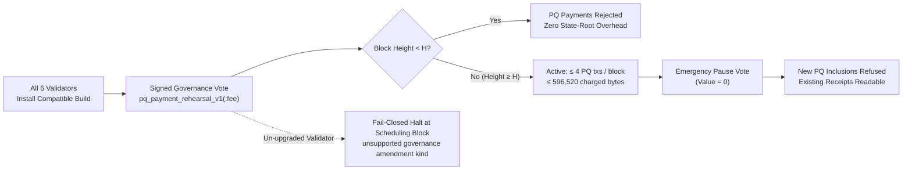

<div class="glance">
  <div><b>~138.5 KB</b><span>Expected non-mint wire (149,130 B ceiling)</span></div>
  <div><b>21–37 ms</b><span>Single-core Rust/Go verify (accelerated)</span></div>
  <div><b>M1–M8</b><span>Rehearsed on 6 validators; 1,754-block replay</span></div>
  <div><b>Off</b><span>Switched off on every public chain; unreviewed</span></div>
</div>

We have a working prototype of private payments for Post Fiat L1—**Peel-Binius-Shielded**, wire format **PFSH02**—that uses **no elliptic curves**. It is built from NIST hash functions (SHAKE256 inside the circuit, SHA-512 and SHA-384 outside it), AES-256-GCM, and the NIST post-quantum standards **ML-KEM-1024** (FIPS 203) and **ML-DSA-65** (FIPS 204).

The design goal is that private payments stay confidential and value-conserving even against an adversary equipped with a large fault-tolerant quantum computer. **That goal is not yet established.** The proof system is new from end to end, its entire security analysis was written by the project, one part of the security argument is stated explicitly as a conjecture, and **no external cryptographer has reviewed it yet**. The protocol is switched off on every public chain and pinned in code to a disposable rehearsal genesis until outside cryptographic and implementation review is complete.

This post consolidates everything built through 23 November 2026 into one self-contained technical reference:

1. The **architecture** of PFSH02 and its follow-on **L1 Profile 2** design (`pq/private-issued-asset-fee`), which removes the public fee-paying account from private `pfUSDC` payments.
2. The **M1–M8 rehearsal evidence**, benchmark tables, and independent 23 November verification—including every place where measurements missed an engineering gate or where early claims overstated the evidence.
3. The **complete mathematical arguments and proofs** (Peel(\(M\)) + BCIKS20, the 34-round IOP, the compressed-oracle QROM extraction proof in Appendix A.3, the A.4 simulation-extractability conjecture, the Appendix B QROM zero-knowledge proof, and the compositional ledger theorems—including the 160-bit account-address weak link).
4. The **downloadable evidence packets**, reproduction commands, and the exact checklist blocking a live launch.

---

## 1. Why Replace Elliptic-Curve Privacy

Accounts and validators on Post Fiat L1 already sign with **ML-DSA-65**. The existing shielded pool does not: it runs Zcash's **Orchard** protocol over **Halo2** and the Pasta elliptic curves.

Elliptic-curve privacy fails against a large quantum computer along two distinct axes, with very different timelines:

- **Harvest now, decrypt later (privacy).** Every shielded note envelope recorded on a public chain today can be archived indefinitely. Once a quantum adversary can solve discrete logarithms, every recorded elliptic-curve note can be decrypted retroactively—exposing who paid whom and how much across the entire history of the pool.
- **On-the-day proof forgery (soundness).** A quantum attacker with live access to a large quantum computer could break Halo2's discrete-log polynomial commitment, forge valid proofs from thin air, and drain the shielded pool without leaving any visible anomaly in the curve equations.

A soundness vulnerability can be mitigated by migrating proof systems before cryptographically relevant quantum computers arrive. **A privacy failure cannot be undone retroactively.** That asymmetry drives PFSH02's architecture: remove elliptic curves from both the zero-knowledge proof and the note-delivery ciphertexts, while keeping wire size under Post Fiat L1's **149,130-byte archival ceiling** (\(12\text{ GiB/day}\) at \(1\text{ tx/s}\)) and single-core validator verification under **50 ms**.

---

## 2. System Architecture & L1 Profile 2


A PFSH02 transaction always consumes **two input slots** (each real or dummy) and creates **two output notes** under one uniform 66-bit integer conservation law over \(\mathbb{Z}\):

$$v_{\mathrm{in},0} + v_{\mathrm{in},1} + v_{\mathrm{mint}} = v_{\mathrm{out},0} + v_{\mathrm{out},1} + (\mathrm{fee} + v_{\mathrm{unshield}})$$

Because every operand lies in \([0, 2^{64}-1]\), each side is bounded by \(3(2^{64}-1) < 2^{66}\), eliminating modular wrap-around structurally.

### 2.1 Disjoint Cryptographic Primitives (Zero Shared Permutation)

PFSH02 separates in-circuit state hashing from the proof compiler's random oracle across two completely disjoint NIST hash families:

1. **In-circuit note commitments & Depth-24 accumulator — FIPS-202 SHAKE256** (Keccak-\(f[1600]\), rate \(r = 136\text{ B}\), capacity \(c = 512\text{ bits}\)). Every call fits inside a **single permutation** (all inputs \(\le 135\text{ B}\)):
   - Shielded address: \(A = H_A(S) := \mathrm{SHAKE256}(\texttt{0x00} \parallel S_{48})[0..48]\)
   - Coin commitment: \(\mathrm{Coin} = H_{\mathrm{Coin}}(A, v, R) := \mathrm{SHAKE256}(\texttt{0x01} \parallel A_{48} \parallel v_8 \parallel R_{78})[0..48]\)
   - Nullifier: \(\mathrm{SN} = H_{\mathrm{SN}}(S, \mathrm{Coin}) := \mathrm{SHAKE256}(\texttt{0x02} \parallel S_{48} \parallel \mathrm{Coin}_{48})[0..48]\)
   - Merkle node: \(H_{\mathrm{Node}}(L, R) := \mathrm{SHAKE256}(\texttt{0x03} \parallel L_{48} \parallel R_{48})[0..48]\)
2. **Compiler Random Oracle — ONE single fixed-range oracle \(H: \{0,1\}^* \to \{0,1\}^{1536}\)** instantiated via three domain-prefixed **FIPS-180-4 SHA-512** calls:
   $$H(m) := \mathrm{SHA\text{-}512}(\texttt{0x00}\parallel m) \parallel \mathrm{SHA\text{-}512}(\texttt{0x01}\parallel m) \parallel \mathrm{SHA\text{-}512}(\texttt{0x02}\parallel m)$$
   Every compiler call carries a unique 8-byte ASCII domain tag (`"PFS-LEAF"`, `"PFS-NODE"`, `"PFS-STMT"`, `"PFS-ABS "`, `"PFS-CH  "`, `"PFS-C4  "`) and a strictly fixed input length, making the SHA-512 domain prefix-free. Widening the never-transmitted internal Fiat–Shamir state from 384 to **512 bits** costs **zero wire bytes** while lifting all 68 programmed transcript queries to \(\ge 512\)-bit conditional min-entropy.
3. **0-Round Non-Interactive Stealth Receive — FIPS-203 ML-KEM-1024 + HMAC-SHA-384 + AES-256-GCM.** A recipient publishes an off-chain static stealth address \(\mathrm{pk}_{\mathrm{recv}} = (\mathrm{ek}, A = H_A(S))\). Neither \(\mathrm{ek}\) nor \(A\) ever appears on-chain—not even during deposits. For each output note, the sender encapsulates \((ss, \mathrm{ct}_{\mathrm{kem}}) \leftarrow \mathrm{ML\text{-}KEM\text{-}1024.Encaps}(\mathrm{ek})\) (\(1,568\text{ B}\)), derives keys via labeled HMAC-SHA-384 binding both \(\mathrm{ct}_{\mathrm{kem}}\) and \(\mathrm{Coin}_{\mathrm{out}}\):
   $$K_{\mathrm{aead}} = \mathrm{HMAC\text{-}SHA\text{-}384}(ss, \texttt{"PFT-SH-KEM-KEY-V2"} \parallel \mathrm{ct}_{\mathrm{kem}} \parallel \mathrm{Coin}_{\mathrm{out}})[0..32]$$
   $$N_{\mathrm{aead}} = \mathrm{HMAC\text{-}SHA\text{-}384}(ss, \texttt{"PFT-SH-KEM-NONCE-V2"} \parallel \mathrm{ct}_{\mathrm{kem}} \parallel \mathrm{Coin}_{\mathrm{out}})[0..12]$$
   and seals \((v_{\mathrm{out}} \parallel R_{\mathrm{out}})\) (\(86\text{ B}\)) with AES-256-GCM using \(\mathrm{AAD} = \mathrm{Coin}_{\mathrm{out}}\) into a \(1,670\text{ B}\) envelope. Recipients scan offline without interacting with senders, accepting a note only if \(H_{\mathrm{Coin}}(A, v_{\mathrm{out}}, R_{\mathrm{out}}) = \mathrm{Coin}_{\mathrm{out}}\).
4. **Depositor Authorization — FIPS-204 ML-DSA-65.** On positive deposits (\(v_{\mathrm{mint}} > 0\)), the wire appends a \(5,261\text{ B}\) suffix (`1,952 B` public key + `3,309 B` signature) with domain context `postfiat-l1-v2/tx/v1` over \(\mathrm{SHA\text{-}384}(\texttt{"PFT-SH-MINT-AUTH-V2"} \parallel \mathrm{source} \parallel \mathrm{tx\_ctx})\). Shielded-to-shielded transfers carry **zero signatures**.

### 2.2 Per-Asset Pools, Epoch Rollover, and L1 Profile 2 (`pq/private-issued-asset-fee`)

Each asset (native **PFT** and each governed issued source series such as **pfUSDC**) maintains its own isolated Depth-24 SHAKE256 note tree holding \(2^{24} = 16,777,216\) leaves (\(\approx 97.1\text{ days}\) at sustained \(1\text{ tx/s}\), two outputs per transaction). The asset identifier and tree epoch are hashed into the L1 statement context before Round 1, while commitments and nullifiers are globally unique across all assets and epochs—preventing cross-asset leakage or double spends. When a tree reaches \(2^{24}\) leaves, it freezes permanently (its roots remain valid anchors forever) and a fresh empty epoch tree opens; old notes migrate to the active epoch via a standard 1-real + 1-dummy spend.

**Closing the Profile 1 fee-payer leak (Profile 2).** In draft PR [#207](https://github.com/postfiatorg/postfiatl1v2/pull/207) (`feat/peel-binius-shielded-pq`, **L1 Profile 1**), internal `pfUSDC` transfers set the inner proof fee to zero and required an explicit public PFT fee payer with an ML-DSA-65 signature. As flagged in the 23 November independent review (finding P1), that revealed a public account on every `pfUSDC` spend unless a third-party sponsor paid the fee.

Follow-on work on branch [`pq/private-issued-asset-fee`](https://github.com/postfiatorg/postfiatl1v2/tree/pq/private-issued-asset-fee) (`48d01e795`, 47 commits ahead of PR #207, completed through three review rounds on 23 November) introduces **L1 Profile 2**:

| Property | L1 Profile 1 (PR #207 / M1–M8 Rehearsal) | L1 Profile 2 (`pq/private-issued-asset-fee`) |
| --- | --- | --- |
| **Native PFT internal spend** | Inner PFT fee burned; no public signer | Unchanged: inner PFT fee burned; no public signer |
| **Issued (`pfUSDC`) deposit** | Depositor signs with ML-DSA-65; pays PFT fee | Unchanged: depositor signs; full issued amount enters pool |
| **Issued (`pfUSDC`) internal pay & exit** | Inner fee = 0; **public PFT payer + signature required** | **Zero public signer or PFT payer.** Exact governed fee paid in `pfUSDC` atoms inside the proof |
| **Issued fee accounting** | Burned as PFT from public payer | Moved from private reserve to public `collected_private_fees` pot (governance payout only) |
| **Fee schedule governance** | Bare `pq_payment_rehearsal_v1` height | `pq_payment_rehearsal_v1:fee:<atoms>` (proposed start: `1` atom = `0.000001 pfUSDC`); value `0` pauses |
| **Wallet fee discovery & relay** | Account-coupled fee review | Account-free next-height quote from finalized pool state; per-spend relay receipt capability |

**What remains visible on-chain even under Profile 2:** the chain still observes the **asset / source series**, the **exact fee**, the **tree epoch and anchor**, the **inclusion height and timing**, the two nullifiers, and the two new commitments/envelopes. Deposits and exits necessarily expose their public account and amount. Gateways and validators still observe network metadata (caller IP and timing), and a small pool provides a small anonymity set.

### 2.3 Governance Activation & Fail-Closed Upgrade Model



Governance amendment kinds in `crates/consensus_cobalt/src/internal_validation.rs` form a closed list. As verified in the M8 two-binary test, an un-upgraded validator halts immediately on the scheduling amendment (`error: verify-blocks failed: unsupported governance amendment kind 'pq_payment_rehearsal_v1'`) instead of diverging silently into a chain split.

---

## 3. Wire Format & 34-Round IOP Mechanics


Every PFSH02 wire parses canonically with zero trailing bytes:

| Wire Component | Expected Bytes | Worst-Case Bytes | Notes |
| --- | ---: | ---: | --- |
| Header + `proof_len` (incl. \(2\times 1,670\text{ B}\) ML-KEM envelopes) | 3,648 | 3,648 | Magic `"PFSH02\0\0"`, anchor, flows, nullifiers, coins, envelopes |
| Fixed proof fields | 59,916 | 59,916 | Sumcheck-1/2 polynomials, ring-switch, \(v_{\mathrm{prox}}\), \(v_{\mathrm{open}}\), 48 B PoW nonce |
| Opened columns (\(t = 52 \times 748\text{ B}\)) | 38,896 | 38,896 | 163 \(K_{32}\) words + 2 \(E\) elements per queried column |
| Pruned 48 B \(MT_1\) Merkle siblings | 36,001 | 38,016 | At most 792 sibling hashes (height-21 tree, \(n = 2^{21}\)) |
| **Total Non-Mint Wire (Pay / Exit)** | **138,461** | **140,476** | **8,654 B headroom** under 149,130 B ceiling |
| Deposit ML-DSA-65 authorization suffix (`v_mint > 0` only) | +5,261 | +5,261 | 1,952 B public key + 3,309 B signature |
| **Total Signed Deposit Wire** | **143,722** | **145,737** | **3,393 B headroom** under 149,130 B ceiling |

### Algebraic Engine & Systems Optimizations

PFSH02 works over a binary field tower verified irreducible in exact arithmetic via Rabin's test across all proper divisors \(d \in \{1, 2, 3, 4, 6\}\):

$$\mathbb{F}_2 \subset K_{16} = \mathbb{F}_2[x]/(x^{16}+x^5+x^3+x+1) \subset K_{32} = K_{16}[Z]/(Z^2+Z+x^{11}) \subset E = K_{32}[Y]/(Y^{12}+Y^3+Y+(Z+x)) \cong \mathbb{F}_{2^{384}}$$

Inside \(K_{32}\), the interpolation domain \(H = V_9 = \{0,\dots,511\}\) (\(|H| = 512\)) and evaluation coset \(L = \texttt{0x00200000} + V_{21}\) (\(|L| = n = 2^{21} = 2,097,152\)) are disjoint \(\mathbb{F}_2\)-affine subspaces. Three algebraic optimizations bring verification well below 50 ms on a single x86-64 core:

1. **5-Column Chi-Only Arithmetization:** All 447,014 active rows (56 Keccak-\(f[1600]\) permutations, 9,216 packed 2-bit Merkle swap mux rows, 6,144 sibling rows, 448 `is_dummy` gating rows, and 258 exact 66-bit ripple-carry adder rows) live in five bit-arrays \(B_0,\dots,B_4 \in \mathbb{F}_2^{2^{19}}\) whose *only* quadratic gates are the five Keccak \(\chi\) monomials \(M_x(i) = (1 + B_{(x+1)\bmod 5}(i)) \cdot B_{(x+2)\bmod 5}(i)\). Subfield-\(K_{32}\) packing enforces booleanity structurally (Lemma 3), saving quadratic \(b(1-b)=0\) constraints.
2. **Exact 3D-Karatsuba Tower-Reduced Ring-Switching:** Reduces the verifier's \(H\)-domain inner-product check from \(143,360\) \(E\)-multiplications down to **\(13,122\)** (\(11\times\) fewer), differentially tested against the naive \(384 \times 384\) bilinear sum in both Rust and Go.
3. **54-`PCLMULQDQ` Field Kernels & Streaming L1-Resident Prover:** Packing \(a_0 + a_1 Z \in K_{32}\) into `u64` executes \(E\)-multiplication in 54 carryless multiplies (Rust SIMD intrinsics and a 2×-unrolled Plan 9 `MOVOU`/`PCLMULQDQ` Go assembly kernel, with portable fallbacks in both languages). On the prover side, skipping identity ANTT levels \(i=20..10\) for \(D = 565 < 1,024\) streams 1,024-column blocks directly from L1 cache into \(MT_1\) leaves (~550 MiB peak RSS).

---

## 4. Complete Mathematical Proofs & Dependency Audit


A rigorous security presentation must separate **what is imported from published, peer-reviewed theorems** from **what is a new argument written by the project**, **what is a conjecture**, and **what is an unquantified assumption**.


| If This Component Turned Out Wrong | What Could Be Lost | What Is Not Affected | Review Status |
| --- | --- | --- | --- |
| **Theorem 1A / App. A.1–A.2** (classical soundness of the 34-round IOP) | Forged proofs; money creation **even with classical computers** | Privacy | **New, unreviewed** (uses published BCIKS20 Thm 6.2) |
| **Theorem 2A / App. A.3** (compressed-oracle QROM extraction) | Quantum proof forgery & pool drain (requires a live quantum computer) | Privacy; classical soundness | **New, unreviewed** |
| **Conjecture 2B / App. A.4** (adaptive multi-proof simulation-extractability) | Proof that observed honest payments cannot be altered/redirected (Thm 4 Modes 1–2) | Value conservation (Thm 3); Privacy (Thm 5) | **Conjecture** (sketch only; no published anchor) |
| **Theorem 1B / App. B** (multi-proof QROM zero-knowledge) | Confidentiality of amounts/links; worst-case spend-secret leakage | Value conservation | **New, unreviewed** (uses published GHHM21 & AHU19) |
| **Non-standard SHAKE256 & ML-KEM-1024 assumptions** (Thm 5) | Recipient anonymity, note unlinkability (retroactive on recorded chain) | Soundness / supply conservation | **Unquantified `[NonStd]`** + GMP22 scanning gap |
| **160-bit L1 Account Address** (Thm 4 Mode 3) | Targeted second-preimage key substitution on deposit authorization | Shielded-to-shielded spends; proof system | **Quantified weak link:** \(\sim 2^{-32}\) at \(Q=2^{64}\), vacuous at \(Q=2^{80}\) |

Below are the complete mathematical statements and proofs from [`docs/security/peel-binius-shielded-pq-payments.md`](https://github.com/postfiatorg/postfiatl1v2/blob/pq/private-issued-asset-fee/docs/security/peel-binius-shielded-pq-payments.md). Every headline number below was recomputed independently on 23 November in exact rational arithmetic (matching `math_bounds.json` everywhere); the proofs themselves remain **unreviewed by any outside cryptographer**.

---

### 4.1 Theorem 1A: 34-Round IOP Knowledge Soundness via `Peel(M)` + BCIKS20 `[Unreviewed]`

Let \(M: L \to (K_{32}^{163} \times E^2) \cup \{\bot\}\) be any (possibly partial) Round-1 oracle over \(L \subset K_{32}\) (\(|L| = n = 2^{21}\)), degree bound \(D = 565\), rate \(\rho = D/n = 565/2^{21} \approx 0.000269413\), Johnson parameter \(m' = 3\), and \(\alpha = \sqrt{2}\). Notably, PFSH02 stays strictly inside the **proven Johnson bound** of Ben-Sasson–Carmon–Ishai–Kopparty–Saraf (**BCIKS20**, FOCS 2020 / JACM 2023, Theorem 6.2), avoiding the stronger list-decoding conjectures that came under public scrutiny in 2025.

**Statement (Theorem 1A).** Define the information-theoretic greedy peeling set \(\mathcal{P}(M) \subset \mathrm{RS}[E, L, 565]^{165}\) and let \(\mathcal{P}_{\mathrm{bad}}(M) := \{u \in \mathcal{P}(M) : u \text{ does not encode a valid witness } w \in \mathcal{R}_{\mathrm{pay}}(x)\}\). Then:

1. \(|\mathcal{P}_{\mathrm{bad}}(M)| \le |\mathcal{P}(M)| \le L_{\max} = \lfloor \sqrt{2/\rho} \rfloor = 86\).
2. There exists a 34-round pre-challenge round-by-round knowledge-soundness (RBR-KS) state function \(\mathrm{State}_{\mathrm{KS}}(x, \mathrm{tr}_k) \in \{0,1\}\) and a deterministic polynomial-time extractor \(\mathrm{Ext}_{\mathrm{IOP}}\) running in \(O(\min(n, |\mathrm{supp}(M)|) + 140 \cdot 565^2)\) time such that whenever \(\mathrm{State}_{\mathrm{KS}}(x, \mathrm{tr}_{34}) = 0\) and \(V(x, \mathrm{tr}_{34}) = 1\), \(\mathrm{Ext}_{\mathrm{IOP}}(x, M, \mathrm{tr}_{34})\) outputs \(w^* \in \mathcal{R}_{\mathrm{pay}}(x)\) with probability \(1\).

| Round(s) | Atomic Challenge | Pure IOP RBR-KS Bound \(\varepsilon_{\mathrm{rbr}}(k)\) |
| --- | --- | --- |
| Round 1 | \(MT_1\) oracle \(M\), \(S_{G_1}\), \(S_{\mathrm{mask2}}\) | \(\mathrm{State}_{\mathrm{KS}}(x, \mathrm{tr}_1) := 0\) |
| Round 2 (`C02`) | Single \(\alpha \in E\) (degree \(N_C - 1 = 2,192,843\)) | \(\le 86 \cdot 2,192,843 / 2^{384} = 2^{-356.51}\) |
| Rounds 3–21 (`C03`–`C21`) | 19 Sumcheck-1 rounds (degree \(\le 3\)) | \(\le 86 \cdot 3 / 2^{384} = 2^{-375.99}\) each |
| Round 22 (`C22`) | Degree-2 evaluation hiding \(\tau \in E\) (degree \(\le 2\)) | \(\le 86 \cdot 2 / 2^{384} = 2^{-376.57}\) |
| Round 23 (`C23`) | Ring-Switch batch \(\gamma \in E\) (degree \(\le 4\)) | \(\le 86 \cdot 4 / 2^{384} = 2^{-375.57}\) |
| Round 24 (`C24`) | Ring-Switch linearization \(\rho_{\mathrm{rs}} \in E\) (degree \(\le 386\)) | \(\le 86 \cdot 386 / 2^{384} = 2^{-368.98}\) |
| Rounds 25–32 (`C25`–`C32`) | 8 Sumcheck-2 rounds over 256 virtual rows (degree \(\le 2\)) | \(\le 86 \cdot 2 / 2^{384} = 2^{-376.57}\) each |
| Round 33a (`C33P`) | \(\lambda_p \in E\): `Peel(M)` + BCIKS20 Thm 6.2 (\(2^{-305.79}\)) + pointwise union (\(2^{-349.22}\)) | \(\le 2^{-305.79}\) |
| Round 33b (`C33O`) | \(\lambda_o \in E\): inner-product batching | \(\le 86 / 2^{384} = 2^{-377.57}\) |
| Round 34 (pure IOP) | \(t = 52\) uniform column queries (no PoW) | \(\le (\sqrt{2\rho})^{52} = 2^{-282.31}\) |
| **Round 34 (compiled + 20-bit PoW)** | Atomic `H_C4` marking (Lemma A.3.3) | **\(p_{34} = 2^{-20} \cdot (\sqrt{2\rho})^{52} = 2^{-302.31}\)** |

<details>
<summary><strong>Expand Full Proofs: Lemma 1 (Peel(M) + BCIKS20 Telescoping), Lemma 2 (Dual-Polynomial Binding), Lemma 3 (Subfield Booleanity), Lemma 4 (Ring-Switching) &amp; Terminal Extraction</strong></summary>

#### Imported Anchor — BCIKS20 Theorem 6.2 (Parameterized Curves up to the Johnson Bound)
Let \(\mathbb{F}_q\) be a finite field, \(D_{\mathrm{eval}} \subset \mathbb{F}_q\) any nonempty domain of size \(n' = |D_{\mathrm{eval}}|\), \(V = \mathrm{RS}[\mathbb{F}_q, D_{\mathrm{eval}}, \rho']\) of dimension \(k' = \rho' n'\), \(u_0, \dots, u_\ell : D_{\mathrm{eval}} \to \mathbb{F}_q\), integer \(m' \ge 3\), and proximity parameter \(0 < \delta' \le 1 - \bigl(1 + \frac{1}{2m'}\bigr)\sqrt{\rho'}\). If
$$\Pr_{z \leftarrow \mathbb{F}_q}\!\left[\Delta_{D_{\mathrm{eval}}}\!\left(u_0 + z u_1 + \dots + z^\ell u_\ell,\, V\right) \le \delta'\right] > \ell \cdot \frac{(m' + \tfrac{1}{2})^7}{3(\rho')^{3/2}} \cdot \frac{(n')^2}{q},$$
then there exist codewords \(v_0, \dots, v_\ell \in V\) and a set \(S \subset D_{\mathrm{eval}}\) of size \(|S| \ge (1 - \delta')n'\) such that \(u_i(x) = v_i(x)\) for all \(x \in S\) and all \(i \in \{0, \dots, \ell\}\).

#### Lemma 1 (`Peel(M)` List Size & Exact 4-Line Telescoping for All \(n' \ge 0\))
Initialize \(L_0 := \mathrm{supp}(M)\) (\(n_0 := |L_0| \le n\)), \(\mathcal{P} := \emptyset\), \(i := 0\). While \(|L_i| > 2D\) and there exists \(u \in \mathrm{RS}[E, L, D]^{165}\) whose remaining agreement set \(D^{(i)}(u) := \{x \in L_i : M(x) = u(x)\}\) satisfies \(|D^{(i)}(u)| \ge \sqrt{2 D |L_i|}\), add the lexicographically first such \(u_{i+1}\) to \(\mathcal{P}\) and set \(L_{i+1} := L_i \setminus D^{(i)}(u_{i+1})\). Halt with \(\mathcal{P}(M) := \mathcal{P}\) (size \(k\)) and \(L_{\mathrm{rem}} := L_k\) (size \(n' := |L_{\mathrm{rem}}|\)).

**Proof of (i) \(k \le 86\):** Set \(x_i := |L_i|\). Whenever \(x_i > 2D\), \(d_i := x_i - x_{i+1} \ge \sqrt{2 D x_i} > 2D > 0\), so \(x_{i+1} < x_i\) and \(\sqrt{x_i} + \sqrt{x_{i+1}} < 2\sqrt{x_i}\). Therefore:
$$\sqrt{x_i} - \sqrt{x_{i+1}} = \frac{d_i}{\sqrt{x_i} + \sqrt{x_{i+1}}} > \frac{\sqrt{2 D x_i}}{2\sqrt{x_i}} = \sqrt{\frac{D}{2}}.$$
Summing over \(i = 0,\dots,k-1\) gives \(\sqrt{n_0} - \sqrt{n'} \ge k\sqrt{D/2}\) (strict when \(k \ge 1\)), hence for **all** \(k \ge 0, n' \ge 0\):
$$kD \le \sqrt{2D}\bigl(\sqrt{n_0} - \sqrt{n'}\bigr) \implies k \le \left\lfloor \sqrt{\frac{2 n_0}{D}} \right\rfloor \le \left\lfloor \sqrt{\frac{2}{\rho}} \right\rfloor = 86.$$

**Proof of (ii) Proximity curve bound \(\Pr_{\lambda_p}[\mathrm{Bad}_{\mathrm{peel}}(\lambda_p)] \le 2^{-305.79}\):** For \(\lambda_p \in E\), let \(F_{\lambda_p}(M)(x) := B_{\mathrm{prox}}(x) + \lambda_p B_{\mathrm{pcs}}(x) + \sum_{r=0}^{162} \lambda_p^{r+2} M_r(x)\). Fix any \(v \in \mathrm{RS}[E, L, D] \setminus \{F_{\lambda_p}(u) : u \in \mathcal{P}(M)\}\) and let \(A := \{x \in L_0 : v(x) = F_{\lambda_p}(M)(x)\}\). On each peeled slice \(D^{(j-1)}(u_j)\), \(v \ne F_{\lambda_p}(u_j)\) forces \(|A \cap D^{(j-1)}(u_j)| \le D - 1\), so:
$$|A \cap (L_0 \setminus L_{\mathrm{rem}})| \le k(D-1) \le kD \le \sqrt{2D}\bigl(\sqrt{n_0} - \sqrt{n'}\bigr)$$
(strict if \(k \ge 1\)). Partition all \(n' \ge 0\) into two cases:

- **Case 1 (\(0 \le n' \le 2D\)):** Here \((n')^2 \le 2Dn'\), so \(n' \le \sqrt{2Dn'}\). If \(k = 0\), then \(n_0 = n' \le 2D = 1,130 < 48,680 = \sqrt{2\rho}\,n\). If \(k \ge 1\), adding the strict peeled bound and \(|A \cap L_{\mathrm{rem}}| \le n' \le \sqrt{2Dn'}\) yields \(|A| < \sqrt{2D}(\sqrt{n_0}-\sqrt{n'}) + \sqrt{2Dn'} = \sqrt{2Dn_0} \le \sqrt{2\rho}\,n\). Thus \(\Pr[\mathrm{Bad}_{\mathrm{peel}}] = 0\).
- **Case 2 (\(n' > 2D\)):** \(M\) has no \(\bot\) entries on \(D_{\mathrm{eval}} := L_{\mathrm{rem}}\) of size \(n' > 2D\), with rate \(\rho' := D/n' < 1/2\). Set \(\delta' := 1 - \sqrt{2\rho'}\). Since \(\rho' < 1/2\), \(\delta' > 0\); since \(\sqrt{2} \approx 1.4142 > 7/6 = 1 + 1/(2\cdot 3)\), \(\delta' < 1 - (1 + \tfrac{1}{2m'})\sqrt{\rho'}\) strictly for \(m' = 3\). Every verbatim hypothesis of BCIKS20 Theorem 6.2 holds on \((\mathbb{F}_q = E, D_{\mathrm{eval}} = L_{\mathrm{rem}}, k' = D, \ell = 164, m' = 3)\). If \(\Pr_{\lambda_p}[\exists v : |A \cap L_{\mathrm{rem}}| \ge \sqrt{2Dn'}] > \varepsilon_{\mathrm{curve}}(3, \rho', n', 164)\), BCIKS20 yields a codeword \(u^* \in \mathrm{RS}[E, L_{\mathrm{rem}}, D]^{165}\) (uniquely extending to \(L\) since \(n' > 2D > D\)) agreeing with \(M\) on \(\ge \sqrt{2Dn'}\) points of \(L_{\mathrm{rem}}\), contradicting that `Peel(M)` halted. Monotonicity \((n')^2 / (\rho')^{3/2} = (n')^{7/2}/D^{3/2} \le n^{7/2}/D^{3/2}\) gives:
$$\Pr_{\lambda_p}[\mathrm{Bad}_{\mathrm{peel}}(\lambda_p)] \le 164 \cdot \frac{(3.5)^7}{3\rho^{3/2}} \cdot \frac{n^2}{2^{384}} = 2^{-305.79}. \quad \blacksquare$$

#### Lemma 2 (Pointwise Inclusion \(A_{\mathrm{both}} \subset A_{\mathrm{prox}} \subset D_u\) & Dual-Polynomial Binding)
For \(u \in \mathcal{P}(M)\), let \(D_u := \{x \in \mathrm{supp}(M) : M(x) = u(x)\}\). Define \(\mathrm{Bad}_{\mathrm{pt}}(\lambda_p)\): \(\exists u \in \mathcal{P}(M), x \in \mathrm{supp}(M)\setminus D_u\) with \(F_{\lambda_p}(M(x)) = F_{\lambda_p}(u(x))\). Each such \((u, x)\) defines a nonzero degree-\(\le 164\) polynomial in \(\lambda_p\), so by union bound \(\Pr[\mathrm{Bad}_{\mathrm{pt}}] \le 86 \cdot 2^{21} \cdot 164 / 2^{384} = 2^{-349.22}\). Conditioned on \(\neg\mathrm{Bad}_{\mathrm{peel}} \land \neg\mathrm{Bad}_{\mathrm{pt}}\), any \((v_{\mathrm{prox}}, v_{\mathrm{open}})\) whose joint agreement set \(A_{\mathrm{both}}\) has size \(\ge \sqrt{2\rho}\,n \approx 48,680 > D = 565\) pins a **unique** \(u \in \mathcal{P}(M)\) (two distinct codewords agree on \(\le 564\) points) satisfying \(v_{\mathrm{prox}} \equiv F_{\lambda_p}(u)\), \(A_{\mathrm{both}} \subset A_{\mathrm{prox}} \subset D_u\), and \(v_{\mathrm{open}} \equiv b_{\mathrm{pcs}}(u) + \lambda_o \sum_{r=0}^{162} c_r u_r\) identically in \(E[X]_{<D}\). \(\blacksquare\)

#### Lemma 3 (Subfield-\(K_{32}\) Inheritance & Structural Booleanity)
Because `Peel(M)` only peels while \(|L_i| > 2D\), every peeled slice satisfies \(|D^{(i)}(u)| \ge \sqrt{2D \cdot 2D} = 2D > D\) points in \(L \subset K_{32}\) where \(M_r(x) \in K_{32}\). Lagrange interpolation over any \(D\) such points forces \(u_r \in K_{32}[X]_{<D}\), so \(u_r(H) \subset K_{32} = \mathbb{F}_{2^{32}}\). Unpacking each \(K_{32}\) element into 32 \(\mathbb{F}_2\) coordinates enforces booleanity of \(B_0,\dots,B_4\) structurally without quadratic gates. \(\blacksquare\)

#### Lemma 4 (Single-Challenge Ring-Switching) & Terminal Extraction
Using the 384-element \(\mathbb{F}_2\)-basis \(\{e_{v,u} = Y^v 2^u\}\) of \(E\), define \(L_{\rho_{\mathrm{rs}}}(z) := \sum_{j=0}^{383} \mathrm{bit}_j(z)\rho_{\mathrm{rs}}^j\) and \(\eta_{1,2,3} := \rho_{\mathrm{rs}}^{384,385,386}\). Discrepancies in Round 23 (\(\deg \le 4\) in \(\gamma\)) or Round 24 (\(\deg \le 386\) in \(\rho_{\mathrm{rs}}\), cleanly discharging any mismatch in \(S_{G_1}\)) fail with probability \(\le 4/|E|\) and \(\le 386/|E|\) per \(u \in \mathcal{P}_{\mathrm{bad}}(M)\).

At Round 34, if \(\mathrm{State}_{\mathrm{KS}}(x, \mathrm{tr}_{34}) = 0\) and \(V(x, \mathrm{tr}_{34}) = 1\), then \(|A_{\mathrm{both}}| \ge \sqrt{2\rho}\,n > 565\), \(\neg\mathrm{Bad}_{\mathrm{peel}}\), and \(\neg\mathrm{Bad}_{\mathrm{pt}}\). Lemma 2 pins the unique \(u^* \in \mathcal{P}(M)\) matching the \(H\)-domain inner product, so \(\mathrm{State}_{\mathrm{KS}}(33b) = 0\) forces \(u^* \in \mathcal{P}(M) \setminus \mathcal{P}_{\mathrm{bad}}(M)\). \(\mathrm{Ext}_{\mathrm{IOP}}\) interpolates the 140 witness rows over \(K_{32}\) from the first 565 points of \(A_{\mathrm{prox}} \subset D_{u^*}\) and outputs \(w^* \in \mathcal{R}_{\mathrm{pay}}(x)\) with probability 1. \(\blacksquare\)

</details>

---

### 4.2 Theorem 2A & Appendix A.3: Single-Oracle QROM Straight-Line Extraction `[Unreviewed]`

Generic multi-round Fiat–Shamir extraction in the Quantum Random Oracle Model (Don–Fehr–Majenz, CRYPTO 2020) incurs a \((Q+1)^{2\mu}\) rewinding loss—completely vacuous for \(\mu = 34\) rounds. In BCS compilation, however, the witness oracle \(M = \mathrm{MRoot}_D^{-1}(\mathrm{root})\) is committed in Round 1 and can be extracted **straight-line** from Zhandry's compressed-oracle database \(D_{\mathrm{end}}\) without rewinding. Published BCS QROM soundness (Chiesa–Manohar–Spooner, TCC 2019) is asymptotic (\(O(t^2\varepsilon + t^3/2^\lambda)\)) and omits both concrete constants and Round-34 proof-of-work grinding.

Appendix A.3 writes out a self-contained operator-norm reduction on the single fixed-range oracle \(H: X \to Y = \{0,1\}^{1536}\) using the transition-capacity framework of Chung–Fehr–Huang–Liao (EUROCRYPT 2021) and Don–Fehr–Majenz–Schaffner (EUROCRYPT 2022).

**Statement (Theorem 2A — Conditional on Unreviewed Appendix A.3).** Let an adversary make \(Q\) quantum queries to \(H\) and output \(L\) simultaneously accepting PFSH02 proofs (\(\kappa_v \le 963\) verifier queries per proof, \(Q_v = Q + L\kappa_v\)). Then the straight-line extractor \(\mathrm{Ext}_{\mathrm{QROM}}\) fails to extract valid witnesses for all \(L\) proofs with probability at most:

$$\varepsilon_{\mathrm{Ext}}(Q, L) \le \left(3.652\, Q_v^{3/2}\, 2^{-192} + Q_v \sqrt{10 \cdot \max\!\bigl(\varepsilon_{\mathrm{rbr}}(33a) + 2 Q_v 2^{-512},\; p_{34}\bigr)}\right)^2 + \frac{2 L \kappa_v}{2^{384}}$$

where \(3.652 > \frac{2}{3}\sqrt{30}\), \(\varepsilon_{\mathrm{rbr}}(33a) = 2^{-305.79}\), and \(p_{34} = 2^{-302.31}\).

- **Below the crossover \(Q_v < 2^{81.28}\):** the spot-check term \(10 Q_v^2 p_{34}\) dominates, giving **\(2^{-170.98}\)** at \(Q = 2^{64}\) and **\(2^{-137.55}\)** at \(Q = 2^{80}\).
- **Above \(Q_v > 2^{81.28}\):** the 384-bit \(MT_1\) collision term \(13.34\, Q_v^3 / 2^{384}\) dominates, giving **\(2^{-92.25}\)** at \(Q = 2^{96}\) (matching generic 384-bit BHT collision sizing \(2^{-91.00}\)), and reaching triviality (\(\varepsilon_{\mathrm{Ext}} = 1\)) at \(Q = 2^{126.75}\).
- **Robustness note:** Because the margin at \(Q = 2^{64}\) is \(\sim 171\) bits, a constant-factor bug even as large as \(2^{40}\) would still leave \(2^{-131}\). The real risk is not a slightly off constant—it is a structural flaw in an unreviewed reduction.

<details>
<summary><strong>Expand Full Proof: Appendix A.3 (Lemmas A.3.0–A.3.4 — Rank-3 Self-Adjoint Operator, Tree-Invariance, Both-Directions Capacity &amp; Readout)</strong></summary>

#### Lemma A.3.0 (Exact Rank-3 Self-Adjoint Operator & Both-Directions Norm Bound)
In Zhandry's compressed-oracle representation, the oracle register at input \(x \in X\) has basis \(\{|\bot\rangle\} \cup \{|u\rangle : u \in Y\}\) (\(N = |Y| = 2^{1536}\)). In the phase basis \(|x, z, D\rangle\), the query unitary \(O\) block-diagonalizes over \((x, z, D_{-x})\) with \(O_{x,0} = I\) and \(O_{x,z} = \mathrm{ST}_x Z_z \mathrm{ST}_x\) acting solely on register \(D(x)\) for \(z \ne 0\), where \(|\phi\rangle = N^{-1/2}\sum_{u \in Y}|u\rangle\), \(|\psi_z\rangle = Z_z|\phi\rangle\) (\(\langle\phi|\psi_z\rangle = 0\)), and \(\mathrm{ST}_x = I - (|\bot\rangle - |\phi\rangle)(\langle\bot| - \langle\phi|)\).

Evaluating \(O_{x,z}\) on the orthogonal decomposition \(\mathrm{span}\{|\bot\rangle, |\phi\rangle, |\psi_z\rangle\} \oplus \perp\) gives \(O_{x,z}|\bot\rangle = |\psi_z\rangle\), \(O_{x,z}|\phi\rangle = |\phi\rangle\), \(O_{x,z}|\psi_z\rangle = |\bot\rangle\), and \(O_{x,z} = Z_z\) on \(\perp\). Subtracting \(Z_z\) yields the exact self-adjoint rank-3 identity:
$$O_{x,z} = Z_z + (|\psi_z\rangle - |\bot\rangle)\langle\bot| + (|\phi\rangle - |\psi_z\rangle)\langle\phi| + (|\bot\rangle - |\phi\rangle)\langle\psi_z|, \qquad O_{x,z}^\dagger = O_{x,z}.$$
For any subset \(S \subset Y\) with \(\bot \notin S\) and density \(p := |S|/N\), let \(P_S\) project onto \(S\) and \(P_{\neg S} = I - P_S\). Since \(Z_z\) is diagonal and \(P_S|\bot\rangle = 0\):
$$P_S O_{x,z} P_{\neg S} = (P_S|\psi_z\rangle)(\langle\bot| - \langle\phi|)P_{\neg S} + (P_S|\phi\rangle)(\langle\phi| - \langle\psi_z|)P_{\neg S}.$$
Because \(\|P_S|\phi\rangle\|_2 = \|P_S|\psi_z\rangle\|_2 = \sqrt{p}\) and \(\||\bot\rangle - |\phi\rangle\|_2 = \||\phi\rangle - |\psi_z\rangle\|_2 = \sqrt{2}\), the triangle inequality and self-adjointness give both entry and exit/uncompute bounds identically:
$$\|P_S O_{x,z} P_{\neg S}\|_2 = \|P_{\neg S} O_{x,z} P_S\|_2 \le 2\sqrt{2p} = \sqrt{8p} < \sqrt{10p}. \quad \blacksquare$$
*(Independently checked numerically on 23 November across 2,150 small-range cases: largest observed ratio was \(2.39\) vs. \(\sqrt{8} \approx 2.83\). Retaining \(\sqrt{10p}\) is strictly conservative.)*

#### Lemma A.3.1 (Tree-Invariance & Retroactive `Peel(M)` Stability)
Let \(R(D)\) be the set of 384-bit roots appearing in `"PFS-STMT"` inputs of \(\mathrm{Dom}(D)\), \(C(D)\) the child digests in `"PFS-NODE"` inputs, and \(S(D) := R(D) \cup C(D)\) (\(|S(D)| \le 2|D|\)). For any database \(D\) of size \(\le s\), any `LEAF`/`NODE` input \(x\) with \(D(x) = \bot\), and any \(u \in Y\) with \(u[0..48] \notin S(D)\), walking down from any \(\mathrm{root} \in R(D)\) queries only digests in \(S(D)\), so \(\mathrm{MRoot}_{D[x\mapsto u]}^{-1}(\mathrm{root}) \equiv \mathrm{MRoot}_D^{-1}(\mathrm{root})\) and \(\mathrm{Peel}(M)\) is bit-for-bit unchanged. The bad-hit probability is \(\le 2s / 2^{384}\). \(\blacksquare\)

#### Lemmas A.3.2 & A.3.3 (Block-Diagonal Superposition Reduction & Both-Directions Capacity)
Define bad database predicate \(P' := \mathrm{CL} \cup \mathrm{SUC}\), where \(\mathrm{CL}(D)\) catches any 384-bit `LEAF`/`NODE` collision, zero digest, or 512-bit internal state collision, and \(\mathrm{SUC}(D) = \bigcup_{k=2}^{34} S_k(D)\) catches any directed 512-bit-chained transcript where \(\mathrm{State}_{\mathrm{KS}}\) transitions from \(0\) to \(1\) (including `PoW_pass(u) = 1` and all 52 spot checks hitting \(A_{\mathrm{both}}\) at \(k=34\)).

Because \(O\) commutes with \(|x, z, D_{-x}\rangle\) and \(\Pi_{P'}\) is diagonal in \(D\), the quantum transition capacity \(\llbracket P_s \to P' \rrbracket := \|\Pi_{P'} O \Pi_{P_s}\|_2\) reduces pointwise to classical \((x, z \ne 0, D_{-x})\) with \(|D_{-x}| \le s\):
- **Direction A (Exit/Uncompute, \(D_{-x} \in P'\)):** If \(D_{-x} \in \mathrm{CL}\), \(\mathrm{CL}\) is upward-monotone so exit is impossible (\(G_- = \emptyset\)). If \(D_{-x} \in \mathrm{SUC} \setminus \mathrm{CL}\), leaving \(P'\) requires breaking every coexisting witness chain; for `STMT`/`ABS`/`CH`/`C4` inputs \(G_- = \emptyset\), while for `LEAF`/`NODE` inputs Lemma A.3.1 forces \(u[0..48] \in S(D_{-x})\), so \(|G_-|/|Y| \le 2s/2^{384}\).
- **Direction B (Entry, \(D_{-x} \notin P'\)):** Under \(\neg\mathrm{CL}(D_{-x})\), every input \(x\) has **at most one** unique ancestor chain and partial oracle \(M = \mathrm{MRoot}_{D_{-x}}^{-1}(\mathrm{root})\) prior to sampling \(u\):
  - `LEAF`/`NODE`: entering \(\mathrm{CL}\) or mutating a tree costs \(\le (3s + 1)/2^{384} \le 3(s+1)/2^{384}\).
  - `STMT`/`ABS`: colliding or linking forward in 512-bit state costs \(\le 2s/2^{512}\).
  - `CH` (\(k \in \{2..33b\}\)): disjoint slices give \(\le \varepsilon_{\mathrm{rbr}}(33a) + 2s/2^{512}\).
  - `C4` (Round 34): disjoint 20-bit PoW and 52 \(\times\) 21-bit indices give \(\le 2^{-20}(|A_{\mathrm{both}}|/n)^{52} \le p_{34} = 2^{-302.31}\).

Applying Lemma A.3.0 with \(\sqrt{a+b} \le \sqrt{a} + \sqrt{b}\) and \(\sqrt{8} < \sqrt{10}\):
$$\llbracket P_s \to P' \rrbracket \le \sqrt{30(s+1)}\, 2^{-192} + \sqrt{10 \cdot \max\!\bigl(\varepsilon_{\mathrm{rbr}}(33a) + 2s/2^{512},\; p_{34}\bigr)}. \quad \blacksquare$$

#### Lemma A.3.4 (Telescoping Induction & Populated-Database Readout)
Telescoping \(q = 1,\dots,Q_v\) with \(\sum_{q=1}^{Q_v}\sqrt{q} \le \tfrac{2}{3}(Q_v+1)^{3/2}\) and squaring gives \(\Pr[D_{\mathrm{end}} \in P'] = \|\Pi_{P'}|\psi_{Q_v}\rangle\|_2^2\). When classical verifier \(V\) queries \(x_i\) and observes \(y_i\), recompressing \(|y_i\rangle\) via \(\mathrm{ST}_{x_i}\) yields:
$$\mathrm{ST}_{x_i}|y_i\rangle = \left(1 - \frac{1}{N}\right)|y_i\rangle + \frac{1}{\sqrt{N}}|\bot\rangle - \frac{1}{N}\sum_{u \ne y_i}|u\rangle \implies \Pr[D_{\mathrm{end}}(x_i) \ne y_i] = \frac{2}{N} - \frac{1}{N^2} < \frac{2}{2^{1536}} < \frac{2}{2^{384}}.$$
On \(\{\text{all } L \text{ accept}\} \cap \{D_{\mathrm{end}} \text{ matches } V\} \cap \{D_{\mathrm{end}} \notin P'\}\), induction forces \(\mathrm{State}_{\mathrm{KS}}(34; M_{\mathrm{end}}^{(j)}) = 0\) for every proof \(j \in \{1..L\}\), so Appendix A.2's terminal extraction outputs valid \(w_j^* \in \mathcal{R}_{\mathrm{pay}}(x_j)\) with probability 1. \(\blacksquare\)

</details>

---

### 4.3 Conjecture 2B & Appendix A.4: Adaptive Multi-Proof Simulation-Extractability `[Conjecture]`

Appendix A.3 considers an adversary interacting only with the hash function \(H\). To prove that an adversary cannot cut-and-paste pieces of *other people's honest proofs* into a forged transaction (Theorem 4 Modes 1 and 2), PFSH02 states **Conjecture 2B** (Appendix A.4)—explicitly tagged as a **conjecture-level bridge with no standalone published anchor**.

**Statement (Conjecture 2B).** If \(\mathcal{A}\) makes \(Q\) quantum queries to \(H'\) and \(P \le 2^{32}\) adaptive queries to \(\mathrm{Sim}_{\mathrm{BCS}}\), then outputs \(L \le 2^{16}\) fresh accepting statement-proof pairs \((x_j^*, \pi_j^*) \notin \{(x_i, \pi_i)\}_{i=1}^P\), the conjectured extraction error is:

$$\varepsilon_{\mathrm{SE}}(P, L, Q) \le \varepsilon_{\mathrm{Ext}}(Q_{\mathrm{eff}}, L) + 10\, Q_{\mathrm{eff}}^2 P \left(\frac{68}{2^{512}} + \frac{n-1}{2^{384}} + \left(\frac{t}{n}\right)^t\right) + \frac{3}{2} P \sqrt{Q_{\mathrm{eff}}}\, \frac{68}{2^{256}}$$

where \(Q_{\mathrm{eff}} = Q + P(n - 1 + t) + L\kappa_v\), giving \(2^{-170.97}\) at \(Q = 2^{64}\), \(2^{-137.55}\) at \(Q = 2^{80}\), and \(2^{-92.25}\) at \(Q = 2^{96}\).

<details>
<summary><strong>Expand Proof Sketch: Appendix A.4 (Classical Overlay Wrapper B^H &amp; Cases A/B/C)</strong></summary>

1. Pre-sample \(T_{\mathrm{aux}} = (T_{\mathrm{tr}}, T_{\mathrm{leaf}}, T_{\mathrm{qidx}})\) independently of \(H\): \(\le 68P\) random 512-bit states, \(\le P(n-1)\) random 384-bit unopened leaf digests, and \(P\) random query-index subsets of size \(\le 52\). Define event \(E_3(D)\): \(D\) hits \(T_{\mathrm{tr}}\), \(T_{\mathrm{leaf}}\), or draws 52 indices inside some \(Q_{\mathrm{idx},i}\).
2. Construct wrapper \(B^H\) interacting solely with unmodified compressed oracle \(H\): on simulation call \(i\), hash the \(\le 52\) opened columns and all internal `NODE` hashes on unmodified \(H\), put \(T_{\mathrm{leaf}}\) on unopened leaves, and store the 68 programmed `STMT`/`ABS`/`CH`/`C4` pairs in a classical overlay \(T_{\mathrm{prog}}\) (zero `LEAF`/`NODE` entries in \(T_{\mathrm{prog}}\)). Forward adversary queries outside \(\mathrm{Dom}(T_{\mathrm{prog}})\) to \(H\).
3. For any fresh accepted \((x^*, \pi^*)\) under \(\neg\mathrm{CL} \land \neg\mathrm{SUC} \land \neg E_3\):
   - **Case A** (different Round-1 tuple \((x^*, \mathrm{root}^*, S_{G_1}^*, S_{\mathrm{mask2}}^*)\)—covering every mauled statement \(x^* \ne x_i\)): `STMT` misses \(T_{\mathrm{prog}}\), runs on unmodified \(H\), stays outside \(T_{\mathrm{tr}}\) across all 68 calls, and extracts via Theorem 2A.
   - **Case B** (same Round-1 tuple as simulated proof \(i\), differing at some later round \(r^*\)): the differing transcript forks off \(T_{\mathrm{prog}}\) onto unmodified \(H\), draws fresh Round-34 indices not contained in \(Q_{\mathrm{idx},i}\), and forces verification of an unopened leaf digest against \(\mathrm{root}_i\) on unmodified \(H\)—contradicting \(\neg\mathrm{CL}\) or \(\neg E_3\). *(This cross-boundary chain—starting in \(T_{\mathrm{prog}}\) and continuing in \(H\)—is the primary gap needing expert formalization.)*
   - **Case C** (identical transcript and `pow_nonce`, differing opened columns/siblings): direct `LEAF`/`NODE` collision in \(H\).

**Mitigating observation:** User-facing non-malleability (Theorem 4) only requires the *weak* form (fresh statement \(x^* \ne x_i\), covered by Case A), because re-proving an identical transaction header has identical ledger effect. And **Theorem 3 (no inflation / no double spend) does not use Appendix A.4 at all.**

</details>

---

### 4.4 Theorem 1B & Appendix B: Multi-Proof QROM Zero-Knowledge `[Unreviewed]`

**Statement (Theorem 1B).** Against any adaptive quantum distinguisher making \(Q\) total queries and requesting up to \(P \le 2^{32}\) compiled proofs from the hard-capped prover (\(M_{\mathrm{pow}} = 2^{27}\)), simulator \(\mathrm{Sim}_{\mathrm{BCS}}(x)\) (using only public \(x\)) achieves distinguishing advantage:

$$\mathrm{Adv}_{\mathrm{QROM\text{-}ZK}}(P, Q) \le P \cdot \frac{133}{2^{384}} + P \cdot \mathrm{TV}(\mathrm{Real}_{\mathrm{capped}}, \mathrm{Ideal}) + \frac{4 P Q \sqrt{n-1}}{2^{2608}} + P \cdot \frac{\binom{n}{2}}{2^{768}} + \frac{3}{2} P \sqrt{Q} \cdot \frac{68}{2^{256}}$$

At \(P = 2^{32}\), \(\mathrm{Adv}_{\mathrm{QROM\text{-}ZK}} \le 2^{-150.60}\) across \(Q = 2^{64}, 2^{80}, 2^{96}\)—dominated entirely by the hard-capped PoW term \(P \cdot 2^{-182.60}\).

<details>
<summary><strong>Expand Full Proofs: Lemma 1.1 (5,216-Bit Leaf O2H), Lemma 1.2 (Capped PoW TV Bound) &amp; 68-Step GHHM21 Reprogramming</strong></summary>

- **Algebraic HVZK (\(\mathrm{Sim}_{\mathrm{IOP}}\), App. B.1):** Aborts only on the exceptional challenge event \(E_{\mathrm{exc}}\): any \(r_1[d] = 0\) (\(19/2^{384}\)), \(\tau = 0\) (\(1/2^{384}\)), \(\rho_{\mathrm{rs}} = 0\) (\(1/2^{384}\)), or vanishing of the \(17\times 17\) Sumcheck-2 Jacobian minor (total degree \(\le 112\), full rank 17 verified in `check_math.py`, \(\le 112/2^{384}\)). Total statistical distance \(\Delta_{\mathrm{HVZK}} \le 133/2^{384} = 2^{-376.94}\).
- **Lemma 1.1 (Exact 5,216-Bit Marginal Unopened-Leaf Min-Entropy):** All algebraic messages depend exclusively on \(U_r|_H\) (low 512 Novel Basis coefficients) and never touch the 53 uniform \(K_{32}\) randomizers vanishing on \(H\). Because \(|Q_{\mathrm{idx}}| \le 52 < 53\) and \((B_{\mathrm{pcs}}, B_{\mathrm{prox}}) \mapsto (v_{\mathrm{open}}, v_{\mathrm{prox}})\) is a bijection, every unopened leaf preimage retains exact marginal conditional min-entropy \(H_\infty(\mathrm{leaf}_{x^*} \mid V_{\mathrm{alg}}, MT_{1,\mathrm{sim}}, G) = 163 \times 32 = 5,216\text{ bits}\). By Ambainis–Hamburg–Unruh (CRYPTO 2019, Theorem 3, Semi-Classical O2H) and a union bound over \(n-1\) marginals, distinguishing the punctured oracle costs at most \(2 Q \sqrt{n-1} / 2^{2608}\) per proof (doubled conservatively to 4 in `check_math.py`).
- **Lemma 1.2 (Hard-Capped Uniform-Nonce PoW Total Variation):** With \(N = 2^{384}\), pass rate \(q = 2^{-20}\) (\(Nq = 2^{364}\)), and hard cap \(M_{\mathrm{pow}} = 2^{27} = 128 \cdot 2^{20}\):
$$\mathrm{TV}(\mathrm{Real}_{\mathrm{capped}}, \mathrm{Ideal}) \le (1 - q)^{M_{\mathrm{pow}}} + \frac{M_{\mathrm{pow}}^2}{2N} + \frac{1}{2\sqrt{Nq}} + e^{-Nq} \le e^{-128} + 2^{-331} + 2^{-183} + e^{-2^{364}} \le 2^{-182.60}.$$
- **68-Step Sequential Product-State Reprogramming (App. B.2):** For each proof \(i \in \{1..P\}\), perform 68 single-point hybrids \(H_{i,0} \to \dots \to H_{i,68}\) *before* returning proof \(i\) to \(\mathcal{A}\). Step \(r=1\) embeds fresh \((S_{G_1}, S_{\mathrm{mask2}})\) (\(p_{\max} \le 2^{-768}\)); each subsequent step \(r \in \{2..67\}\) embeds the freshly reprogrammed uniform 512-bit state \(\mathrm{st}_{i,r-1}\) (\(p_{\max} \le 2^{-512}\)); step 68 embeds \(\mathrm{tr}_{\mathrm{final}} \parallel \mathrm{nonce}^*\) (\(p_{\max} \le 2^{-896}\)). Applying Grilo–Hövelmanns–Hülsing–Majenz (**GHHM21**, ASIACRYPT 2021, Theorem 1) at each step adds \((3/2)\sqrt{Q}\cdot 2^{-256} \times 68\) per proof. Summing Stages 1–3 yields \(\mathrm{Adv}_{\mathrm{QROM\text{-}ZK}}(2^{32}, Q) \le 2^{-150.60}\). \(\blacksquare\)

</details>

---

### 4.5 Compositional Ledger Theorems 3, 4, and 5 (and Their Weak Links)

The proof system sits inside three end-to-end ledger security games (Section 4 of the specification):

| Theorem & Security Property | Depends On | Quantified Target at \(Q = 2^{64}\) | Critical Weak Links & Standing Caveats |
| --- | --- | --- | --- |
| **Theorem 3: Value Conservation & No Double Spend** | Thm 2A (A.3), 384-bit SHAKE256 CR & zero-preimage. **Zero simulation, zero A.4, zero ZK.** | \(\le 2^{-170.98}\) (full tree \(2^{23}\) txs; \(2^{-170.88}\) at \(2^{32}\) honest txs) | Assumes the 2,192,844 constraints faithfully encode \(\mathcal{R}_{\mathrm{pay}}\) (supported by tests & Z3 adder proofs, not a mechanized whole-circuit proof). |
| **Theorem 4: Spend Auth, Non-Malleability & Mint Auth** | Modes 1–2: Thm 1B (ZK), **Conj. A.4**, SHAKE256 `JointPRF`, dummy `PRG`, SHA-384 CR. Mode 3: ML-DSA-65 + **160-bit account address**. | Modes 1–2: \(\sim 2^{-150}\) (cond. on A.4 + unquantified terms). **Mode 3: \(\sim 2^{-32}\) (vacuous at \(Q=2^{80}\))** | **160-bit L1 account address** (`pf` + 20 bytes of SHA3-384) is the weakest quantified link in the entire stack. |
| **Theorem 5: Global-Pool & ZK-Mint Privacy** | Thm 1B (ZK), ML-KEM-1024 IND-CCA2 + **`[NonStd]` IK-CCA**, HMAC-SHA-384 PRF, AES-256-GCM, **`[NonStd]` SHAKE256 `JointPRF`, dummy `PRG`, `Hide`**. **Zero A.3/A.4.** | **No single number** (parameterized by \(U, q_{\mathrm{scan}}\) and four unquantified `[NonStd]` terms) | **Least supported claim.** Single challenge tx only (no multi-hop unlinkability proof); no forward secrecy if static `dk` leaks; **GMP22 implicit-rejection scanning gap** in final hybrid \(H_4\). |

<details>
<summary><strong>Expand Proofs of Theorems 3, 4 &amp; 5 — Including the 160-Bit Address Bound &amp; Implicit-Rejection Gap</strong></summary>

#### Theorem 3 (Shielded-Pool & Joint Ledger Supply Conservation — Unmodified Oracle Only)
Fold the adversary and all \(q_{\mathrm{hon}}\) honest real provers into a single unmodified-oracle algorithm \(B^H\) making \(Q_{\mathrm{tot}} = Q + q_{\mathrm{hon}}(2n + M_{\mathrm{pow}} + 68)\) queries (\(Q_{\mathrm{tot}}\) grows by only \(0.0001\text{ bits}\) at \(q_{\mathrm{hon}}=2^{23}, Q=2^{64}\)) and outputting all \(q_{\mathrm{tx}}\) accepted transactions. Apply Theorem 2A to extract valid witnesses \(w_1,\dots,w_{q_{\mathrm{tx}}} \in \mathcal{R}_{\mathrm{pay}}(x_i)\). By induction on \(i = 0..q_{\mathrm{tx}}\), maintain canonical opening map \(\mathrm{Open}_L(c) = (A_c, \mathrm{val}_L(c), R_c)\) and unspent set \(\mathrm{Live}_i \subset \mathrm{Coins}\):
1. Each dummy input forces \(v_{\mathrm{in},b} = 0\) (Z3-verified C3 gating). Each real input authenticates against a historical anchor (Z3-verified C4 gating), locating a unique prior coin in \(\mathrm{Coins}\) (up to \(H_{\mathrm{Node}}\) CR and \(H_{\mathrm{Coin}}\) zero-preimage on sentinel `0^48`).
2. Opening agreement is enforced up to \(H_{\mathrm{Coin}}\) CR. Double-spending an already-spent coin with \(S_b \ne S'\) yields an \(H_A\) collision, while \(S_b = S'\) produces the identical nullifier \(H_{\mathrm{SN}}(S_b, c)\) rejected by Rules R2/R3.
3. Outputs are distinct, non-zero, and fresh (Rule R4). Exact 66-bit conservation over \(\mathbb{Z}\) preserves \(\sum_{c \in \mathrm{Live}_i}\mathrm{val}_L(c) + \mathrm{Unshielded}_{\mathrm{acc}} + \mathrm{Fees}_{\mathrm{acc}} = \mathrm{Supply}_{\mathrm{minted}}\) at every step. Combining with L1 transparent debits/credits establishes joint supply conservation:
$$\mathrm{Adv}_{\mathrm{Bal}}(\mathcal{A}) \le \varepsilon_{\mathrm{Ext}}(Q_{\mathrm{tot}}, q_{\mathrm{tx}}) + \mathrm{Adv}_{\mathrm{ZeroPre}}^{H_{\mathrm{Coin}}} + \mathrm{Adv}_{\mathrm{CR}}^{H_{\mathrm{Coin}}} + \mathrm{Adv}_{\mathrm{CR}}^{H_A} + \mathrm{Adv}_{\mathrm{CR}}^{H_{\mathrm{Node}}}. \quad \blacksquare$$

#### Theorem 4 (Authorization & the 160-Bit Account Address)
- **Modes 1 & 2 (Shielded Spend & Malleability):** Replace honest proofs via Theorem 1B (ZK), replace honest nullifiers via `JointPRF` + dummy `PRG` (eliminating \(S^*\)), then extract from the fresh forgery via Conjecture 2B (`SE`). Mode 1 breaks one-wayness of \(H_A\); Mode 2 breaks multi-target target-preimage resistance of \(H_{\mathrm{SN}}\) (\(\sim 2^{-223}\) at \(Q=2^{64}\) for \(2^{33}\) targets).
- **Mode 3 (Deposit Debit):** Post Fiat L1 derives transparent account addresses as `"pf" || hex(SHA3-384("postfiat.address.v1" || 0x00 || pk)[0..20])`—a **160-bit digest**. For a fixed target account, Grover's algorithm searches for a second ML-DSA-65 public key mapping to the same 160-bit address in \(\approx 2^{80}\) quantum keygen+hash evaluations, giving ideal reference bound \(\min(1, Q^2 / 2^{160})\): **\(\sim 2^{-32}\) at \(Q = 2^{64}\)** and **vacuous at \(Q = 2^{80}\)**. While \(2^{80}\) quantum key-generations is far from practical, it sits orders of magnitude below the 384-bit proof system and must be flagged explicitly to reviewers (and addressed if Post Fiat L1 upgrades account address lengths or pins public keys on-chain on first use).

#### Theorem 5 (Privacy — 5-Hop Hybrid & the Nov 23 Implicit-Rejection Finding)
The 5-hop hybrid \(H_0 \to H_4\) replaces: (\(H_1\)) all \(P\) proofs via \(\mathrm{Sim}_{\mathrm{BCS}}\); (\(H_2\)) both stealth envelopes via single-user ML-KEM IND-CCA2 (factor \(U\)), HMAC-SHA-384 PRF, AES-GCM INT-CTXT + IND$-CPA, and ML-KEM IK-CCA (factor \(U\)); (\(H_3\)) challenge nullifiers via dummy `PRG` and single-user `JointPRF` (factor \(r U\)); and (\(H_4\)) challenge commitments via `Hide`.

**Gap found during the 23 November security-argument read:** The specification asserts \(H_4\) is *identically distributed* for \(b=0\) and \(b=1\). As written, it is not: when a candidate recipient who is *not* the real recipient scans a modified challenge envelope sharing \(\mathrm{ct}_{\mathrm{kem}}^*\), ML-KEM returns its deterministic implicit-rejection secret \(J(z \parallel \mathrm{ct})\), which the hybrids never replace—treating the two candidate recipients asymmetrically (the exact subtlety identified by Grubbs–Maram–Paterson, EUROCRYPT 2022). The gap is small and likely repairable by adding an implicit-rejection pseudorandomness hop before AES-GCM rejection, and is listed explicitly as Question #12 for external reviewers. Furthermore, recipient anonymity (`IK-CCA`) was proved by Maram–Xagawa (PKC 2023) for NIST-submission Kyber, not verbatim for the modified key derivation in standardized FIPS-203 ML-KEM-1024.

</details>

---

## 5. Build Milestones (M1–M8) & Chain Replay Evidence

All eight engineering milestones are implemented and re-tested on a disposable six-validator chain (under L1 Profile 1 in PR [#207](https://github.com/postfiatorg/postfiatl1v2/pull/207), with Profile 2 verified across three review rounds on [`pq/private-issued-asset-fee`](https://github.com/postfiatorg/postfiatl1v2/tree/pq/private-issued-asset-fee)):

| Milestone | Scope | Status & Measured Evidence (with 23 Nov Independent Check Qualifiers) |
| --- | --- | --- |
| **M1** | Six validators finalize & replay a real PFSH02 payment | **Done 22 Nov:** 6 validators finalize & replay sample payment; 21.5–34.3 ms inside validator. |
| **M2** | Frozen on-chain wire format + Rust/Go test vectors | **Done 22 Nov:** 8 byte-exact L1 vectors (PFT, pfUSDC); largest stored payment 144,770 B (at most 146,546 of 149,130 B ceiling). |
| **M3** | Per-asset pool state, nullifiers, root history, epoch rollover | **Done 22 Nov:** Separate pool per asset; old notes spendable across two rollovers (using pre-built tree prefix on-chain); real **1,734-block R64 archive** replays to identical hashes & state roots. |
| **M4** | Signed deposits, private pay, partial/full exit for PFT & pfUSDC | **Done 22 Nov:** Supply reconciles at every block of the test chain and on archive replay (`public + private pool + burned fees = 1,000,000,000 PFT`). |
| **M5** | Governance activation height, per-block cap, public submission | **Done 23 Nov (rehearsal):** Off until signed amendment; max **4 payments / block** (596,520 charged B); 24–45 ms per payment warm, up to 55 ms cold portable; 6-validator 4-proof round **0.98–1.03 s** (0.31–0.84 s ordinary). |
| **M6** | Local wallet daemon, encrypted backup/restore, Python CLI | **Done 23 Nov (local chain):** Shield, pay, unshield for PFT & pfUSDC; Bob restores from backup & spends across rollover; zero secrets in 89 RPC requests/logs; ~25 s 1-core proving (585 MB). Laptop proving benchmark still open. |
| **M7** | Browser wallet flow & two-step Orchard migration | **Done 23 Nov (local chain):** Two isolated browser sessions (Alice & Bob) shield, pay, spend received notes, exit for PFT & pfUSDC (10 validator receipts); Orchard funds exit publicly then deposit fresh into PQ and survive restart. |
| **M8** | Six-validator upgrade rehearsal & external crypto review | **Rehearsal done 23 Nov:** Activation at \(H=6\), mixed traffic, 4-proof block at \(H=9\), `pfUSDC` deposit at \(H=28\), pause at \(H=29\), cold restart, signed snapshot import, and fail-closed halt of an un-upgraded M4 validator. **External review: package ready, reviewers not yet engaged.** |

### Real-Chain Historical Replays

Two independent full-chain replays confirm that integrating PFSH02 leaves ordinary chain history byte-for-byte unchanged while inactive:

1. **R64 Validator-3 Archive (1,734 blocks, M8 paired two-binary replay):** Both the original R64 binary (`674dbb18a`, SHA-256 `95d5b237...17d1`) and the candidate PQ binary (`f0a44680e`, SHA-256 `5a510875...d772`) replayed heights `1..1734` from genesis `ce22ca8c...90a9` to final block `910c7448...1e40` and final state root `a7b1185e...fe56`, producing identical row SHA-256 `c28eb87280050e96e996ad5c9e8c2eae12f2fb9774438f3a7b5f1295ef155910` and exact PFT supply reconciliation (`999,954,296 live + 45,671 receipt fees + 33 FastPay fees = 1,000,000,000`).
2. **Live Devnet Replay (1,754 blocks, 23 Nov independent check):** On a second machine, a read-only copy of a live validator's data replayed from genesis to height **1,754**, tip `519bbc0c...6642de9`, state root `246d6113...124be4b8e6`—matching all six live validators identically.

---

## 6. Benchmarks & Independent Reproduction (23 November)

### 6.1 Standalone Tool Benchmarks (1 Core Pinned, AMD EPYC)

| Measurement | Spec / Tool Run (22 Nov) | Independent 2nd Machine (23 Nov, EPYC-Genoa) | Budget / Notes |
| --- | --- | --- | --- |
| `sha256sum -c SHA256SUMS` | 36/36 OK | 36/36 OK | Reproduced |
| `./verify.sh` (7-stage self-check) | 7/7 passed | 7/7 passed (35 attacks + 150 mutations rejected) | Team's own test suite |
| Rust verify, 1 core (`PCLMULQDQ`) | 20.58–21.88 ms | 21.4–22.8 ms (cold spikes 34.5–41.4 ms) | Under 50 ms gate |
| Go verify, 1 core (`PCLMULQDQ` ASM) | 30.61–36.92 ms | 32.2 ms median (max 36.2 ms) | Under 50 ms gate |
| Go verify, 1 core (`-tags purego`) | 58.87 ms median | 58.0 ms median | **Over 50 ms gate** |
| Full \(2^{24}\)-leaf epoch spend (leaf 16,777,215) | 20.58 ms Rust / 30.61 ms Go | 22.64 ms Rust / 31.54 ms Go (138,364 B) | Reproduced |
| Proving (16 threads / 1 core) | 2.9 s (32 thr) / 26.7–27.97 s | 2.64 s median (16 thr) / 25.5 s (1 core) | 547–562 MiB peak RSS |
| Wallet trial-decrypt scanning | 4,722–6,073 outputs/s/core | 8,044–8,971 outputs/s/core | Offline ML-KEM + AES-GCM |

### 6.2 Inside-Validator Settlement Timing (M8 Rehearsal)

Measured inside `postfiat-node` including parsing, proof + account verification, state lookup, append, and accounting (21 samples per condition, 1,024 history entries):

| Validator Backend & CPU | Actions / Block | Result | Median (ms) | p95 (ms) | Maximum (ms) | Gate Status |
| --- | ---: | --- | ---: | ---: | ---: | --- |
| Accelerated (CPU 17) | 1 | Accepted | 25.37 | 30.96 | 31.49 | Pass (\(< 50\text{ ms}\)) |
| Accelerated (CPU 17) | 1 | Rejected | 24.35 | 36.58 | 36.60 | Pass (\(< 50\text{ ms}\)) |
| Accelerated (CPU 17) | 4 | Accepted | 143.58 | 166.13 | 166.23 | Pass (\(< 200\text{ ms}\)) |
| Accelerated (CPU 17) | 4 | Rejected | 95.31 | 130.45 | 138.67 | Pass (\(< 200\text{ ms}\)) |
| **Portable (CPU 13)** | 1 | Accepted | 38.96 | 46.51 | **50.23** | **Missed 50 ms gate (cold)** |
| **Portable retry (CPU 11)** | 1 | Accepted / Rej. | 39.16 / 40.08 | 48.26 / 53.18 | **54.50 / 55.32** | **Missed 50 ms gate (cold)** |
| **Portable (CPU 13 / 11)** | 4 | Accepted / Rej. | 154.56–200.88 | 162.63–252.45 | **186.54–252.53** | **Missed 200 ms gate** |

Durable commit persistence adds 45.7–49.3 ms median (max 67.7 ms) at ~619 MiB whole-process RSS. A full six-validator certified round with **4 proofs** completed in **979.44 ms** in M8 rehearsal (`1,034.87 ms` in M5), against `305.82–844.65 ms` for ordinary traffic and a `20,000 ms` vote-phase ceiling.

---

## 7. Downloadable Evidence Packets & Reproduction Commands

Every artifact referenced above is mirrored directly on `postfiat.org` for offline inspection alongside the public repository [`postfiatorg/postfiatl1v2`](https://github.com/postfiatorg/postfiatl1v2):

| Evidence Artifact | Description | Direct Link |
| --- | --- | --- |
| **Consolidated Evidence Packet (JSON)** | All pinned commits, replay digests, parameters, conditional bounds, benchmarks, and launch blockers | [`pq-private-payments-evidence-packet-20261124.json`](/evidence/pq-private-payments/pq-private-payments-evidence-packet-20261124.json) |
| **External Cryptographic Review Package** | Complete source inventory (line counts), payment trace, reproduction guide, and 9 reviewer scopes | [`external-review-package.md`](/evidence/pq-private-payments/external-review-package.md) |
| **M8 Release Rehearsal Record** | Exact R64 1,734-block replay, 30-block 6-validator fleet receipts, M4 halt log, and resource gates | [`rehearsal-record.md`](/evidence/pq-private-payments/rehearsal-record.md) |
| **Exact-Rational Math Bounds Output** | Machine-generated output of `check_math.py` (tower irreducibility, Jacobians, RBR & QROM tables) | [`math_bounds.json`](/evidence/pq-private-payments/math_bounds.json) |
| **Circuit & Z3 Equivalence Report** | Z3 5.4.1 UNSAT results (66-bit adder, mux, dummy gating) and 3-way Rust/Go/Python IR check | [`circuit_equivalence.json`](/evidence/pq-private-payments/circuit_equivalence.json) |
| **SHA-256 Fixture Manifests** | 36-file SHA-256 checksums for standalone, L1 Profile 1, L1 Profile 2, and rollover vectors | [`SHA256SUMS.txt`](/evidence/pq-private-payments/SHA256SUMS.txt) · [`SHA256SUMS-profile2.txt`](/evidence/pq-private-payments/SHA256SUMS-profile2.txt) |
| **Public Branches & Draft PR** | Draft PR #207 (`a87887001`), Profile 2 fee branch (`48d01e795`), cheap-checks PR #211 (`e779ef95c`) | [PR #207](https://github.com/postfiatorg/postfiatl1v2/pull/207) · [`pq/private-issued-asset-fee`](https://github.com/postfiatorg/postfiatl1v2/tree/pq/private-issued-asset-fee) |

### Reproduce Locally

```bash
git clone https://github.com/postfiatorg/postfiatl1v2.git
cd postfiatl1v2
git checkout feat/peel-binius-shielded-pq   # or pq/private-issued-asset-fee for L1 Profile 2

# 1. Verify fixture checksums and run the 7-stage standalone suite
#    (Rust prover/verifier, 35 attacks + 150 mutations, Go PCLMUL + purego,
#     full 2^24-leaf rollover, ML-KEM wallet scan, check_math.py, Z3 adder proofs)
cd tools/pft-binius-shielded-pq
sha256sum -c SHA256SUMS
./verify.sh

# Or run inside the pinned container (Rust 1.95.0, Go 1.25.1, Python 3.12 + Z3)
docker build -t pft-binius-shielded-pq .
docker run --rm pft-binius-shielded-pq
```

Note on what the automated scripts actually check (clarified by the 23 November review): `check_math.py` verifies exact rational arithmetic of the specification's formulas and field tower, **not** the mathematical proofs themselves; Z3 verifies the 66-bit conservation adder, 2-bit Merkle mux, and `is_dummy` gating, **not** the wiring of note values into the 56 SHAKE256 permutations; and the Rust, Go, and Python implementations were written by the same team from the same specification, so cross-language agreement is a strong regression check rather than independent spec validation.

---

## 8. What Blocks a Real Launch (and the 18 Questions for External Reviewers)

PFSH02 is **held** from production activation. Six concrete blockers remain open:

1. **External cryptographic & implementation review has not started.** Reviewers need to audit the *entire* new proof system—classical soundness (Theorem 1A / App. A.1–A.2), QROM extraction (App. A.3), the multi-proof SE conjecture (App. A.4), QROM zero-knowledge (App. B), Privacy (Theorem 5, including FIPS-203 ML-KEM anonymity and the GMP22 implicit-rejection gap), and the Rust/Go/L1 settlement code—not just Appendix A.3/A.4.
2. **Code is pinned to a disposable rehearsal genesis.** `crates/node/src/pq_payment_fixture.rs` and `pq_payment_actions.rs` hard-code `postfiat-pfsh02-m1-disposable` and one dev `pfUSDC` series. Switching on for a live chain requires a dedicated release naming the live genesis and governed asset series, followed by a fresh rehearsal.
3. **Branch consolidation onto `main`.** Draft PR #207 is 129 commits behind `public/main`. It must be rebased and consolidated with `pq/private-issued-asset-fee` (Profile 2, 47 commits), PR #211 (`fix/pq-cheap-checks-first-20261123`, which runs cheap root/nullifier/commitment checks *before* 22–55 ms proof verification to prevent verification-DoS), and PR #210 (status-page corrections).
4. **Four pre-existing failing workspace tests on `main`.** Three external-lane fee tests and one default RPC systemd-unit digest test fail on `main` at the merge base. They are unrelated to PFSH02 and already have a reviewed fix waiting in PR #209 (`fix/main-checks-20261123`), but keep the repository-wide release gate red until merged.
5. **Hardware & full-tree operational measurements.** Cold portable verification missed the 50 ms single-action (50.23–55.32 ms) and 200 ms 4-proof (up to 252.53 ms) gates; 4 proofs in a block are currently verified sequentially rather than in parallel; and on-chain node memory/restart replay time for a truly full \(2^{24}\)-leaf tree (estimated at several GB RAM and ~45 GB of stored pages without checkpointed indexes) has not been measured in `postfiat-node`.
6. **Governance decision & live activation height \(H\).** Setting \(H\) is a founder/governance call only after the items above are closed and all validators have installed the compatible release.

<details>
<summary><strong>Expand the 18 Prioritized Questions Handed to External Cryptographers</strong></summary>

**Classical IOP Soundness (Theorem 1A, Appendix A.1–A.2)**
1. Does Lemma 1 (`Peel(M)`) validly derive list-decoding soundness for the 165-row interleaved RS code from one call to BCIKS20 Theorem 6.2 on \(L_{\mathrm{rem}}\), including when \(|L_{\mathrm{rem}}|\) is small and \(\delta'\) enters the unique-decoding regime?
2. Is \(\mathrm{State}_{\mathrm{KS}}\) well-defined and do all per-round bounds hold for partially defined Round-1 oracles \(M\) as required by Appendix A.3?
3. Is Lemma 4's single-challenge ring-switching step (one \(\rho_{\mathrm{rs}}\), powers up to 386, checking \(S_{G_1}\) and \(S_{\mathrm{mask2}}\) in the same polynomial, adding \(G_1\) without an independent randomizer before Round 24) sound?
4. Do the 2,192,844 constraints evaluated in factored verifier form exactly equal \(\mathcal{R}_{\mathrm{pay}}\)—especially the wiring of note values, addresses, and nullifiers into the 56 Keccak permutations?

**QROM Extraction & Simulation-Extractability (Appendices A.3 & A.4)**
5. Is Lemma A.3.3's case analysis complete—specifically erasing/uncomputing tree entries, trees completed after challenges are drawn, and interleaved partial transcripts—and are the constants exact?
6. Does Chiesa–Manohar–Spooner (TCC 2019) apply as an asymptotic fallback given the Round-34 PoW and single sliced oracle, or is the construction outside CMS19's literal theorem?
7. Is modeling \(3\times\mathrm{SHA\text{-}512}\) as one 1,536-bit QRO acceptable while SHA-384 (same compression function, different IV and domain prefix) is used for `tx_ctx` and HMAC?
8. Does Appendix A.4's classical overlay wrapper \(B^H\) formalize cleanly—specifically Case B, where a forged proof starts inside overwritten entries of \(T_{\mathrm{prog}}\) and continues on unmodified \(H\)?
9. Is weak simulation-extractability (fresh statement \(x^* \ne x_i\)) sufficient for Theorem 4, removing unique proof encodings as a security requirement?

**Zero-Knowledge (Appendix B)**
10. Does \(\mathrm{Sim}_{\mathrm{IOP}}\) match the real prover's exact distribution (beyond the small-model rank checks in `check_math.py`), and are 53 randomizers per row sufficient given that \(v_{\mathrm{prox}}\), \(v_{\mathrm{open}}\), and \(b_{\mathrm{eval}}\) are revealed?
11. In reprogramming step 68 (programming `H_C4` to a PoW-passing output), is composing Lemma 1.2 with GHHM21 Theorem 1 valid in the order used?

**Privacy & System-Level Security (Theorem 5 & L1 Profile 2)**
12. Confirm or refute the implicit-rejection scanning gap in Theorem 5's final hybrid \(H_4\) (Grubbs–Maram–Paterson 2022) and determine the exact term needed to close it.
13. Does Maram–Xagawa (PKC 2023) anonymity for Kyber carry over to standardized FIPS-203 ML-KEM-1024?
14. Are `JointPRF`, dummy `PRG`, and `Hide` reasonable assumptions for single-permutation SHAKE256 with the secret placed inside a sponge whose rate exceeds capacity?
15. What is required to extend Theorem 5 beyond a single challenge transaction to multi-hop spends and cross-epoch migration?
16. Do Theorems 1–5 carry over verbatim to the **L1 Profile 2** transcript (binding network, genesis, pool, asset, epoch, and inner issued fee) and per-asset tree isolation?
17. What single headline security level (and under which explicit assumptions) may Post Fiat state publicly?
18. Is the **160-bit L1 account address** (\(\sim 2^{-32}\) targeted second-preimage reference at \(Q = 2^{64}\)) acceptable for deposits into a system designed for post-quantum security, or should deposit accounts migrate to wider address digests / on-chain key pinning before launch?

</details>

---

*PFSH02 is open-source in [`postfiatorg/postfiatl1v2`](https://github.com/postfiatorg/postfiatl1v2) (draft PR [#207](https://github.com/postfiatorg/postfiatl1v2/pull/207) and branch [`pq/private-issued-asset-fee`](https://github.com/postfiatorg/postfiatl1v2/tree/pq/private-issued-asset-fee)). External cryptographers interested in reviewing the specification, Rust/Go verifiers, or L1 settlement rules can start directly from the [External Review Package](/evidence/pq-private-payments/external-review-package.md).*
