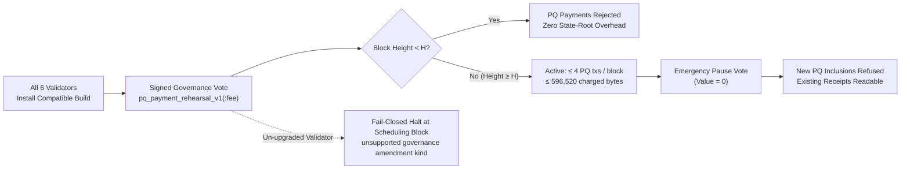

<div class="glance">
  <div><b>138.5–146.5 KB</b><span>Raw non-mint wire (~138.5 KB exp.) to max L1 stored deposit (146.5 / 149.1 KB cap)</span></div>
  <div><b>21–37 ms · ~25 s</b><span>Accelerated 1-core verify (portable misses 50 ms gate, up to 55 ms cold); ~25 s 1-core proving (~550 MiB RAM)</span></div>
  <div><b>1,734 + 1,754</b><span>Paired R64 archive replay (1,734 blks) + internal devnet replay (1,754 blks)</span></div>
  <div><b>Off · Unreviewed</b><span>Disabled on every public chain; no headline security level claimed</span></div>
</div>

**We currently claim no quantified end-to-end security level for PFSH02.** This post is a research-status report on an experimental private-payment prototype for Post Fiat L1—**Peel-Binius-Shielded** (wire format **PFSH02**)—built without elliptic curves from NIST hash functions (SHAKE256 inside the circuit, SHA-512 and SHA-384 outside it), AES-256-GCM, **ML-KEM-1024** (FIPS 203), and **ML-DSA-65** (FIPS 204).

The protocol is disabled on every public chain and hard-coded to a disposable rehearsal genesis. Its proof system is new from end to end, its security analysis was authored internally, and **no external cryptographer has reviewed it**. The full line-by-line formal arguments, symbol glossary, and 18 prioritized reviewer questions live in the companion [PFSH02 Mathematical Arguments & Reviewer Appendix](/research/pfsh02-proofs/).

### Security Status at a Glance

| Property | Current Status | Quantified Bound? | Open Gaps & Standing Assumptions |
| --- | --- | --- | --- |
| **Aggregate Value Conservation & No Double Spend** (Thm 3) | Proposed new proof (**unreviewed**) | Conditional estimate only: \(\lesssim 2^{-171}\) at \(Q=2^{64}\), \(\lesssim 2^{-92}\) at \(Q=2^{96}\) | Relies on unreviewed IOP soundness (Thm 1A / App. A.1–A.2) and unreviewed QROM extraction (Thm 2A / App. A.3). Avoids Conj. A.4 and ZK. Assumes circuit constraints match \(\mathcal{R}_{\mathrm{pay}}\). |
| **Spend Authorization & Non-Malleability** (Thm 4, Modes 1–2) | **Rests on an explicit conjecture** | Conditional estimate only: \(\lesssim 2^{-151}\) at \(Q=2^{64}\) | Depends on **Conjecture 2B (App. A.4)**—a proof sketch with no published anchor—plus unreviewed ZK (Thm 1B) and unquantified SHAKE256 `JointPRF` / dummy `PRG` assumptions. |
| **Deposit Authorization** (Thm 4, Mode 3) | Standard ML-DSA-65 + **160-bit weak link** | Ideal target reference: **\(\sim 2^{-32}\) at \(Q=2^{64}\)**; **vacuous at \(Q=2^{80}\)** | Inherits Post Fiat L1's 160-bit account-address truncation (`pf` + 20 bytes of SHA3-384), far below the 384-bit proof system. |
| **Confidentiality & Unlinkability** (Thm 5) | **Unproven; least supported claim** | **No single number** | Rests on four unquantified `[NonStd]` assumptions (ML-KEM-1024 FIPS-203 `IK-CCA`, SHAKE256 `JointPRF`, dummy `PRG`, `Hide`), covers **one challenge transaction only** (no multi-hop unlinkability proof), has **no forward secrecy**, and contains an **unresolved implicit-rejection scanning gap** in final hybrid \(H_4\). |

---

## 1. Motivation—and the Honest Gap on Privacy

Accounts and validators on Post Fiat L1 already sign with **ML-DSA-65**. The existing shielded pool does not: it runs Zcash's **Orchard** protocol over **Halo2** and the Pasta elliptic curves.

Elliptic-curve shielded pools face two distinct quantum risks on different timelines:

- **Harvest now, decrypt later (confidentiality).** Shielded note envelopes recorded on a public ledger today can be archived indefinitely. A future adversary who solves elliptic-curve discrete logarithms can retroactively decrypt recorded envelopes, recovering note amounts, blindings, and—where decrypted outputs are later linked to public inflows or exits—transaction graph relationships.
- **On-the-day proof forgery (soundness).** An adversary with live access to a large quantum computer could break Halo2's discrete-log polynomial commitment and forge valid proofs to mint unbacked value.

Soundness can be upgraded before large quantum computers exist; **retroactive confidentiality cannot.** That asymmetry motivated building PFSH02 without elliptic curves.

> **Status of the privacy goal: unproven.** Although retroactive confidentiality motivates PFSH02, **Theorem 5 (privacy) is currently the protocol's weakest-supported claim.** It has no concrete numerical security bound, depends on four unquantified non-standard assumptions (including ML-KEM-1024 key anonymity, proved in the literature only for pre-standard Kyber rather than FIPS 203), models only a single challenge transaction rather than multi-hop unlinkability, provides no forward secrecy if a recipient's long-term decapsulation key later leaks, and contains an unresolved implicit-rejection scanning gap in its final hybrid \(H_4\) (Grubbs–Maram–Paterson 2022). The strong conditional numbers elsewhere in this post (`~2^-171` at \(2^{64}\) queries) apply to value conservation and extraction, **not** to confidentiality.

---

## 2. Architecture, Visible Metadata & Profile 1 vs. Profile 2


A PFSH02 transaction consumes **two input slots** (each real or dummy) and creates **two output notes** under one uniform integer conservation equation over \(\mathbb{Z}\):

$$v_{\mathrm{in},0} + v_{\mathrm{in},1} + v_{\mathrm{mint}} = v_{\mathrm{out},0} + v_{\mathrm{out},1} + (\mathrm{fee} + v_{\mathrm{unshield}})$$

All individual amounts lie in \([0, 2^{64}-1]\), and acceptance Rule **R5** explicitly enforces \(\mathrm{pub\_exit} := \mathrm{fee} + v_{\mathrm{unshield}} < 2^{64}\) (no `u64` overflow). Combining \(\mathrm{fee} + v_{\mathrm{unshield}}\) into one 64-bit value bounds both sides by \(3(2^{64}-1) < 2^{66}\) (even without R5's check, four 64-bit terms on the right-hand side satisfy \(4(2^{64}-1) < 2^{66}\)), so 66-bit unsigned integer arithmetic represents either side without modular wrap-around, provided the circuit enforces the stated range and addition constraints.

### 2.1 Disjoint Cryptographic Stack (Zero Shared Permutation)

PFSH02 separates in-circuit state hashing from the proof compiler's random oracle across two disjoint NIST hash families:

1. **In-circuit note hashes & Depth-24 accumulator — FIPS-202 SHAKE256** (Keccak-\(f[1600]\), rate \(136\text{ B}\), capacity \(512\text{ bits}\)). Every call fits inside a **single permutation** (all inputs \(\le 135\text{ B}\)):
   - Shielded address: \(A = H_A(S) := \mathrm{SHAKE256}(\texttt{0x00} \parallel S_{48})[0..48]\)
   - Coin commitment: \(\mathrm{Coin} = H_{\mathrm{Coin}}(A, v, R) := \mathrm{SHAKE256}(\texttt{0x01} \parallel A_{48} \parallel v_8 \parallel R_{78})[0..48]\)
   - Nullifier: \(\mathrm{SN} = H_{\mathrm{SN}}(S, \mathrm{Coin}) := \mathrm{SHAKE256}(\texttt{0x02} \parallel S_{48} \parallel \mathrm{Coin}_{48})[0..48]\)
   - Merkle node: \(H_{\mathrm{Node}}(L, R) := \mathrm{SHAKE256}(\texttt{0x03} \parallel L_{48} \parallel R_{48})[0..48]\)
2. **Compiler Random Oracle — one fixed-range oracle \(H: \{0,1\}^* \to \{0,1\}^{1536}\)** instantiated via three domain-prefixed **FIPS-180-4 SHA-512** calls (`0x00`, `0x01`, `0x02`), with fixed-length domain tags (`"PFS-LEAF"`, `"PFS-NODE"`, `"PFS-STMT"`, `"PFS-ABS "`, `"PFS-CH  "`, `"PFS-C4  "`). Widening the never-transmitted internal Fiat–Shamir state from 384 to **512 bits** adds zero wire bytes while keeping all 68 programmed transcript queries at \(\ge 512\)-bit conditional min-entropy.
3. **0-Round Non-Interactive Stealth Receive — FIPS-203 ML-KEM-1024 + HMAC-SHA-384 + AES-256-GCM.** A recipient publishes an off-chain static stealth address \(\mathrm{pk}_{\mathrm{recv}} = (\mathrm{ek}, A = H_A(S))\); neither \(\mathrm{ek}\) nor \(A\) appears on-chain. The sender encapsulates \((ss, \mathrm{ct}_{\mathrm{kem}}) \leftarrow \mathrm{ML\text{-}KEM\text{-}1024.Encaps}(\mathrm{ek})\) (\(1,568\text{ B}\)), derives \((K_{\mathrm{aead}}, N_{\mathrm{aead}})\) via labeled HMAC-SHA-384 over \((\mathrm{ct}_{\mathrm{kem}}, \mathrm{Coin}_{\mathrm{out}})\), and encrypts \((v_{\mathrm{out}} \parallel R_{\mathrm{out}})\) (\(86\text{ B}\)) under AES-256-GCM with \(\mathrm{AAD} = \mathrm{Coin}_{\mathrm{out}}\) into a \(1,670\text{ B}\) envelope. Offline wallets trial-decrypt envelopes and accept a note only when \(H_{\mathrm{Coin}}(A, v_{\mathrm{out}}, R_{\mathrm{out}}) = \mathrm{Coin}_{\mathrm{out}}\).
4. **Depositor Authorization — FIPS-204 ML-DSA-65.** Positive deposits (\(v_{\mathrm{mint}} > 0\)) append a \(5,261\text{ B}\) authorization (`1,952 B` public key + `3,309 B` signature) under context `postfiat-l1-v2/tx/v1`. Shielded-to-shielded transfers carry **zero signatures**.

Each asset (native **PFT** and each governed issued source series such as **pfUSDC**) keeps its own Depth-24 SHAKE256 note tree holding \(2^{24} = 16,777,216\) leaves (\(\approx 97.1\text{ days}\) at \(1\text{ tx/s}\)). The asset identifier and tree epoch are bound into the L1 proof transcript, and roots are resolved strictly within that asset's trees to preserve per-asset reserve isolation; global uniqueness of commitments and nullifiers across all assets and epochs prevents cross-asset replay and double-spending. When a tree fills, it freezes permanently (keeping its roots spendable) and a fresh empty epoch opens.

### 2.2 Profile 1 vs. Profile 2 Evidence Matrix

Two L1 transaction profiles exist on separate branches, and **their verification evidence must not be conflated**:

| Dimension | L1 Profile 1 (`feat/peel-binius-shielded-pq`, PR #207) | L1 Profile 2 (`pq/private-issued-asset-fee`) |
| --- | --- | --- |
| **Pinned Commit SHA** | `a87887001e342252ac456e56085668a2de108df7` | `48d01e795689057ee468448900434b8ce61e0e3a` (+47 commits) |
| **Issued (`pfUSDC`) Pay & Exit Fee** | Inner fee = 0; requires an **explicit public PFT fee payer + ML-DSA-65 signature** (reveals public account unless sponsored) | **Zero public signer or PFT payer.** Exact governed fee paid in `pfUSDC` atoms inside the proof (`pq_payment_rehearsal_v1:fee:<atoms>`, proposed start: `1` atom = `0.000001 pfUSDC`), collected into public `collected_private_fees` (governance payout only) |
| **Native PFT & Deposits** | Inner PFT fee burned; deposits signed by depositor | Unchanged |
| **6-Validator M8 Paired Rehearsal** | **Completed (23 Nov)** on disposable genesis (pinned at `f0a44680e6435fb87a7392f75677a86d3ba5d5fe`) | **Not yet re-run** with the M8 two-binary paired rehearsal |
| **Unit, Node, CLI & Browser Tests** | M1–M7 suites pass (4 pre-existing `main` lib failures) | All Profile 2 Rust/Go/CLI/browser/recovery suites pass through 3 review rounds (same 4 `main` lib failures) |
| **Formal Spec Coverage** | Stand-alone wire analyzed in spec; L1 wrapper unreviewed | Transcript Delta noted in spec abstract; **not yet folded into formal theorems** |

### 2.3 What Remains Visible On-Chain (Even Under Profile 2)

PFSH02 hides note amounts, recipient keys, and—for internal spends under Profile 2—the sender's public account. It does **not** hide:

- **Transaction metadata:** the asset / source series, the exact fee, the tree epoch and anchor, the inclusion height and timing, the two nullifiers, and the two output commitments/envelopes.
- **Public bridge edges:** deposits and exits expose their public account and amount.
- **Orchard migration linkage:** migrating existing funds from Post Fiat's legacy Orchard pool uses a two-step flow—public Orchard exit followed by a fresh PQ deposit—so migrated balances are linkable by amount and timing unless users split and delay them.
- **Network & pool-size metadata:** gateways and validators observe caller IP addresses and request timing, and a small pool yields a small anonymity set.

### 2.4 Fail-Closed Governance Activation



Governance amendment kinds in Post Fiat's consensus layer form a closed list. In the M8 two-binary test, an un-upgraded pre-activation binary halted cleanly at the scheduling block (`unsupported governance amendment kind 'pq_payment_rehearsal_v1'`) instead of diverging into a chain split.

---

## 3. Wire Accounting, L1 Framing & Binary-Field Engine


A crucial distinction caught during review separates the **raw standalone PFSH02 wire** from the **L1 stored archive size** (which adds outer L1 framing, logical archive references, and storage authentication):

| Size Category (Depth-24 Tree, \(t = 52\) Column Openings) | Expected / Observed (B) | Worst-Case Ceiling (B) | Headroom vs. 149,130 B Cap |
| --- | ---: | ---: | ---: |
| **Standalone raw non-mint wire** (header `3,648` + proof `59,916` + 52 cols `38,896` + pruned siblings `36,001` exp / `38,016` max) | 138,461 *(sampled vectors vary with sibling pruning, e.g. `138,364 B`)* | 140,476 | 8,654 B |
| **Standalone raw signed deposit wire** (adds `5,261 B` ML-DSA-65 pubkey + sig) | 143,722 | 145,737 | 3,393 B |
| **L1 stored archive payment (Profile 1, M2/M8)** — wraps raw inner record + outer L1 header, `20 B` payer, `8 B` seq, `5,261 B` ML-DSA-65 auth, logical reference & `redb` framing (`+809 B` over raw deposit ceiling, or `+843 B` JSONL-framed) | 144,770 *(M2 largest vector)* · 145,140 *(M8 charged max)* | **146,546** (`redb`) / **146,580** (`JSONL`) | **2,550 B** |

### Binary-Field Engine (Adapting Binius Ring-Switching)

Building on the binary-tower polynomial commitment and ring-switching ideas of **Diamond and Posen (Binius, 2023–2024)**, PFSH02 arithmetizes its 447,014 active rows (`2,192,844` scalar constraints covering 56 Keccak-\(f[1600]\) permutations, Merkle swap muxes, `is_dummy` gating, and 66-bit conservation adders) over the binary tower \(\mathbb{F}_2 \subset K_{16} \subset K_{32} \subset E = \mathbb{F}_{2^{384}}\):

- **5-column Chi-only layout:** Every quadratic gate uses only the five Keccak \(\chi\) monomials, while packing witness bits into \(K_{32}\) enforces booleanity structurally (Lemma 3).
- **Exact 3D-Karatsuba ring-switch verifier:** Cuts \(H\)-domain inner-product verification from `143,360` to `13,122` \(E\)-multiplications (`11×` fewer), differentially tested against naive \(384 \times 384\) sums in Rust and Go.
- **54-`PCLMULQDQ` field kernels & streaming L1-cache prover:** Bring **accelerated** single-core standalone verification to **21–37 ms** (25.4 ms median / 31.5 ms max inside an accelerated validator). **The portable (non-`PCLMULQDQ`) builds do not yet meet the 50 ms engineering gate** (reaching 58 ms in pure Go and 50.2–55.3 ms cold in portable Rust; see §5).

---

## 4. Proposed Security Arguments, Conjectures, and Known Gaps


This prototype demonstrates implementation feasibility, **not** established end-to-end security. Numerical bounds below are **conditional estimates** derived from proposed reductions—rounded to whole bits in prose (exact rational decimals remain in [`math_bounds.json`](/evidence/pq-private-payments/math_bounds.json))—not a validated system security level.


### 4.1 Failure Blast Radius: Separating Conservation, Theft, and Privacy

| Component & Review Status | If Wrong, What Can Break | What Remains Unaffected |
| --- | --- | --- |
| **Theorem 1A / App. A.1–A.2** *(new, unreviewed; imports published BCIKS20 Thm 6.2)* | Classical & quantum proof forgery \(\to\) unbacked note creation (inflation). | Confidentiality. |
| **Theorem 2A / App. A.3** *(new, unreviewed)* | Quantum proof forgery \(\to\) unbacked note creation (requires live quantum computer). | Confidentiality; classical soundness. |
| **Conjecture 2B / App. A.4** *(explicit conjecture; no published anchor)* | Proof against altering/redirecting observed honest payments (Thm 4 Modes 1–2). | Aggregate supply conservation (Thm 3); Confidentiality (Thm 5). |
| **Theorem 1B / App. B** *(new, unreviewed; imports GHHM21 & AHU19)* | Confidentiality of amounts/links; worst-case spend-secret leakage enabling **ownership theft without aggregate supply inflation**. | Aggregate supply conservation (total pool + public balance still sums to genesis). |
| **Non-standard Privacy Assumptions & \(H_4\) Gap** *(Thm 5, `[NonStd]`)* | Retroactive recipient anonymity & transaction unlinkability on recorded chain data. | Supply conservation; spend authorization. |
| **160-Bit L1 Account Address** *(Thm 4 Mode 3)* | Targeted second-preimage key substitution on transparent deposit authorization (\(\sim 2^{-32}\) at \(Q=2^{64}\), vacuous at \(Q=2^{80}\)). | Shielded-to-shielded spends; proof system. |

### 4.2 Summary of the Five Core Arguments

Full line-by-line derivations, symbol definitions, and all 18 reviewer questions are published in the companion [PFSH02 Mathematical Arguments & Reviewer Appendix](/research/pfsh02-proofs/).

1. **Interactive Proof Soundness (Theorem 1A, App. A.1–A.2 — `[Unreviewed]`):** PFSH02 stays strictly inside the **proven Johnson bound** of Ben-Sasson–Carmon–Ishai–Kopparty–Saraf (**BCIKS20**, FOCS 2020 / JACM 2023, Theorem 6.2, \(m' = 3\), rate \(\rho = 565/2^{21}\)), avoiding the 2025-disputed Reed–Solomon list-decoding conjectures. A new greedy peeling argument (`Peel(M)`, Lemma 1) telescopes the remaining domain size via \(\sqrt{x_i} - \sqrt{x_{i+1}} > \sqrt{D/2}\) to cap the candidate list at \(L_{\max} = \lfloor\sqrt{2/\rho}\rfloor = 86\) and bound Round-33a proximity error at \(\lesssim 2^{-306}\). All algebraic rounds sit below \(2^{-356}\); Round 34's 52 random column spot-checks give \((\sqrt{2\rho})^{52} \approx 2^{-282}\) in the pure IOP and \(p_{34} = 2^{-20}(\sqrt{2\rho})^{52} \approx 2^{-302}\) with the 20-bit proof-of-work.
2. **QROM Straight-Line Extraction (Theorem 2A, App. A.3 — `[Unreviewed]`):** Generic multi-round Fiat–Shamir (Don–Fehr–Majenz, CRYPTO 2020) loses \((Q+1)^{68}\) over 34 rounds. Because BCS commits to the witness tree in Round 1, Appendix A.3 constructs a straight-line compressed-oracle extractor (in the framework of Zhandry 2019, CFHL21, and DFMS22a) via an exact rank-3 self-adjoint operator norm bound \(\|P_S O_{x,z} P_{\neg S}\|_2 = \|P_{\neg S} O_{x,z} P_S\|_2 \le \sqrt{8p} < \sqrt{10p}\) (Lemma A.3.0), yielding:
   $$\varepsilon_{\mathrm{Ext}}(Q, L) \le \left(3.652\, Q_v^{3/2} 2^{-192} + Q_v \sqrt{10 \cdot \max(\varepsilon_{\mathrm{rbr}}(33a) + 2 Q_v 2^{-512},\; p_{34})}\right)^2 + \frac{2 L \kappa_v}{2^{384}}$$
   At \(Q = 2^{64}\), the spot-check term dominates (\(\approx 2^{-171}\)). Near the crossover \(Q \approx 2^{81}\), the spot-check and 384-bit \(MT_1\) collision terms sit within ~1.3 bits of each other, so their cross term yields \(\approx 2^{-138}\) at \(Q = 2^{80}\). Above \(Q \approx 2^{81}\), 384-bit tree collisions dominate (\(\approx 2^{-92}\) at \(Q = 2^{96}\), aligned with the spec's \(32\,Q^3 / 2^{384} = 2^{-91}\) BHT collision reference), reaching triviality at \(Q \approx 2^{127}\).
3. **Adaptive Multi-Proof Simulation-Extractability (Conjecture 2B, App. A.4 — `[Conjecture]`):** Sketches a classical overlay wrapper \(B^H\) over unmodified \(H\) to argue that observing \(P \le 2^{32}\) simulated proofs does not help forge a fresh statement-proof pair. No standalone published anchor exists, and Case B (a forged hash chain starting inside overwritten simulation entries and continuing in unmodified \(H\)) requires formal proof. **Theorem 3 (supply conservation) does not use Appendix A.4.**
4. **Multi-Proof QROM Zero-Knowledge (Theorem 1B, App. B — `[Unreviewed]`):** Combines algebraic HVZK (\(\Delta_{\mathrm{HVZK}} \le 133/2^{384}\)), 5,216-bit unopened-leaf marginal min-entropy via AHU19 semi-classical O2H (Lemma 1.1), a hard-capped \(M_{\mathrm{pow}} = 2^{27}\) uniform-nonce PoW total-variation bound \(\lesssim 2^{-183}\) (Lemma 1.2), and 68 sequential product-state GHHM21 reprogramming steps to bound \(\mathrm{Adv}_{\mathrm{QROM\text{-}ZK}}(2^{32}, Q) \lesssim 2^{-151}\).
5. **Compositional Ledger Security (Theorems 3, 4 & 5):**
   - **Theorem 3 (Balance):** Inductively tracks canonical openings using unmodified-oracle extraction only (Theorem 2A + 384-bit SHAKE256 CR/zero-preimage).
   - **Theorem 4 (Authorization):** Modes 1–2 depend on Conjecture 2B + ZK + `[NonStd]` SHAKE256 `JointPRF` and dummy `PRG`. **Mode 3 (deposit debit)** depends on ML-DSA-65 plus Post Fiat L1's **160-bit account address**, whose targeted quantum second-preimage reference scales as \(\min(1, Q^2 / 2^{160})\)—**\(\sim 2^{-32}\) at \(Q = 2^{64}\) and vacuous at \(Q = 2^{80}\)**.
   - **Theorem 5 (Privacy):** Uses a 5-hop hybrid (ZK \(\to\) ML-KEM IND-CCA2 + HMAC-SHA-384 PRF + AES-GCM INT-CTXT/IND$-CPA + ML-KEM IK-CCA \(\to\) dummy PRG & SHAKE256 `JointPRF` \(\to\) `Hide`), parameterized by user count \(U\) and active scan queries \(q_{\mathrm{scan}}\) with **no numerical bound**. During the 23 November internal security-argument review, we identified an **open gap in final hybrid \(H_4\)**: when a non-recipient candidate scans a modified challenge envelope sharing \(\mathrm{ct}_{\mathrm{kem}}^*\), ML-KEM returns its deterministic implicit-rejection key \(J(z \parallel \mathrm{ct})\), which the hybrids never replace—leaving \(b=0\) and \(b=1\) asymmetric (the Grubbs–Maram–Paterson 2022 subtlety). Closing this gap and addressing FIPS-203 ML-KEM key anonymity are explicit pre-launch requirements.

---

## 5. Benchmarks, Rehearsals & Internal Cross-Check (23 November)

All eight engineering milestones (M1–M8) are implemented on the Profile 1 branch (`a87887001`), with M8 split strictly into **rehearsal (completed 23 Nov)** and **external review (not started)**. On 23 November, a Post Fiat operator (Domagoj Ravlić, `dravlic`) conducted a **read-only internal cross-check** on a second server (AMD EPYC-Genoa, 16 vCPUs) to test reproducibility of the measurements, code, and security argument; this is an internal cross-check, **not** an outside third-party audit.

*Project terms used below:* **R64** is Post Fiat's retained production-devnet validator-3 archive (`1,734` blocks from genesis); **FastPay** refers to retained consensusless payment certificates whose `33` fees sit outside standard block **receipt fees** (`45,671`); a **certified round** is one full six-validator consensus round including voting, certification, and persistence; **pinned CPUs** (`CPU 17`, `CPU 13`, `CPU 11`) are single isolated logical cores on a 32-thread AMD EPYC test host (`taskset -c`); the **dev `pfUSDC` series** is the single test-genesis issued asset series permitted in rehearsal code.

### 5.1 Real-Chain Historical Replays (Zero Impact While Inactive)

- **R64 Paired Two-Binary Replay (1,734 blocks, M8 rehearsal):** Both the original live R64 node binary (`674dbb18a`, SHA-256 `95d5b237...17d1`) and the candidate PQ binary (`f0a44680e`, SHA-256 `5a510875...d772`) replayed heights `1..1734` from genesis `ce22ca8c...90a9` to identical final block `910c7448...1e40`, final state root `a7b1185e...fe56`, row SHA-256 `c28eb87280050e96e996ad5c9e8c2eae12f2fb9774438f3a7b5f1295ef155910`, and exact PFT supply (`999,954,296 live + 45,671 receipt fees + 33 FastPay fees = 1,000,000,000`).
- **Live Devnet Internal Replay (1,754 blocks, 23 Nov internal cross-check):** Replayed a read-only copy of a live validator's data directory from genesis to height `1,754`, tip `519bbc0c...6642de9`, state root `246d6113...124be4b8e6`, matching all six live validators identically.

### 5.2 Key Performance & Gate Results

| Measurement (Single Core Unless Noted) | Primary Host (22–23 Nov) | 2nd Machine Internal Check (23 Nov) | Engineering Gate |
| --- | --- | --- | --- |
| Rust standalone verify (`PCLMULQDQ`) | 20.6–21.9 ms | 21.4–22.8 ms *(cold spikes 34.5–41.4 ms)* | Pass (\(< 50\text{ ms}\)) |
| Go standalone verify (`PCLMULQDQ` ASM) | 30.6–36.9 ms | 32.2 ms median (36.2 ms max) | Pass (\(< 50\text{ ms}\)) |
| **Go standalone verify (`-tags purego`)** | **58.9 ms median** | **58.0 ms median** | **Over 50 ms gate** |
| Full \(2^{24}\)-leaf rollover spend (leaf `16,777,215`, `138,364 B`) | 20.6 ms Rust / 30.6 ms Go | 22.6 ms Rust / 31.5 ms Go | Pass (\(< 50\text{ ms}\)) |
| Inside-validator verify — Accelerated (`CPU 17`, 1 / 4 txs) | 25.4 ms med (31.5 max) / 143.6 ms med (166.2 max) | — | Pass (\(< 50 / 200\text{ ms}\)) |
| **Inside-validator verify — Portable (`CPU 13 / 11`, 1 / 4 txs)** | **39.0–40.1 ms med (50.2–55.3 max) / 154.6–200.9 ms med (252.5 max)** | — | **Missed 50 ms & 200 ms gates (cold)** |
| Six-validator certified round (4 PQ proofs vs. ordinary) | 979.4–1,034.9 ms vs. 305.8–844.7 ms *(20,000 ms vote phase)* | — | Pass |
| Rust proving (16 threads / 1 core, ~550 MiB peak RSS) | 2.9 s (32 thr) / 26.7–28.0 s (1 core) | 2.64 s (16 thr) / 25.5 s (1 core) | Laptop proving still unmeasured |
| Offline wallet scanning (ML-KEM + AES-GCM) | 4,722–6,073 outputs/s/core | 8,044–8,971 outputs/s/core | Informational |

*What the automated checks do and do not verify:* `check_math.py` evaluates the specification's bound formulas in exact rational arithmetic—it does **not** check the proofs. Z3 `5.4.1` proves the 66-bit conservation adder, 2-bit Merkle mux, and `is_dummy` gating—it does **not** verify how note values wire into the 56 SHAKE256 permutations. Both the Rust and Go verifiers and Python IR builder were written by the same team from the same specification, so cross-language equality is a regression check rather than third-party validation.

---

## 6. Evidence Packets & Immutable Reproduction

Every artifact below is mirrored directly on `postfiat.org` alongside immutable Git commits in [`postfiatorg/postfiatl1v2`](https://github.com/postfiatorg/postfiatl1v2):

| Artifact | Purpose & Scope | Direct Link |
| --- | --- | --- |
| **Companion Mathematical Arguments & 18 Reviewer Questions** | Full line-by-line Lemmas 1–4, App. A.3, Conj. A.4, App. B, Thms 3–5 & symbol glossary | [`/research/pfsh02-proofs/`](/research/pfsh02-proofs/) |
| **Consolidated Evidence Packet (JSON)** | Pinned commits, replay digests, parameters, conditional bounds, benchmarks & blockers | [`pq-private-payments-evidence-packet-20261124.json`](/evidence/pq-private-payments/pq-private-payments-evidence-packet-20261124.json) |
| **External Cryptographic Review Package** | Complete source inventory (line counts), payment trace & 9 reviewer scopes | [`external-review-package.md`](/evidence/pq-private-payments/external-review-package.md) |
| **M8 Release Rehearsal Record** | R64 1,734-block replay, 30-block 6-validator receipts, M4 halt log & resource gates | [`rehearsal-record.md`](/evidence/pq-private-payments/rehearsal-record.md) |
| **Exact-Rational Math & Z3 Circuit Outputs** | Machine outputs of `check_math.py` and `verify_circuit_equivalence.py` | [`math_bounds.json`](/evidence/pq-private-payments/math_bounds.json) · [`circuit_equivalence.json`](/evidence/pq-private-payments/circuit_equivalence.json) |
| **SHA-256 Fixture Manifests** | 36-file SHA-256 checksums (`SHA256SUMS` inside repo; mirrored with `.txt` suffix here) | [`SHA256SUMS.txt`](/evidence/pq-private-payments/SHA256SUMS.txt) *(Profile 1)* · [`SHA256SUMS-profile2.txt`](/evidence/pq-private-payments/SHA256SUMS-profile2.txt) *(Profile 2)* |

### Reproduce From Immutable Commits

```bash
git clone https://github.com/postfiatorg/postfiatl1v2.git
cd postfiatl1v2

# Check out an immutable pinned revision:
#   Profile 1 (M8 rehearsal head / PR #207): a87887001e342252ac456e56085668a2de108df7
#   Profile 1 (rehearsal source pin):        f0a44680e6435fb87a7392f75677a86d3ba5d5fe
#   Profile 2 (payerless issued-asset fee):  48d01e795689057ee468448900434b8ce61e0e3a
git checkout a87887001e342252ac456e56085668a2de108df7

cd tools/pft-binius-shielded-pq
sha256sum -c SHA256SUMS      # verifies 36 fixture/tool checksums (mirrored as SHA256SUMS.txt on postfiat.org)
./verify.sh                  # runs fixtures, 35 attacks + 150 mutations, Go check, scan, check_math.py & Z3

# Or run inside the pinned Dockerfile (base: rust:1.95.0-bookworm, Go 1.25.1, z3-solver==5.4.1.0)
docker build -t pft-binius-shielded-pq .
docker run --rm pft-binius-shielded-pq
```

---

## 7. Launch Acceptance Criteria (What Blocks Production)

PFSH02 remains **held** from live activation until all seven blockers below are closed:

1. **External cryptographic & implementation review:** Engage independent cryptographers to audit classical IOP soundness (Thm 1A / App. A.1–A.2), QROM extraction (App. A.3), the A.4 simulation-extractability conjecture, QROM zero-knowledge (App. B), Privacy (Thm 5), and the Rust/Go/L1 settlement implementations.
2. **Close the Theorem 5 privacy gap & address non-standard assumptions:** Resolve the \(H_4\) implicit-rejection scanning gap (GMP22), clarify FIPS-203 ML-KEM-1024 anonymity and SHAKE256 `JointPRF`/`PRG`/`Hide` assumptions, and evaluate whether Post Fiat L1's 160-bit deposit account address requires wider digests or on-chain public-key pinning before launch.
3. **Branch consolidation & Profile 2 rehearsal:** Rebase PR [#207](https://github.com/postfiatorg/postfiatl1v2/pull/207) (129 commits behind `public/main`), integrate Profile 2 (`pq/private-issued-asset-fee`), integrate PR #211 (`fix/pq-cheap-checks-first-20261123`, running cheap root/nullifier/commitment checks before proof verification to prevent verification-DoS), and run a fresh six-validator M8 paired rehearsal on Profile 2.
4. **Dedicated live-chain release:** Replace the hard-coded disposable rehearsal genesis (`postfiat-pfsh02-m1-disposable`) and dev `pfUSDC` series in `pq_payment_fixture.rs` and `pq_payment_actions.rs` with a reviewed production release targeting the real chain and governed asset series.
5. **Merge the four pre-existing `main` test fixes:** Land PR #209 (`fix/main-checks-20261123`) so the repository-wide release gate is green.
6. **Close operational & hardware gaps:** Resolve or formally accept cold portable verification latency (50.2–55.3 ms single / 252.5 ms 4-proof), parallelize 4-proof block verification, measure laptop proving performance, and benchmark `postfiat-node` RAM and restart replay time on a truly full \(2^{24}\)-leaf tree (currently estimated at several GB RAM and ~45 GB of replayed pages without checkpointed indexes).
7. **Governance vote for activation height \(H\):** Only after all validators run the reviewed release and the blockers above are signed off.

---

*PFSH02 source lives in [`postfiatorg/postfiatl1v2`](https://github.com/postfiatorg/postfiatl1v2) (Profile 1 commit `a87887001e342252ac456e56085668a2de108df7`; Profile 2 commit `48d01e795689057ee468448900434b8ce61e0e3a`). Cryptographers and auditors can start from the [Companion Mathematical Arguments & Reviewer Appendix](/research/pfsh02-proofs/) and the [External Review Package](/evidence/pq-private-payments/external-review-package.md).*
