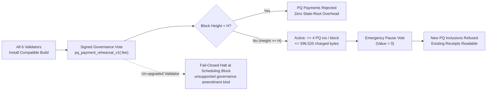

<div class="glance">
  <div><b>138.5–146.6 KB</b><span>Raw non-mint wire (~138.5 KB exp.) to worst-case L1 stored deposit (149.1 KB cap)</span></div>
  <div><b>21–59 ms · 26–28 s</b><span>1-core verify (21–41 ms accel., 39–59 ms portable); 26–28 s 1-core proving (~550 MiB RAM)</span></div>
  <div><b>Rehearsed · Off</b><span>Tested on a 6-validator disposable chain; disabled on every public chain</span></div>
  <div><b>Unreviewed</b><span>No external crypto audit; no headline security level claimed yet</span></div>
</div>

Post Fiat L1 already uses post-quantum **ML-DSA-65** signatures for public accounts and validators, while its existing shielded pool runs Zcash's **Orchard** protocol over elliptic curves. Over the past week we built and rehearsed a prototype replacement—**Peel-Binius-Shielded**, wire format **PFSH02**—that removes elliptic curves completely, relying only on NIST hash functions (SHAKE256, SHA-512, SHA-384), AES-256-GCM, **ML-KEM-1024** (FIPS 203), and **ML-DSA-65** (FIPS 204).

**What a payment does in plain terms.** A user deposits funds from a public Post Fiat account into a private per-asset pool, creating two encrypted private notes whose commitments enter an append-only Merkle tree. To pay someone privately, the sender's wallet proves in zero knowledge that it owns two earlier notes in that tree without revealing which ones, publishes two one-time spend tags (nullifiers) to prevent double-spending, and posts two new note commitments plus two ML-KEM-1024 encrypted envelopes. Recipients stay offline and discover incoming payments by trial-decrypting envelopes locally. Exiting back to a public account works through the same transaction format.

**What this prototype establishes—and what it does not.** We have verified engineering feasibility on a disposable six-validator test chain: payments stay under Post Fiat L1's 149,130-byte archival ceiling, verify in 21–37 ms warm on an accelerated x86-64 core (with cold spikes up to 41.4 ms and portable builds missing the 50 ms gate), and leave live-devnet history byte-for-byte unchanged while inactive. **We currently claim no quantified end-to-end security level for PFSH02.** The protocol is switched off on every public chain, its proof system is new and has received **zero external cryptographic review**, its authorization argument depends on an explicit conjecture, its deposit path inherits a 160-bit account-address weak link, and **confidentiality—the primary reason to replace elliptic curves—is currently its weakest-supported claim.**

Every line-by-line derivation, symbol definition, and all 18 external reviewer questions live in the companion [PFSH02 Mathematical Arguments & Reviewer Appendix](/research/pfsh02-proofs/).

---

## 1. Why Replace Elliptic Curves—and Why Privacy Remains Unproven

Elliptic-curve shielded pools face two quantum threats on different timelines:

- **Harvest now, decrypt later (confidentiality).** Encrypted note envelopes recorded on a public ledger today can be stored indefinitely. A future adversary who breaks elliptic-curve discrete logarithms can retroactively decrypt recorded envelopes, recovering note amounts, blindings, and—where those outputs connect to public inflows, exits, or later spends—transaction graph relationships.
- **On-the-day proof forgery (soundness).** An adversary with live access to a large quantum computer could break Halo2's discrete-log polynomial commitment and forge valid proofs to create unbacked value.

A soundness weakness can be mitigated by migrating proof systems before cryptographically relevant quantum computers arrive. **A confidentiality failure cannot be undone retroactively.** That asymmetry motivated building PFSH02 without elliptic curves.

> **Status of the privacy goal: unproven.** Although retroactive confidentiality motivates PFSH02, **Theorem 5 (privacy) currently has no numerical security bound.** It rests on four unquantified non-standard assumptions (including ML-KEM-1024 key anonymity, proved in the literature only for pre-standard Kyber rather than FIPS 203), models only a single challenge transaction rather than multi-hop unlinkability, provides **no forward secrecy** if a recipient's long-term decapsulation key ever leaks (exposing all past envelopes encrypted to that key), and contains an **unresolved proof gap** in its final hybrid step when non-recipients scan modified envelopes under ML-KEM implicit rejection (the Grubbs–Maram–Paterson 2022 subtlety). The large conditional security numbers elsewhere in this post (`~2^-171` at \(2^{64}\) quantum queries) concern **value conservation and extraction, not confidentiality**.

### Security Status at a Glance

| Security Property | Current Status | Conditional Estimate | Key Gaps & Standing Assumptions |
| --- | --- | --- | --- |
| **Aggregate Supply Conservation & No Double Spend** (Theorem 3) | New in-house proof (**unreviewed**) | \(\lesssim 2^{-171}\) at \(Q=2^{64}\); \(\lesssim 2^{-92}\) at \(Q=2^{96}\) | Depends on unreviewed interactive proof soundness (Theorem 1A) and unreviewed quantum extraction (Theorem 2A). Avoids Conjecture 2B and zero-knowledge. Assumes the circuit constraints faithfully encode the payment rules. |
| **Spend Authorization & Non-Malleability** (Theorem 4, Modes 1–2) | **Depends on an explicit conjecture** | \(\lesssim 2^{-151}\) at \(Q=2^{64}\) | Relies on **Conjecture 2B** (multi-proof simulation-extractability—a sketch with no published anchor), unreviewed zero-knowledge (Theorem 1B), and unquantified SHAKE256 assumptions. |
| **Deposit Authorization** (Theorem 4, Mode 3) | Standard ML-DSA-65 + **160-bit weak link** | **\(\sim 2^{-32}\) at \(Q=2^{64}\)**; **vacuous at \(Q=2^{80}\)** | **Quantified weakest link of the deposit-to-shielded system:** inherits Post Fiat L1's 160-bit account-address truncation (`pf` + 20 bytes of SHA3-384), far below the 384-bit proof system. |
| **Confidentiality & Unlinkability** (Theorem 5) | **Unproven; least supported claim** | **No single number** | Four unquantified non-standard assumptions; single-transaction model only; no forward secrecy; unresolved implicit-rejection scanning gap in the final hybrid. |

---

## 2. How PFSH02 Works & Profile 1 vs. Profile 2


Every PFSH02 transaction consumes **two input slots** (each real or dummy) and produces **two output notes** satisfying one exact integer conservation law over \(\mathbb{Z}\):

$$v_{\mathrm{in},0} + v_{\mathrm{in},1} + v_{\mathrm{mint}} = v_{\mathrm{out},0} + v_{\mathrm{out},1} + (\mathrm{fee} + v_{\mathrm{unshield}})$$

Every amount lies in \([0, 2^{64}-1]\), and acceptance Rule **R5** explicitly enforces \(\mathrm{pub\_exit} := \mathrm{fee} + v_{\mathrm{unshield}} < 2^{64}\) (no 64-bit overflow). Combining \(\mathrm{fee} + v_{\mathrm{unshield}}\) into one 64-bit value bounds both sides by \(3(2^{64}-1) < 2^{66}\) (and even without that check, four 64-bit right-hand operands satisfy \(4(2^{64}-1) < 2^{66}\)), so 66-bit unsigned integer arithmetic avoids modular wrap-around, provided the circuit enforces the stated range and addition constraints.

### 2.1 Disjoint Cryptographic Stack (Zero Shared Permutation)

1. **In-circuit note hashes & Depth-24 accumulator — FIPS-202 SHAKE256.** Every in-circuit hash (address \(H_A\), coin commitment \(H_{\mathrm{Coin}}\), nullifier \(H_{\mathrm{SN}}\), Merkle node \(H_{\mathrm{Node}}\)) takes \(\le 135\text{ B}\), fitting inside a single Keccak-\(f[1600]\) permutation (512-bit capacity, 48-byte outputs).
2. **Proof-compiler oracle — `3 × SHA-512` (FIPS 180-4).** Every Merkle commitment hash, transcript absorb, field challenge, and final query draw comes from one fixed-range 1,536-bit oracle built from three domain-prefixed SHA-512 calls—completely disjoint from Keccak inside the circuit. Widening the never-transmitted internal Fiat–Shamir state from 384 to **512 bits** adds zero wire bytes while keeping all 68 programmed transcript calls at \(\ge 512\)-bit conditional min-entropy.
3. **0-round offline stealth receive — ML-KEM-1024 + HMAC-SHA-384 + AES-256-GCM.** Recipients publish an off-chain static stealth address \((\mathrm{ek}, A = H_A(S))\); neither component appears on-chain. Each \(1,670\text{ B}\) output envelope packs a `1,568 B` ML-KEM-1024 ciphertext plus a `102 B` AES-256-GCM ciphertext (`86 B` amount + blinding, `16 B` tag, AAD = output commitment) keyed via labeled HMAC-SHA-384. Offline wallets trial-decrypt envelopes and accept a note only when its decrypted opening reproduces the public commitment.
4. **Signatures by transaction kind.** Positive deposits (\(v_{\mathrm{mint}} > 0\)) append a `5,261 B` **ML-DSA-65** authorization (`1,952 B` public key + `3,309 B` signature) under context `postfiat-l1-v2/tx/v1`. **Native PFT internal transfers—and issued-asset transfers under Profile 2—carry zero on-chain signatures; Profile 1 issued-asset transfers carry a public fee-payer ML-DSA-65 signature** (see §2.2).

Each asset (native **PFT** and each governed issued source series such as **pfUSDC**) maintains an isolated Depth-24 SHAKE256 note tree holding \(2^{24} = 16,777,216\) leaves—enough for **8,388,608 two-output transactions**, or **\(\approx 97.1\) days at a sustained 1 tx/s**. The asset identifier and tree epoch are bound into the proof transcript and roots resolve strictly inside that asset's trees to enforce per-asset reserve isolation; global uniqueness of commitments and nullifiers across all assets and epochs prevents cross-asset replay and double-spending. When a tree fills, it freezes permanently (remaining spendable) and a fresh empty epoch opens.

### 2.2 Profile 1 vs. Profile 2 Evidence Matrix

Two L1 transaction profiles exist on separate branches, and **their verification status must stay distinct**:

| Dimension | L1 Profile 1 (`feat/peel-binius-shielded-pq`, PR #207) | L1 Profile 2 (`pq/private-issued-asset-fee`) |
| --- | --- | --- |
| **Pinned Commits** | Rehearsal binary/spec pin: `f0a44680e6435fb87a7392f75677a86d3ba5d5fe`<br/>PR #207 head (adds M8 records & halt test): `a87887001e342252ac456e56085668a2de108df7` | Branch head: `48d01e795689057ee468448900434b8ce61e0e3a` (47 commits stacked on `a87887001`) |
| **Issued (`pfUSDC`) Pay & Exit Fee** | Inner fee = 0; requires an **explicit public PFT fee payer + ML-DSA-65 signature** (exposes a public account unless sponsored) | **Zero public signer or PFT payer.** Exact governed fee paid in `pfUSDC` atoms inside the proof (`pq_payment_rehearsal_v1:fee:<atoms>`, proposed start: `1` atom = `0.000001 pfUSDC`), sent to public `collected_private_fees` (governance payout only) |
| **Native PFT & Deposits** | Inner PFT fee burned; deposits signed by depositor | Unchanged |
| **6-Validator M8 Rehearsal** | **Completed (23 Nov)** on disposable genesis (`f0a44680e` binary) | **Not yet rehearsed** with the six-validator two-binary M8 harness |
| **Automated Test Suites** | Build milestones M1–M7 pass (4 pre-existing `main` lib failures) | All Profile 2 Rust/Go/CLI/browser/recovery suites pass across 3 review rounds (same 4 `main` lib failures) |
| **Formal Spec Coverage** | Stand-alone wire analyzed; L1 wrapper unreviewed | High-level note in spec abstract; **not yet incorporated into formal theorems** |

### 2.3 Visible Metadata & Practical Privacy Limits

Even under Profile 2, PFSH02 is **designed to hide** note amounts, recipient addresses, and (for internal transfers) the sender's public account—noting that omitting a sender field from the wire is distinct from a formal computational-hiding proof, which remains unproven (§1). The protocol does **not** hide:

- **On-chain transaction metadata:** the asset / source series, the exact fee, the tree epoch and anchor, the inclusion height and time, the two nullifiers, and the two output commitments and envelopes.
- **Bridge edges:** deposits and exits expose their public account and exact amount.
- **Legacy Orchard migration linkage:** moving funds from Post Fiat's legacy Orchard pool uses a two-step flow—public Orchard exit followed by a fresh PQ deposit—making migrated amounts and timing linkable unless users split and delay them.
- **Network & anonymity-set limits:** gateways and validators observe caller IP addresses and request timing, and a small pool provides a small anonymity set.

### 2.4 Fail-Closed Governance Activation



Governance amendment kinds in Post Fiat's consensus layer form a closed list. In the two-binary upgrade check, an older pre-activation binary halted cleanly on the scheduling amendment (`unsupported governance amendment kind 'pq_payment_rehearsal_v1'`) rather than diverging into a chain split.

---

## 3. Wire Size Reconciliation & Binary-Field Engine


Wire sizes must distinguish the **raw standalone PFSH02 wire** from the **L1 stored archive size**, which adds outer L1 transaction framing, archive references, and storage authentication:

| Encoding Layer (Depth-24 Tree, 52 Column Openings) | Expected / Measured (B) | Worst-Case Ceiling (B) | Headroom vs. 149,130 B Cap |
| --- | ---: | ---: | ---: |
| **Standalone raw non-mint wire** (header `3,648` + fixed proof `59,916` + 52 cols `38,896` + pruned siblings `36,001` exp / `38,016` max) | 138,461 *(varies by sibling pruning, e.g. `138,364 B` on rollover fixture)* | 140,476 | 8,654 B |
| **Standalone raw signed deposit wire** (adds `5,261 B` ML-DSA-65 pubkey + sig) | 143,722 | 145,737 | 3,393 B |
| **L1 stored payment — Profile 1 `redb` store** (wraps `140,476 B` inner ceiling + outer L1 header, `20 B` payer, `8 B` seq, `5,261 B` ML-DSA-65 auth, logical ref & `redb` keys/auth) | 144,770 *(M2 largest vector)* · 145,140 *(M8 charged max)* | **146,546** | **2,584 B** |
| **L1 stored payment — Profile 1 `JSONL` file store** (adds JSONL envelope & digest filename) | 144,804 *(M2 largest vector)* | **146,580** | **2,550 B** |

### Binary-Field Engine (Adapting Binius)

Adapting the binary-tower polynomial commitment and ring-switching architecture of **Diamond and Posen (Binius, 2023–2024)**, PFSH02 arithmetizes its 447,014 active rows (`2,192,844` constraints covering 56 Keccak-\(f[1600]\) permutations, Merkle swap muxes, `is_dummy` gating, and 66-bit conservation adders) over the binary tower \(\mathbb{F}_2 \subset K_{16} \subset K_{32} \subset E = \mathbb{F}_{2^{384}}\):

- **5-column Chi-only layout:** Every quadratic gate uses only the five Keccak \(\chi\) monomials; packing witness bits into \(K_{32}\) enforces booleanity structurally without quadratic gates.
- **3D-Karatsuba ring-switch verifier:** Cuts \(H\)-domain inner-product verification from `143,360` to `13,122` \(E\)-multiplications (`11×` fewer), differentially tested against naive \(384 \times 384\) sums in Rust and Go.
- **54-`PCLMULQDQ` kernels & streaming L1-cache prover:** Keep **accelerated** single-core standalone verification at 20.6–22.8 ms warm in Rust (up to 41.4 ms cold) and 30.6–36.9 ms in Go, and inside an accelerated validator at 25.4 ms median (31.5 ms max). **Portable builds without `PCLMULQDQ` miss the 50 ms / 200 ms gates** (58.0–58.9 ms median in pure Go; up to 55.3 ms single / 200.9 ms median / 252.5 ms max 4-proof in portable Rust).

---

## 4. Proposed Security Arguments, Conjectures & Failure Blast Radius


Numerical bounds below are **conditional estimates** derived from proposed in-house reductions—rounded to whole bits in prose (exact two-decimal rational outputs are in [`math_bounds.json`](/evidence/pq-private-payments/math_bounds.json))—not validated end-to-end security levels. **Across the deposit-to-shielded system as a whole, the quantified weakest link is Post Fiat L1's 160-bit deposit account address (\(\sim 2^{-32}\) at \(Q=2^{64}\), vacuous at \(Q=2^{80}\)), while confidentiality has no quantified bound at all.**


### 4.1 Failure Blast Radius (Claimed Proof Dependencies)

| Component & Review Status | If Wrong, What Can Break | Claimed Proof Dependencies Not Affected |
| --- | --- | --- |
| **Theorem 1A (34-Round Interactive Proof)** *(new, unreviewed; imports published BCIKS20 Thm 6.2)* | Classical & quantum proof forgery \(\to\) unbacked note creation (inflation). | Theorem 5 (confidentiality). |
| **Theorem 2A (Quantum Extraction, App. A.3)** *(new, unreviewed)* | Quantum proof forgery \(\to\) unbacked note creation (requires live quantum computer). | Theorem 5 (confidentiality); classical soundness. |
| **Conjecture 2B (Multi-Proof SE, App. A.4)** *(explicit conjecture; no published anchor)* | Proof against altering or redirecting observed honest payments (Theorem 4 Modes 1–2). | Theorem 3 (aggregate supply conservation); Theorem 5 (confidentiality). |
| **Theorem 1B (Quantum Zero-Knowledge, App. B)** *(new, unreviewed; imports GHHM21 & AHU19)* | Confidentiality of amounts/links; worst-case spend-secret leakage enabling **ownership theft without aggregate supply inflation**. | Theorem 3 (aggregate supply conservation). |
| **Privacy Assumptions & Final-Hybrid Gap** *(Theorem 5, non-standard)* | Retroactive recipient anonymity & transaction unlinkability on recorded chain data. | Theorem 3 (supply conservation); Theorem 4 (spend authorization). |
| **160-Bit L1 Account Address** *(Theorem 4 Mode 3)* | Targeted second-preimage key substitution on transparent deposit authorization (\(\sim 2^{-32}\) at \(Q=2^{64}\), vacuous at \(Q=2^{80}\)). | Shielded-to-shielded spends; proof system. |

### 4.2 High-Level Structure of the Five Arguments

All formal definitions, step-by-step lemmas, and the 18 questions for external cryptographers are in the companion [PFSH02 Mathematical Arguments & Reviewer Appendix](/research/pfsh02-proofs/):

1. **Interactive Proof Soundness (Theorem 1A — unreviewed):** Stays strictly inside the **proven Johnson bound** of Ben-Sasson–Carmon–Ishai–Kopparty–Saraf (**BCIKS20**, FOCS 2020 / JACM 2023, Theorem 6.2, \(m'=3\), rate \(\rho = 565/2^{21}\)), avoiding disputed Reed–Solomon list-decoding conjectures. A greedy peeling lemma (`Peel(M)`) caps candidate codewords at \(L_{\max} = \lfloor\sqrt{2/\rho}\rfloor = 86\) and bounds Round-33a proximity error at \(\lesssim 2^{-306}\); all algebraic rounds sit below \(2^{-356}\); Round 34's 52 random column openings give \((\sqrt{2\rho})^{52} \approx 2^{-282}\) without PoW and \(p_{34} = 2^{-20}(\sqrt{2\rho})^{52} \approx 2^{-302}\) (`2^-302.31` exact) with the 20-bit proof-of-work.
2. **Single-Oracle Quantum Extraction (Theorem 2A / App. A.3 — unreviewed):** Avoids the vacuous \((Q+1)^{68}\) multi-round Fiat–Shamir loss by extracting straight-line from Zhandry's compressed oracle (building on CFHL21 / DFMS22a) via an exact rank-3 self-adjoint operator bound (\(\le \sqrt{8p} < \sqrt{10p}\)):
   $$\varepsilon_{\mathrm{Ext}}(Q, L) \le \left(3.652\, Q_v^{3/2} 2^{-192} + Q_v\sqrt{10\cdot\max(\varepsilon_{\mathrm{rbr}}(33a) + 2 Q_v 2^{-512},\; p_{34})}\right)^2 + \frac{2 L \kappa_v}{2^{384}}$$
   Using the exact unrounded \(p_{34} = 2^{-302.31}\), the spot-check and 384-bit tree-collision terms cross at \(Q = 2^{81.28}\): at \(Q = 2^{64}\), spot-checks dominate (\(\approx 2^{-171}\)); at \(Q = 2^{80}\), both terms sit within ~1.3 bits so their cross term yields \(\approx 2^{-138}\); at \(Q = 2^{96}\), 384-bit tree collisions dominate (\(\approx 2^{-92}\), aligned with the spec's \(32\,Q^3 / 2^{384} = 2^{-91}\) collision reference), reaching triviality at \(Q \approx 2^{127}\).
3. **Adaptive Multi-Proof Simulation-Extractability (Conjecture 2B / App. A.4 — conjecture):** Sketches a classical overlay wrapper \(B^H\) over unmodified \(H\) to argue that seeing \(P \le 2^{32}\) simulated proofs does not enable forging a fresh pair. No published anchor exists, and cross-boundary chains (Case B) require formal proof. **Theorem 3 (supply conservation) does not rely on this conjecture.**
4. **Quantum Zero-Knowledge (Theorem 1B / App. B — unreviewed):** Combines algebraic honest-verifier zero-knowledge (\(\le 133/2^{384}\)), 5,216-bit unopened-leaf marginal min-entropy via AHU19 semi-classical one-way-to-hiding, a hard-capped \(M_{\mathrm{pow}} = 2^{27}\) PoW total-variation bound (\(\lesssim 2^{-183}\)), and 68 sequential product-state GHHM21 reprogramming steps to estimate \(\mathrm{Adv}_{\mathrm{QROM\text{-}ZK}}(2^{32}, Q) \lesssim 2^{-151}\).
5. **Compositional Ledger Theorems (Theorems 3, 4 & 5):** Theorem 3 proves supply conservation by induction from Theorem 2A + 384-bit SHAKE256 collision/zero-preimage resistance. Theorem 4 proves spend authorization/non-malleability (Modes 1–2, depending on Conjecture 2B + ZK + non-standard SHAKE256 assumptions) and deposit authorization (Mode 3, bounded by ML-DSA-65 plus the 160-bit account-address weak link). Theorem 5 proposes a 5-hop privacy hybrid over single-transaction indistinguishability—leaving four non-standard assumptions unquantified and an open implicit-rejection scanning gap in its final hybrid (see §1 and the [companion proofs](/research/pfsh02-proofs/)).

---

## 5. Benchmarks, Live-Devnet Replays & Internal Cross-Check

All eight engineering milestones (M1–M8) are implemented on the Profile 1 branch, with M8 split into **rehearsal (completed 23 Nov)** and **external review (not started)**. On 23 November, a Post Fiat operator (`dravlic`) performed a **read-only internal cross-check** on a second server (AMD EPYC-Genoa, 16 vCPUs); this establishes multi-machine reproducibility within the project team and is **not** a third-party audit.

### 5.1 Live-Devnet Historical Replays (Zero Impact While Inactive)

- **Paired Two-Binary Archive Replay (1,734 blocks, M8 rehearsal):** Using Post Fiat's retained live-devnet validator-3 archive (release `R64`, heights `1..1734`), both the original live binary (`674dbb18a`) and the candidate PQ binary (`f0a44680e`) replayed from genesis to identical final block, state root, full-row digest (`c28eb872...5910`), and exact PFT supply (`999,954,296 live + 45,671 block receipt fees + 33 retained FastPay certificate fees = 1,000,000,000`).
- **Second-Machine Live-Devnet Replay (1,754 blocks, 23 Nov internal check):** Replayed a read-only snapshot of a live `postfiat-wan-devnet-2` validator through height `1,754`, matching the tip and state root of all six live validators identically.

### 5.2 Measured Performance vs. Engineering Gates

Primary host: shared 32-thread AMD EPYC KVM server (single-core runs pinned via `taskset`). Second host: 16-vCPU AMD EPYC-Genoa. Inside-validator timings average 21 samples per condition with 1,024 history entries.

| Workload | Primary Host (22–23 Nov) | 2nd Host Internal Check (23 Nov) | Engineering Gate |
| --- | --- | --- | --- |
| Rust standalone verify, 1 core (`PCLMULQDQ`) | 20.6–21.9 ms | 21.4–22.8 ms *(cold spikes 34.5–41.4 ms)* | Pass (\(< 50\text{ ms}\)) |
| Go standalone verify, 1 core (`PCLMULQDQ` ASM) | 30.6–36.9 ms | 32.2 ms med (36.2 ms max) | Pass (\(< 50\text{ ms}\)) |
| **Go standalone verify, 1 core (`-tags purego`)** | **58.9 ms med** (60.5 ms max) | **58.0 ms med** | **Missed 50 ms gate** |
| Full \(2^{24}\)-leaf rollover spend (leaf `16,777,215`, `138,364 B`) | 20.6 ms Rust / 30.6 ms Go | 22.6 ms Rust / 31.5 ms Go | Pass (\(< 50\text{ ms}\)) |
| Inside-validator verify — Accelerated (1 / 4 txs) | 25.4 ms med (31.5 max) / 143.6 ms med (166.2 max) | — | Pass (\(< 50 / 200\text{ ms}\)) |
| **Inside-validator verify — Portable (1 / 4 txs)** | **39.0–40.1 ms med (50.2–55.3 max) / 154.6–200.9 ms med (252.5 max)** | — | **Missed 50 ms (cold) & 200 ms (med & max) gates** |
| 6-validator certified round (4 PQ proofs vs. ordinary) | 979.4–1,034.9 ms vs. 305.8–844.7 ms | — | Pass (well under 20,000 ms vote-phase limit) |
| Multi-thread / 1-core Rust proving (~550 MiB peak RSS) | 2.9 s (32 threads) / 26.7–28.0 s (1 core) | 2.64 s (16 threads) / 25.5 s (1 core) | Consumer laptop proving still unmeasured |
| Offline wallet trial-decrypt scanning (1 core) | 4,722–6,073 outputs/s | 8,044–8,971 outputs/s *(newer EPYC-Genoa core)* | Informational |

*Limits of automated checks:* `check_math.py` recomputes the specification's formulas in exact arithmetic—it does **not** check the proofs. Z3 (`z3-solver 5.4.1.0`) proves the 66-bit conservation adder, 2-bit Merkle mux, and `is_dummy` gating—it does **not** prove how note values wire into the 56 SHAKE256 permutations. The Rust, Go, and Python builders share one author team, so cross-language equality is an implementation regression check rather than independent spec validation.

---

## 6. Evidence Packets & Commit-Pinned Reproduction

| Artifact | Scope | Direct Link |
| --- | --- | --- |
| **Companion Mathematical Arguments & 18 Reviewer Questions** | Full symbol glossary, Lemmas 1–4, App. A.3, Conj. A.4, App. B, Theorems 3–5 & reviewer list | [`/research/pfsh02-proofs/`](/research/pfsh02-proofs/) |
| **Consolidated Evidence Packet (JSON)** | Full commit SHAs, replay digests, parameters, conditional bounds, benchmarks & blockers | [`pq-private-payments-evidence-packet-20261124.json`](/evidence/pq-private-payments/pq-private-payments-evidence-packet-20261124.json) |
| **External Cryptographic Review Package** | Complete source inventory (line counts), payment trace & 9 reviewer scopes | [`external-review-package.md`](/evidence/pq-private-payments/external-review-package.md) |
| **M8 Release Rehearsal Record** | Paired 1,734-block replay, 30-block 6-validator receipts, M4 halt log & resource gates | [`rehearsal-record.md`](/evidence/pq-private-payments/rehearsal-record.md) |
| **Exact-Rational Math & Z3 Outputs** | Raw outputs of `check_math.py` and `verify_circuit_equivalence.py` | [`math_bounds.json`](/evidence/pq-private-payments/math_bounds.json) · [`circuit_equivalence.json`](/evidence/pq-private-payments/circuit_equivalence.json) |
| **SHA-256 Fixture Manifests** | 36-file checksums (`SHA256SUMS` in repo; mirrored with `.txt` suffix here) | [`SHA256SUMS.txt`](/evidence/pq-private-payments/SHA256SUMS.txt) *(Profile 1)* · [`SHA256SUMS-profile2.txt`](/evidence/pq-private-payments/SHA256SUMS-profile2.txt) *(Profile 2)* |

### Reproduce From Immutable Commits

```bash
git clone https://github.com/postfiatorg/postfiatl1v2.git
cd postfiatl1v2

# Choose the exact immutable commit for what you want to reproduce:
#   f0a44680e6435fb87a7392f75677a86d3ba5d5fe  -> Profile 1 candidate node & spec pinned for M8 rehearsal digests
#   a87887001e342252ac456e56085668a2de108df7  -> Profile 1 PR #207 head (adds M8 rehearsal records & halt test)
#   48d01e795689057ee468448900434b8ce61e0e3a  -> Profile 2 (payerless issued-asset fee & collector pot)
git checkout f0a44680e6435fb87a7392f75677a86d3ba5d5fe

cd tools/pft-binius-shielded-pq
sha256sum -c SHA256SUMS      # verifies 36 fixture/tool checksums (mirrored as SHA256SUMS.txt on postfiat.org)
./verify.sh                  # runs fixtures, 35 attacks + 150 mutations, Go verify, scan, check_math.py & Z3

# Or run inside the pinned Dockerfile (base: rust:1.95.0-bookworm, Go 1.25.1, z3-solver==5.4.1.0)
docker build -t pft-binius-shielded-pq .
docker run --rm pft-binius-shielded-pq
```

---

## 7. Launch Acceptance Criteria

PFSH02 remains **held** from public-chain activation until every deliverable below is closed:

1. **External cryptographic & code review completed:** Independent cryptographers audit Theorem 1A (classical IOP soundness), Theorem 2A (QROM extraction), Theorem 1B (QROM ZK), and the Rust/Go/L1 settlement code—and either prove, replace, or explicitly bound Conjecture 2B (App. A.4).
2. **Privacy proof gap closed & Profile 2 formalized:** Supply and review a formal fix for Theorem 5's implicit-rejection scanning gap, document acceptable bounds/assumptions for FIPS-203 ML-KEM-1024 anonymity and SHAKE256, fold L1 Profile 2's transcript into the formal theorems, and decide whether deposit accounts must migrate beyond 160-bit addresses or enforce on-chain key pinning before launch.
3. **Branch consolidation & Profile 2 six-validator rehearsal:** Rebase PR [#207](https://github.com/postfiatorg/postfiatl1v2/pull/207) (129 commits behind `public/main`), integrate Profile 2 (`pq/private-issued-asset-fee`) and PR #211 (cheap pool checks before proof verification to block verification-DoS), and complete a fresh six-validator M8 paired rehearsal on Profile 2.
4. **Live-chain release cut:** Replace the hard-coded disposable rehearsal genesis (`postfiat-pfsh02-m1-disposable`) and test `pfUSDC` series with a reviewed release targeting the live chain and governed asset series.
5. **Pre-existing `main` test failures merged:** Land PR #209 (`fix/main-checks-20261123`) so the workspace release gate passes cleanly.
6. **Hardware & full-tree operational gates closed:** Resolve or formally accept portable verification latency (58–59 ms pure Go; 50.2–55.3 ms single / 200.9–252.5 ms 4-proof portable Rust), parallelize 4-proof block verification, benchmark consumer-laptop proving, and measure `postfiat-node` memory and restart replay time on a full \(2^{24}\)-leaf tree.
7. **Governance activation vote:** Schedule live height \(H\) only after all validators run the reviewed release and items 1–6 are signed off.

---

*PFSH02 source lives in [`postfiatorg/postfiatl1v2`](https://github.com/postfiatorg/postfiatl1v2) (rehearsal pin `f0a44680e6435fb87a7392f75677a86d3ba5d5fe`, PR #207 head `a87887001e342252ac456e56085668a2de108df7`, Profile 2 head `48d01e795689057ee468448900434b8ce61e0e3a`). External reviewers can begin with the [Companion Mathematical Arguments & Reviewer Appendix](/research/pfsh02-proofs/) and the [External Review Package](/evidence/pq-private-payments/external-review-package.md).*
