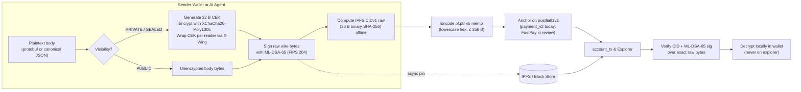
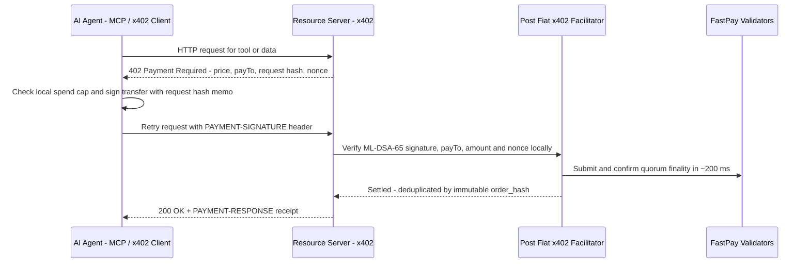

> **Scope & deployment status (27 November 2026):**
> - **Merged on `main`:** Canonical protobuf schemas (`proto/postfiat/message/v1/message.proto`, [`postfiatl1v2#288`](https://github.com/postfiatorg/postfiatl1v2/pull/288)), Python & JavaScript codecs and x402/MCP facilitator code ([`postfiatl1v2#289`](https://github.com/postfiatorg/postfiatl1v2/pull/289)), and block-explorer decoding views ([`postfiatorg.github.io#56`](https://github.com/postfiatorg/postfiatorg.github.io/pull/56)).
> - **Verified live on `postfiat-wan-devnet-2` (Blocks `1923–1930`):** **Eight** live `payment_v2` transactions carrying `pf.ptr` v5 memos (7 encrypted messages—including 1-to-1, multi-recipient group, 3-sender thread, direct `SEALED`, **self-payment `SEALED`**, and a 320 KiB 3-chunk encrypted manifest—plus 1 `PUBLIC` signed dispatch), alongside pre-block key-binding checks and 9 local negative controls (tampering, chunk attacks, cross-chain replay, spoofed sender, and foreign re-anchoring). The live run exercised the merged `python/postfiat_rpc/message_protocol.py` wire codec using pure-Python reference crypto libraries (`kyber-py==1.2.0`, `dilithium-py==1.5.1`, `pycryptodome`, `cryptography`)—**not** the production constant-time Rust/WASM wallet backend. Full raw receipts are published at [`devnet2-live-verification-20261127.json`](/evidence/message-protocol/devnet2-live-verification-20261127.json).
> - **Built & in review (not yet live on devnet-2):** Sub-second FastPay fee floors and `order_hash` indexing in `account_tx` ([`postfiatl1v2#295`](https://github.com/postfiatorg/postfiatl1v2/pull/295)), browser Rust/WASM crypto ([`postfiatl1v2#303`](https://github.com/postfiatorg/postfiatl1v2/pull/303)), Task Node FastPay reward payouts ([`tasknode#450`](https://github.com/postfiatorg/tasknode/pull/450)), and connecting the x402 facilitator from unit/refusal harnesses to live FastPay validators.

<div class="glance">
  <div><b>8 Live Devnet-2 Txs</b><span>Blocks 1923–1930 · 7 encrypted + 1 public · 6/6 validator consensus</span></div>
  <div><b>X-Wing + ML-DSA-65</b><span>ML-KEM-768 + X25519 hybrid KEM · FIPS 204 raw-byte signatures</span></div>
  <div><b>76–100 B On-Chain Memo</b><span>pf.ptr v5 CIDv1 raw pointer · 5.5–9.8 KB off-chain envelopes · 16 MiB manifests</span></div>
  <div><b>FastPay &amp; x402 In Review</b><span>Fee floor, account_tx order_hash &amp; live validator adapter pending cutover</span></div>
</div>

**Plain-language overview:** Post Fiat L1v2 is a post-quantum Layer-1 blockchain where wallets, validators, and autonomous AI agents exchange payments alongside structured messages (task instructions, reward receipts, governance disclosures, and API settlement proofs). Because blockchains cannot afford to store megabytes of encrypted text directly in consensus state, every Post Fiat message splits into two pieces: a compact pointer (`76–100 bytes`) attached to a normal on-chain transaction, and a signed, optionally encrypted content-addressed payload stored off-chain (IPFS CIDv1 `raw`). This post documents the merged wire format (`postfiat.message.v1`), its explicit threat model and metadata limits, an 8-transaction live verification run on our 6-validator devnet, and the next-wave FastPay and x402 extensions currently in code review.

On Post Fiat's legacy XRPL-derived chain, `pf.ptr` v4 message pointers were hand-encoded across three languages without a shared schema, used uppercase hex (rejected by `postfiatl1v2`), encrypted payloads with classical X25519 only, omitted a sender signature over the full envelope, published plaintext SHA-256 hashes, and included the Task Node server as a default reader. `postfiat.message.v1` replaces that ad-hoc layer with one cross-language protocol.

---

## 1. Wire Format & Cryptographic Design

Every message—1-to-1 private chat, multi-recipient group dispatch, sealed drop, public announcement, or multi-chunk attachment—follows one pipeline:



### Canonical Schema, Raw-Byte Signing & `pf.ptr` v5 Memos

1. **Single `.proto` source of truth (`proto/postfiat/message/v1/message.proto`):**
   `Pointer`, `Envelope`, `MessageHeader`, `XWingEncryptionHeader`, `RecipientWrap`, `Manifest`, `MessageKeyBinding`, `TextMessage`, and `X402PaymentPayload` are defined in `postfiat.message.v1`, alongside sibling governance (`postfiat.governance.v1`) and NFT (`postfiat.nft.v1`) schemas. Python (`python/postfiat_rpc/message_protocol.py`) and JavaScript (`wallet-proxy/message-protocol.js`) codecs are tested against shared byte vectors (`scripts/test-message-protocol-vectors.py`), including 48-byte SHA3-384 transaction digests. Third-party applications can define custom schemas permissionlessly via `schema_id = 1` plus a full `schema_name` string.

2. **Zero re-serialization signature verification:**
   Protobuf encoders in different languages can emit fields in different orders or omit default values, breaking naive "decode → re-encode → verify" schemes. `Envelope` stores `header_bytes`, `encryption_header_bytes`, and `body_bytes` as **opaque raw byte fields**. Verifiers check:
   - the 36-byte IPFS CIDv1 `raw` digest against the exact envelope bytes; and
   - the sender's **FIPS 204 ML-DSA-65** signature (`1,952 B` public key, `3,309 B` signature, domain tag `postfiat-l1-v2/message-envelope/v1`) over those exact transmitted bytes
   **before** decoding inner protobuf fields. Malformed or tampered envelopes fail prior to parsing or decryption.

3. **Compact on-chain `pf.ptr` v5 memos (`<= 256 B`):**
   `postfiatl1v2` consensus caps transactions at `<= 4` memos, `<= 256` decoded bytes per memo, and `<= 512` total decoded memo bytes, strictly **lowercase hex**. A `pf.ptr` v5 memo encodes:
   - `memo_type`: `"pf.ptr"` (`70662e707472`, 6 bytes)
   - `memo_format`: `"v5"` (`7635`, 2 bytes)
   - `memo_data`: lowercase-hex canonical protobuf `Pointer` bytes carrying the 36-byte binary CIDv1 `raw` hash (`0x01 0x55 0x12 0x20 || sha256`) or compact inline bytes for small commitments.
   Measured live on devnet-2, single-block pointers occupy **`68 B` of `memo_data` (`76 B` total)** and multipart manifest pointers occupy **`92 B` (`100 B` total)**—leaving ample headroom under the 256-byte cap. Pure messages with no external value transfer anchor as a standard self-payment (`from == to`), requiring no custom L1 transaction type.

### Hybrid Encryption: X-Wing + XChaCha20-Poly1305

Private and sealed envelopes use **X-Wing** (`draft-connolly-cfrg-xwing-kem`), combining **FIPS 203 ML-KEM-768** and **X25519** via a SHA3-256 combiner, paired with **XChaCha20-Poly1305** symmetric AEAD:

| Component | Exact Wire Size | Specification |
| --- | ---: | --- |
| **ML-DSA-65 auth (per envelope)** | `5,261 B` | `1,952 B` public key + `3,309 B` signature (FIPS 204) |
| **X-Wing public key** | `1,216 B` | `1,184 B` ML-KEM-768 encapsulation key `\|\|` `32 B` X25519 public key |
| **X-Wing ciphertext (per reader)** | `1,120 B` | `1,088 B` ML-KEM-768 ciphertext `\|\|` `32 B` X25519 ephemeral public key |
| **Shared secret combiner** | `32 B` | `SHA3-256(ss_MLKEM \|\| ss_X25519 \|\| ct_X25519 \|\| pk_X25519 \|\| 0x5c2e2f2f5e5c)` |
| **Wrapped Content Key (CEK)** | `48 B` | `32 B` random CEK encrypted under HKDF-SHA256 KEK + `16 B` Poly1305 tag (`24 B` nonce) |
| **Recipient `key_id` tag** | `32 B` | `SHA-256` fingerprint of the recipient's `1,216 B` X-Wing public key |
| **Body / chunk AEAD** | `XChaCha20-Poly1305` | AAD = `postfiat-l1-v2/message-aad/v1 \|\| chain_id \|\| header_bytes \|\| chunk_index` |

- **Measured off-chain PQ overhead:** Post-quantum signatures and hybrid KEM wraps are not small. Measured directly on our devnet-2 test envelopes, a short text message produces **`5,488 B`** when `PUBLIC` (0 wraps), **`8,162 B`** when `PRIVATE` 1-to-1 (2 wraps: recipient + sender copy), and **`9,539 B`** for a 3-wrap group dispatch (`~1,377 B` per added reader wrap). Because only the `76–100 B` `pf.ptr` v5 pointer touches L1 consensus, this overhead stays off-chain in content-addressed storage.
- **Multi-chunk encrypted `Manifest` (up to 16 MiB):** Payloads above the 1 MiB single-envelope cap split into ordered encrypted chunks (e.g., 128 KiB), each encrypted under the same CEK with a fresh 24-byte nonce and its own `chunk_index` in the AEAD AAD. Two distinct mechanisms protect multi-chunk integrity:
  - The **signed `Manifest`** commits to the exact ordered list of chunk CIDs, per-chunk byte lengths, and `total_plaintext_bytes`—preventing **truncation** or missing chunks.
  - The per-chunk **`chunk_index` AAD** binds each ciphertext block to its exact slot index, `chain_id`, and `header_bytes`—preventing **reordering** or **cross-message chunk splicing** even if an attacker bypasses CID checks.
  No plaintext SHA-256 digest is ever published in cleartext.

---

## 2. Threat Model, Metadata Limits, Discovery & Storage Availability

Post-quantum encryption protects ciphertext confidentiality against a future quantum attacker holding only public ciphertexts ("harvest-now, decrypt-later"). It does **not** magically erase on-chain metadata, solve key-compromise forward secrecy, or guarantee off-chain storage availability. Below are the exact boundaries.

### What Observers Can and Cannot Learn

| Mode & Anchor Pattern | On-Chain (`account_tx` / block) Observer Learns | Off-Chain (IPFS block) Observer Learns | Hidden From Non-Recipients |
| --- | --- | --- | --- |
| **`PUBLIC`** (direct or self-payment) | Sender, destination, amount, fee, timestamp, memo size (`76 B`), CID | Everything (plaintext body, sender pubkey, thread ID) | Nothing (authenticated integrity only) |
| **`PRIVATE`** (direct `Alice → Bob`) | Sender, **anchor destination (`Bob`)**, amount, fee, timing, CID | Sender pubkey/account, header metadata, explicit `recipient_account` hints, reader count, approximate body length | Plaintext body, `Manifest` chunk plaintexts |
| **`SEALED` (direct `Charlie → Bob`, Block `1927`)** | Sender, **anchor destination (`Bob`)**, amount, fee, timing, CID | Sender pubkey/account, **no `recipient_account` strings**, reader count, **32-byte `recipient_key_id` tags**, approximate body length | Plaintext body; explicit account strings in IPFS header *(on-chain destination is NOT hidden)* |
| **`SEALED` (self-payment `Charlie → Charlie`, Block `1930`)** | Sender (`Charlie`), `to == Charlie` (**no recipient address on-chain**), fee, timing, CID | Sender pubkey/account, **no `recipient_account` strings**, reader count, **32-byte `recipient_key_id` tags**, approximate body length | Plaintext body **and** on-chain recipient address |

**Critical `SEALED` limitation (`recipient_key_id` linkability):** Even when anchored via a self-payment (so the recipient's address never appears in any block or in the recipient's `account_tx`, as verified in Block `1930`), `XWingEncryptionHeader` still carries a static 32-byte `recipient_key_id` per reader wrap so wallets can find their wrap in $O(1)$ without trial-decapsulating every wrap. If a recipient's `MessageKeyBinding` (mapping `account ↔ xwing_public_key ↔ key_id`) is published in a public directory or on-chain identity record, an observer who joins the directory against IPFS envelopes can still link a `SEALED` envelope back to that recipient's `key_id`. True unlinkable anonymous messaging requires single-use ephemeral KEM keys or trial decapsulation without static `key_id`s, which `postfiat.message.v1` does not claim to provide.

### Signature Scope, Anchor Binding, Re-Anchoring & Key Distribution

- **Exact signed preimage (`envelope_signing_preimage`):** Every envelope signature signs the length-prefixed raw-byte concatenation:

  ```text
  "postfiat-l1-v2/message-envelope/v1" || 0x00 ||
  uint32_be(version) ||
  uint32_be(len(header_bytes)) || header_bytes ||
  uint32_be(len(encryption_header_bytes)) || encryption_header_bytes ||
  uint32_be(len(body_bytes)) || body_bytes
  ```

  Because `header_bytes` encodes `MessageHeader`—which carries `chain_id`, `sender_account`, `created_at_unix_ms`, `visibility`, `schema_name`, `thread_id`, and `reply_to_cid`—the ML-DSA-65 signature binds `chain_id` and `sender_account` for **all** visibilities, including `PUBLIC` messages (where `encryption_header_bytes` is empty). Length-prefixing each section prevents cross-field boundary ambiguity.
- **Disjoint domain separation across key uses:** Although a wallet reuses its ML-DSA-65 account keypair across L1 transactions, message envelopes, and key bindings, each surface uses a disjoint domain separator: FIPS 204 context `postfiat-l1-v2/tx/v1` for L1 transactions, prefix `postfiat-l1-v2/message-envelope/v1` for envelopes, and prefix `postfiat-l1-v2/message-key-bind/v1` for `MessageKeyBinding` records. A signature from one surface cannot validate on another.
- **Why signatures are PQ-only (`ML-DSA-65`) while encryption is hybrid (`X-Wing`):** Confidentiality faces a decades-long retroactive ("harvest-now, decrypt-later") exposure window, so hybrid X-Wing hedges both ML-KEM-768 and X25519 for only 32 extra bytes per wrap. Authentication only requires unforgeability *at verification time* before BFT block finalization, and Post Fiat L1v2 accounts are already native ML-DSA-65—using the same account key lets verifiers derive the L1 address directly from `envelope.sender_pubkey` without maintaining a second classical signing key.
- **Mandatory caller-level anchor binding & re-anchoring rules:** Because the envelope CID must be computed offline *before* creating the anchoring transaction, `tx_id` and block height are **not** inside the signed preimage—and `open_envelope()` in the wire codec verifies only the CID and ML-DSA-65 signature over raw bytes. Every wallet, explorer, and application verifier **must** enforce three additional checks against the L1 transaction context:
  1. `header.chain_id == expected_chain_id` (stops cross-chain replay, e.g., devnet envelopes re-anchored on mainnet);
  2. `derive_l1_account_address(envelope.sender_pubkey) == header.sender_account` where address derivation is `"pf" || hex(SHA3-384("postfiat.address.v1\x00" || sender_pubkey)[:20])` (stops a signer from forging another user's `sender_account` in `MessageHeader`); and
  3. `header.sender_account == anchoring_tx.from` (stops third-party CID re-anchoring: if Eve copies Alice's valid Block `1923` CID into Eve's own transaction, Alice's envelope signature still verifies, so verifiers reject foreign anchors unless `header.sender_account == anchoring_tx.from`—and deduplicate repeated self-anchors by `(cid, sender_account)`).
- **Key-binding distribution for unfunded (`0 PFT`) wallets:** At onboarding, a `0 PFT` wallet signs its `MessageKeyBinding` (`chain_id`, `account`, `xwing_public_key`, `key_id`, `created_at_unix_ms`, `key_epoch`) with its ML-DSA-65 account key and posts it to Task Node's onboarding registry. Recipients verify `derive_l1_account_address(account_pubkey) == account`, `key_id == SHA-256(xwing_public_key)`, and the ML-DSA-65 signature—so Task Node cannot forge a key binding for an address it does not control. However, until the user funds their wallet and publishes an on-chain identity record, Task Node acts as the distribution directory and could theoretically withhold a binding or serve a stale `key_epoch`; once published on-chain, the on-chain identity record is authoritative and clients cross-check against it.

### Forward-Secrecy Tradeoff, Key Compromise & Rotation

- **Zero-balance bootstrap vs. forward secrecy:** New users start with `0 PFT` and cannot submit an on-chain identity transaction before receiving their first Task Node reward. To let a brand-new wallet receive an encrypted first payout—and recover message history from one backup phrase—the default bootstrap X-Wing keypair is derived deterministically from the wallet's master seed (`HKDF-SHA256`, domain `postfiat-l1-v2/message-key/v1`), bound by an ML-DSA-65 `MessageKeyBinding` (`postfiat-l1-v2/message-key-bind/v1`).
- **Real compromise risk:** Deterministic seed derivation gives up **incoming forward secrecy**. If an attacker compromises a user's master seed or long-term X-Wing decapsulation key—far more likely today than a fault-tolerant quantum computer—they can retroactively decrypt every historical ciphertext harvested for that key. That reproduces the same retrospective exposure X-Wing prevents against quantum cryptanalysis.
- **Rotation & revocation path:** `MessageKeyBinding` includes a monotonically increasing `key_epoch`. Once a wallet is funded and active, it can publish a fresh non-seed-derived (or rotated-epoch) X-Wing keypair and retire prior epochs so new incoming messages stop encrypting to older keys. However, retiring a key only protects *future* messages; already-anchored ciphertexts remain bound to the key that wrapped them, and automated epoch rotation / revocation UX is still wallet-level rollout work rather than an L1 consensus primitive.
- **Reader policy:** Task Node is included as an encrypted reader only on Task Node lifecycle/reward schemas that the server must process—never on user-to-user messages or shielded transfers.

### Recipient Discovery & Discovery Privacy Tradeoffs

When a message has multiple recipients (e.g., `Alice → [Bob, Charlie]` anchored to `Bob` in Block `1924`) or uses a self-payment anchor (`Charlie → Charlie` in Block `1930`), non-payee recipients will **not** see the transaction in their own `account_tx` history. Each discovery mechanism carries its own metadata tradeoff:

| Discovery Mechanism | How Recipients Learn `(tx_id, cid)` | What Leaks to Infrastructure Observers | Recommended Fit |
| --- | --- | --- | --- |
| **Sender-indexed polling** | Poll `account_tx` for known contacts/channels and match `recipient_key_id` (Block `1930`) | RPC node observes which sender addresses a client polls (mitigated by running a local node or batch-polling) | Small trusted groups or local-node users |
| **Off-chain relay hint** | Relay (`relay.postfiat.org`, `ops/nostr-relay/`) or app server pushes `(tx_id, cid)` hint; client still verifies CID + ML-DSA-65 on L1 | Relay operator learns push timing and subscriber graph (cannot forge or decrypt payloads) | Interactive chats and Task Node notifications |
| **Opt-in `key_id` indexer** | Indexer scans `pf.ptr` v5 pointers and serves matches for subscribed 32-byte `recipient_key_id`s | Indexer learns subscriber `key_id` watchlists and query timing | Public/semi-public inboxes where convenience outweighs watch-graph privacy |

### Off-Chain IPFS Pinning & Availability

An on-chain `pf.ptr` v5 memo guarantees **existence, ordering, and tamper-evidence** (via the 36-byte SHA-256 CIDv1 `raw` hash), not permanent off-chain data hosting:

- **Task Node traffic, governance packets, and Post Fiat NFT metadata:** Task Node pins these envelopes asynchronously through a durable retry outbox so transient pinning hiccups do not block payment confirmation or drop CIDs on browser tab close.
- **Third-party & user-to-user apps:** External builders pin their own envelopes (or pay a pinning provider via x402).
- **Failure mode:** If all copies of an off-chain IPFS block are garbage-collected before a recipient fetches it, the on-chain pointer and transaction remain valid, but the message body is permanently unrecoverable.

---

## 3. Live Devnet-2 Verification (Blocks 1923–1930)

We tested the wire protocol on the live 6-validator **`postfiat-wan-devnet-2`** network on **27 November 2026** using a standalone funded Python harness (`pf-message-test-env`) that imports the exact merged `python/postfiat_rpc/message_protocol.py` codec (`postfiatl1v2#289`, commit `3c10aa0513`).

**Important toolchain disclosure:** The harness pairs the merged wire codec with pure-Python reference cryptographic packages—`kyber-py==1.2.0` (`ML_KEM_768`, FIPS 203), `dilithium-py==1.5.1` (`ML_DSA_65`, FIPS 204), `cryptography` (`X25519`), and `pycryptodome` (`ChaCha20_Poly1305` with 24-byte XChaCha20 nonces). `kyber-py` and `dilithium-py` are **non-constant-time educational/reference implementations** suitable for wire-format and live devnet integration testing, **not** for production secret-key handling. Production browser/desktop signing and KEM run in Rust/WASM (`crates/wallet_wasm`, [`postfiatl1v2#303`](https://github.com/postfiatorg/postfiatl1v2/pull/303), currently in review).

The complete, sanitized machine-readable receipt packet (zero private keys) is published in this repository at [`/evidence/message-protocol/devnet2-live-verification-20261127.json`](/evidence/message-protocol/devnet2-live-verification-20261127.json).

### Chain Snapshot & Exact Atom Reconciliation

- **Chain:** `postfiat-wan-devnet-2` (**6/6 validators converged**, `mempool_pending = [0, 0, 0, 0, 0, 0]`)
- **Genesis hash (SHA3-384, 48 B):** `ce22ca8c932da0998b484483a09647138a30e0bf44408dd49a8d6d452787ad25521aff3ed334da07e150a7233a3e90a9`
- **Final block height:** `1930`
- **Final block tip hash:** `94731796878850b5509fc9d2adbfecc8862c6ba4713bbc9c17b87899978d2076da30b6684cd8eb2c2ce2ffb6da9bdc69`
- **Final state root:** `a7248db228fb08e1b3c03e37413a1f77b598d26b93e4517751e66324ee579d680dd181478ec6a808ec0c2eb7cd9f750e`

| Test Wallet | On-Chain Address | Initial Atoms | Final Atoms (Seq) | X-Wing `key_id` (32 B, prefix) | `MessageKeyBinding` |
| --- | --- | ---: | ---: | --- | --- |
| **Alice** | `pf6d2d0a000bb5c1feda7da2df955cfe0a78c788c9` | `200,000` | `199,711` (`seq 4`) | `ab3230536886467e…` | Verified pre-1923 |
| **Bob** | `pf721bb3b98bceeeebfb835d97dac6a7b4a72c797a` | `200,000` | `200,378` (`seq 1`) | `e5f40742cfcb516b…` | Verified pre-1923 |
| **Charlie** | `pfef21b496662a755d19c7c04fc37a8ed8af86a091` | `200,000` | `199,734` (`seq 3`) | `0971617dec92fd69…` | Verified pre-1923 |
| **Eve** *(outsider)* | `pf31e18f9533fc38839234a90aeb25629ebaac093a` | `200,000` | `200,000` (`seq 0`) | `16c7a1ebd8d24137…` | Verified pre-1923 |

**Exact balance reconciliation:** Starting total `800,000 atoms` (`0.800000 PFT`) → final total `799,823 atoms` (`199,711 + 200,378 + 199,734 + 200,000`). The **`177 atoms`** burned equal exactly `7 × 22 atoms` (the seven `76 B` memos) + `1 × 23 atoms` (Block `1929`'s `100 B` multipart manifest memo). Every `100`-atom attached transfer conserved across wallets, and Block `1930`'s self-payment (`Charlie → Charlie`) deducted only the `22`-atom fee (`199,756 → 199,734`).

### Eight Live On-Chain Message Transactions (Blocks 1923–1930)

Each transaction below was signed by the sender's ML-DSA-65 key, anchored via `payment_v2` carrying a lowercase-hex `pf.ptr` v5 memo, finalized across all 6 validators, fetched back via `account_tx`, and verified against its CID and ML-DSA-65 signature (with local X-Wing decryption on the 7 encrypted rows):

| Block | Mode & Anchor | Full On-Chain `tx_id` (48 B SHA3-384) | IPFS CIDv1 (`raw`) & Envelope Size | Observed Result |
| ---: | --- | --- | --- | --- |
| **`1923`** | `PRIVATE` 1-to-1 (`Alice → Bob`) | `c8b7f540228331c773f0be66d92bac47a4e34c91b75a0c2b43cac53052a561cd97afcbc62b69fb7c0a3a280760ace3f2` | `bafkreihx2tfnjrdfjk6w7fq5pmnauaamtqxzjlghnqtl5cjconrfniulnu` (`8,162 B` env · `76 B` memo) | Bob & Alice sender-copy decrypted; Eve had no matching `RecipientWrap` |
| **`1924`** | `PRIVATE` group (`Alice → [Bob, Charlie]`, anchor `Bob`) | `1484c78c9e02475ff867b3db9199b6a9671066bdb1d871a93cff64a60f92dcd0f093c709fa0b069340b9ac56fe212791` | `bafkreihdokv7wfjd6r5kyu7tf2itbij5ug4c5wt57ei2fuoqspuo77p7zq` (`9,539 B` env · 3 wraps) | Single ciphertext; Bob & Charlie decrypted identically; Eve rejected |
| **`1925`** | `PRIVATE` thread reply #1 (`Bob → [Alice, Charlie]`, `live-thread-f9815b56`) | `253342e9861bf78a1ec1668870c62b7032ff27c2600f61c6987d50afa21eb484674095af11ea033f77c29804a0a4e85b` | `reply_to_cid` → Block `1924` CID | Alice decrypted & verified Bob's ML-DSA-65 signature + reply link |
| **`1926`** | `PRIVATE` thread reply #2 (`Charlie → [Alice, Bob]`, `live-thread-f9815b56`) | `0483906c1b57b5bc224d91985fcfe07bbe5ddf55ae5e80e6e8dc9a4bc20eaeb67b93a4b79beca33938fe399ebf2452ea` | `reply_to_cid` → Block `1925` CID | Alice & Bob decrypted; 3 distinct ML-DSA-65 senders verified in thread |
| **`1927`** | `SEALED` direct (`Charlie → Bob`, exposes payee on-chain) | `4a999c08f0be5bd9a8b280cea75f7a21d784746d2b856ade7eb3d393c3be98c194ff4800ea57544340beef331696f808` | `bafkreih5m3t44nh5kck6z4tfvxgboslafij73seqadfebd2ela6abg6gui` (`8,075 B` env) | Zero `recipient_account` strings in header; Bob decrypted by `key_id`; Eve rejected |
| **`1928`** | `PUBLIC` signed (`Alice → Bob`, unencrypted) | `c57ead3054861bff84e8947884f5672a14f92bd7b2f039fe440cc276be7977eaf010197eb4892e061178a0246ea963c3` | `bafkreie3x6km7obhasbkx3yl5xy2uzogjbskpwjkwbrdd3tgefnbs4kwz4` (`5,488 B` env) | Read & ML-DSA-65 signature verified by Eve without decryption |
| **`1929`** | `PRIVATE` 320 KiB 3-chunk `Manifest` (`Alice → [Bob, Charlie]`) | `697117e66111cb057813e1451e970c2cd946b99eed50a05765ad37e5ca6bed72172746a602f9f354d2229df056055444` | `bafkreifuhlb5nq4hjokl7t3edyfzh6yn2drvqdksr5gz5hruwqhh2cqrha` (`9,832 B` env · `100 B` memo) | `327,680 B` (`128+128+64 KiB`) reassembled byte-for-byte by Bob & Charlie (`SHA-256 b7c24200…17b`) |
| **`1930`** | **`SEALED` self-payment (`Charlie → Charlie`, readable by Bob)** | `6fa3b8e19af9772b7011075af87e114ba87d0ae397f18d7738f398d08674a1dac33b0acc72ee0a90a4b42f62305fc4f0` | `bafkreib2ktfa6ducqfyuh4fx627acjfutace7eudkxduceizjetj5bkhdi` (`8,077 B` env · `76 B` memo) | `from == to == Charlie` (**Bob absent from Block `1930` on-chain `account_tx`**); Bob discovered via Charlie's `account_tx` & decrypted; Eve rejected |

*(Block `1929` encrypted chunk CIDs inside the signed manifest: `bafkreiegkschilopdhomw5nxxqxh4ixr6byj35wlvepebgx7rhxdecpoa4`, `bafkreig3v6si5nng7rj42h6gs5752zrjvn64xaso6dytl44o5lgz475aki`, and `bafkreihnzshsdmr4j34x5pgfxlisgybrsylakfy3oais2i3k2u3qt6bwx4`.)*

### Local Negative Controls (Executed on Live Envelopes & Chunks)

| Attack Tested | Target Artifact | Observed Rejection Error |
| --- | --- | --- |
| **1-bit signature flip** | Block `1923` envelope | `MessageProtocolError: Envelope raw-byte signature verification failed` *(before header decode)* |
| **1-bit raw block tamper vs. CID** | Block `1923` envelope | `MessageProtocolError: IPFS CIDv1 raw multibase mismatch` |
| **Chunk reorder (`[1, 0, 2]`)** | Block `1929` 3-chunk manifest | `MessageProtocolError: IPFS CIDv1 raw binary digest mismatch` |
| **Chunk truncation (`[0, 1]`)** | Block `1929` 3-chunk manifest | `MessageProtocolError: block count does not match manifest.chunks length` |
| **Chunk-index AAD splice (chunk 1 decrypted under slot 0 AAD)** | Block `1929` chunk 1 (bypassing CID check) | `MessageProtocolError: XChaCha20-Poly1305 authentication failed` |
| **1-bit ciphertext tamper on chunk 1** | Block `1929` chunk 1 (bypassing CID check) | `MessageProtocolError: XChaCha20-Poly1305 authentication failed` |
| **Cross-chain replay (`wrong chain_id`)** | Block `1923` envelope verified against `postfiat-mainnet-1` | `MessageProtocolError: Envelope chain_id mismatch: got 'postfiat-wan-devnet-2', expected 'postfiat-mainnet-1'` |
| **Foreign-sender CID re-anchoring** | Alice's Block `1923` CID verified with Eve as `anchoring_tx.from` | `MessageProtocolError: Foreign re-anchor rejected: header.sender_account pf6d2d… != anchoring tx.from pf31e1…` |
| **Spoofed `sender_account` in header** | Eve signs with Eve's ML-DSA-65 key claiming Alice's address | `MessageProtocolError: Envelope sender_pubkey address pf31e1… != header.sender_account pf6d2d…` |

### Python Harness Example (Self-Payment `SEALED` + Sender-Indexed Discovery)

```python
from pf_message_test_env import MessageTestEnvironment, Visibility

env = MessageTestEnvironment()
env.bootstrap(("alice", "bob", "charlie", "eve"))

# Anchor a SEALED message via self-payment (Charlie -> Charlie) so Bob's address
# never appears in the on-chain payment_v2 transaction or in XWingEncryptionHeader
receipt = env.send_message(
    sender_name="charlie",
    recipient_names=["bob"],
    text="Self-payment sealed drop from Charlie readable by Bob",
    visibility=Visibility.SEALED,
    thread_id="live-thread-f9815b56",
    anchor_self=True,
)

# Bob discovers the pointer by polling Charlie's account_tx (or via relay hint),
# verifies CID + ML-DSA-65 over raw bytes, and decrypts via his 32-byte recipient_key_id
msgs = env.read_onchain_messages_for_address(
    query_address=env.wallet("charlie").address,
    decrypt_as_wallet="bob",
    from_height=receipt.height,
    to_height=receipt.height,
)
assert msgs[0].text == "Self-payment sealed drop from Charlie readable by Bob"
```

---

## 4. Planned Next Rollout: FastPay Fee Floor, `account_tx` Indexing & Task Node Payouts

The live verification above settled over `payment_v2` consensus blocks. For sub-second (`~200 ms`) Task Node reward payouts and interactive agent micropayments, `postfiatl1v2` also has an owned-object **FastPay** lane (`OwnedTransferOrderV3`). Today FastPay accepts zero fees and enforces a hard 100,000 chain-wide owned-object cap, and applied FastPay transfers are not yet indexed into `account_tx`.

Two open PRs currently in final review close those gaps before devnet-2 cutover:

### 1. FastPay Computation + New-Object Fee Floor ([`postfiatl1v2#295`](https://github.com/postfiatorg/postfiatl1v2/pull/295))

To deter free object-splitting spam without blocking object consolidation, validators enforce:

```text
min_fee_atoms = 25 + ceil(tx_bytes / 512) + max(0, outputs - inputs) * 1_000 + inputs
```

The real cost depends directly on whether a transaction creates a net-new owned object:

| FastPay Pattern | Inputs → Outputs | Net New Objects | Approximate Minimum Fee (`<= 512 B` order) |
| --- | --- | ---: | ---: |
| **Self-transfer message or exact spend** | `1 → 1` | `0` | **`~27 atoms`** (`0.000027 PFT`) |
| **Consolidating 20 small payout objects** | `20 → 1` | `0` | **`~46 atoms`** (`0.000046 PFT`) |
| **Standard payment with recipient + change output** | `1 → 2` | `1` | **`~1,027 atoms`** (`0.001027 PFT`) |
| **Object-splitting fan-out (`1 → 100`)** | `1 → 100` | `99` | **`~99,027 atoms`** (`0.099027 PFT`) |

**Honest scope note vs. Sui:** Unlike Sui's full storage-fund model, v1 charges the `1,000`-atom net-new-object fee **without a 99% refundable storage rebate** on later merges or unwraps (refundable rebates are deferred to a future protocol upgrade). Whether `0.001 PFT` per net-new object suffices as an anti-bloat deterrent depends on PFT's market price and remains tunable via validator governance alongside per-account soft limits.

### 2. Canonical `order_hash` Indexing & Crash-Safe Task Node Payouts ([`tasknode#450`](https://github.com/postfiatorg/tasknode/pull/450))

Because FastPay validator certificates can have different `certificate_digest` hashes depending on which quorum of validator signatures arrives first, `postfiatl1v2#295` indexes applied FastPay transfers and unwraps directly into `account_tx` and `tx` keyed by **`order_hash`**—the immutable hash of the signed `OwnedTransferOrderV3`.

In `tasknode#450`, Task Node leases owned payout objects under database row locks and persists `(payout_id, object_id, order_hash, signed_order_bytes)` *before* submitting to validators. On crash or timeout, recovery polls or resubmits that exact `order_hash` rather than signing a conflicting order on the same object, and falls back to `payment_v2` only after confirming the FastPay order was not certified and retiring/replacing the leased object.

On the **block explorer**, public messages decode in place with escaped text and zero script execution. Encrypted Task Node payouts display a **`"Task reward"`** badge only when the verified ML-DSA-65 envelope signer matches the pinned official Task Node payout public key—any other sender's `pf.reward.v1` envelope renders as a generic private message. Decryption always runs locally in the user's wallet or Mac app.

---

## 5. Planned Agent Payments Over x402 (+ MCP Wrapper)

Post Fiat ships an **x402 v2** payment codec, facilitator, and thin **Model Context Protocol (MCP)** wrapper (`tools/x402-facilitator/`, merged in [`postfiatl1v2#289`](https://github.com/postfiatorg/postfiatl1v2/pull/289)) targeting two rails: native **`PFT` over FastPay** for sub-second API/tool calls and **`pfUSDC` on the consensus lane** for dollar-denominated settlement.



**Current verification boundary:** `tools/x402-facilitator/test_x402_e2e.js` and `test_x402_refusals.js` verify local edge validation (rejecting invalid ML-DSA-65 signatures, wrong `payTo` addresses, underpayments, expired deadlines, and nonces under rate limits before contacting validators), replica-safe deduplication on immutable `order_hash` / `tx_hash`, and local MCP spend caps—all against **deterministic in-memory/mock validator harnesses**. Wiring the facilitator to live devnet-2 FastPay validators and running live `402 → pay → 200` settlement tests happens immediately after `postfiatl1v2#295` deploys.

---

## 6. Component Status Matrix & References

| Component | Status (27 Nov 2026) | Source / Artifact |
| --- | --- | --- |
| **Canonical `.proto` schemas & 48-byte SHA3-384 vectors** | **Merged on `main`** (`223769bdc9`) | [`postfiatl1v2#288`](https://github.com/postfiatorg/postfiatl1v2/pull/288) · `proto/postfiat/message/v1/message.proto` |
| **Python & JS codecs, x402 facilitator, MCP wrapper, relay packaging** | **Merged on `main`** (`3c10aa0513`) | [`postfiatl1v2#289`](https://github.com/postfiatorg/postfiatl1v2/pull/289) · `python/postfiat_rpc/message_protocol.py` · `wallet-proxy/message-protocol.js` |
| **Live 6-validator devnet-2 run (`payment_v2`, `pf.ptr` v5)** | **Executed (Blocks `1923–1930`, 8 txs + 9 negative controls)** | [`devnet2-live-verification-20261127.json`](/evidence/message-protocol/devnet2-live-verification-20261127.json) *(test-only Python crypto backends)* |
| **Explorer Message views & technical guide** | **Live on postfiat.org** | [`postfiatorg.github.io#56`](https://github.com/postfiatorg/postfiatorg.github.io/pull/56) · [`/docs/message-protocol/`](/docs/message-protocol/) |
| **FastPay fee floor & `order_hash` `account_tx` indexing** | **Open PR (CI green, final review)** | [`postfiatl1v2#295`](https://github.com/postfiatorg/postfiatl1v2/pull/295) |
| **Production Rust/WASM wallet crypto, Task Node FastPay payouts & Mac UI** | **Open PRs (CI green, pending devnet-2 cutover)** | [`postfiatl1v2#303`](https://github.com/postfiatorg/postfiatl1v2/pull/303) · [`tasknode#450`](https://github.com/postfiatorg/tasknode/pull/450) · [`tasknode-apple#41`](https://github.com/postfiatorg/tasknode-apple/pull/41) |

For full protobuf wire definitions, domain-separation constants, and x402 header schemas, see the [Post-Quantum Message Protocol, FastPay & x402 Technical Guide](/docs/message-protocol/) and [`docs/specs/message-protocol-v1.md`](https://github.com/postfiatorg/postfiatl1v2/blob/main/docs/specs/message-protocol-v1.md).
