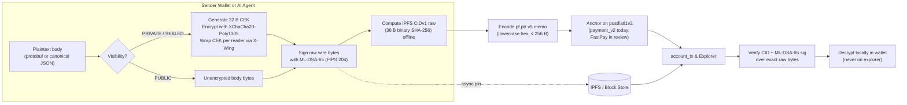
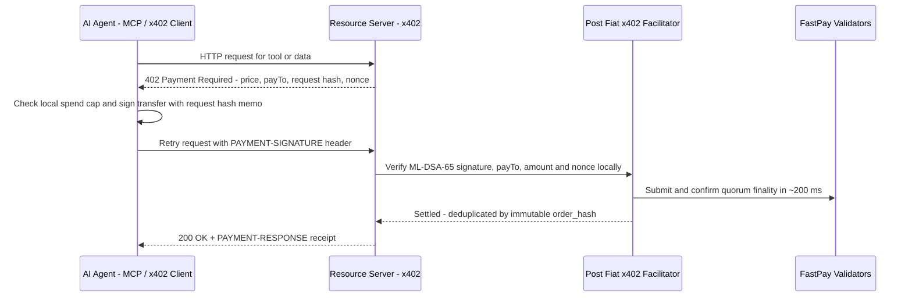

Post Fiat L1v2 is a post-quantum Layer-1 blockchain where wallets, validators, and AI agents attach structured messages—task instructions, reward receipts, governance disclosures, and API settlement proofs—to payments. Storing kilobytes or megabytes of encrypted text inside consensus state is impractical, so every message splits into two pieces: a compact pointer (`76–100 B`) embedded in a normal transaction memo, and a signed, optionally encrypted content-addressed payload stored off-chain (IPFS CIDv1 `raw`).

On Post Fiat's legacy XRPL-derived chain, `pf.ptr` v4 pointers were hand-encoded across three languages without a shared schema, used uppercase hex (which `postfiatl1v2` rejects), encrypted bodies with classical X25519 only, omitted a sender signature over the full envelope, published plaintext SHA-256 hashes, and added the Task Node server as a default reader. `postfiat.message.v1` replaces that layer with one canonical protobuf specification.

### Deployment & Verification Scope (27 November 2026)

| Component | Current Status | Boundary & Source |
| --- | --- | --- |
| Canonical `.proto` schemas & 48 B SHA3-384 vectors | **Merged on `main`** (`223769bdc9`) | [`postfiatl1v2#288`](https://github.com/postfiatorg/postfiatl1v2/pull/288) · `proto/postfiat/message/v1/message.proto` |
| Python & JS codecs, x402 facilitator, MCP wrapper, relay ops | **Merged on `main`** (`3c10aa0513`) | [`postfiatl1v2#289`](https://github.com/postfiatorg/postfiatl1v2/pull/289) · `python/postfiat_rpc/message_protocol.py` · `wallet-proxy/message-protocol.js` |
| Live `postfiat-wan-devnet-2` run (Blocks `1923–1930`) | **Executed** (8 txs + 9 negative controls) | [`devnet2-live-verification-20261127.json`](/evidence/message-protocol/devnet2-live-verification-20261127.json) — exercises the merged Python codec with pure-Python reference crypto (`kyber-py==1.2.0`, `dilithium-py==1.5.1`, `pycryptodome`, `cryptography`), **not** constant-time production Rust/WASM; 6 negative controls hit the merged codec and 3 test caller-level anchor checks not yet inside `open_envelope()` |
| Explorer decoding views & technical guide | **Live on postfiat.org** | [`postfiatorg.github.io#56`](https://github.com/postfiatorg/postfiatorg.github.io/pull/56) · [`/docs/message-protocol/`](/docs/message-protocol/) |
| FastPay fee floor, `order_hash` `account_tx` indexing, Rust/WASM wallet, Task Node FastPay payouts, live x402 adapter | **In review (not yet live)** | [`postfiatl1v2#295`](https://github.com/postfiatorg/postfiatl1v2/pull/295) · [`postfiatl1v2#303`](https://github.com/postfiatorg/postfiatl1v2/pull/303) · [`tasknode#450`](https://github.com/postfiatorg/tasknode/pull/450) · [`tasknode-apple#41`](https://github.com/postfiatorg/tasknode-apple/pull/41) |

<div class="glance">
  <div><b>8 Live Devnet-2 Txs</b><span>Blocks 1923–1930 · 7 encrypted + 1 public · 6/6 validator consensus</span></div>
  <div><b>X-Wing + ML-DSA-65</b><span>ML-KEM-768 + X25519 hybrid KEM · FIPS 204 raw-byte signatures</span></div>
  <div><b>76–100 B On-Chain</b><span>pf.ptr v5 CIDv1 raw pointer · 5.5–9.8 KB off-chain envelopes</span></div>
  <div><b>FastPay &amp; x402 In Review</b><span>Fee floor, Rust/WASM crypto &amp; live validator adapter pending cutover</span></div>
</div>

---

## 1. Wire Format & Cryptographic Construction

Every message—1-to-1 private chat, multi-recipient group dispatch, sealed drop, public announcement, or multi-chunk attachment—follows one pipeline:



### Canonical Protobufs, Raw-Byte Signing & `pf.ptr` v5 Memos

1. **One `.proto` source of truth (`proto/postfiat/message/v1/message.proto`):** Core types (`Pointer`, `Envelope`, `MessageHeader`, `XWingEncryptionHeader`, `RecipientWrap`, `Manifest`, `MessageKeyBinding`, `TextMessage`, `X402PaymentPayload`) live in `postfiat.message.v1` alongside governance (`postfiat.governance.v1`) and NFT (`postfiat.nft.v1`) schemas. Python and JavaScript codecs pass shared cross-language byte vectors (`scripts/test-message-protocol-vectors.py`), including 48-byte SHA3-384 transaction digests. Third-party apps can define custom schemas permissionlessly using `schema_id = 1` with a full `schema_name` string.
2. **Zero re-serialization verification:** Protobuf encoders across languages can emit fields in different orders or omit default values, breaking "decode → re-encode → verify" schemes. `Envelope` keeps `header_bytes`, `encryption_header_bytes`, and `body_bytes` as opaque raw byte fields. Verifiers check the 36-byte CIDv1 `raw` hash and the FIPS 204 ML-DSA-65 signature over those exact transmitted bytes *before* decoding any inner protobuf field.
3. **Compact on-chain `pf.ptr` v5 memos (`<= 256 B`):** Consensus enforces `<= 4` memos per transaction, `<= 256` decoded bytes per memo, `<= 512` total decoded memo bytes, and lowercase hex only. A `pf.ptr` v5 memo sets `memo_type` to `"pf.ptr"` (`70662e707472`, 6 B), `memo_format` to `"v5"` (`7635`, 2 B), and `memo_data` to lowercase-hex protobuf `Pointer` bytes carrying the 36-byte binary CIDv1 `raw` prefix (`0x01 0x55 0x12 0x20 || sha256`) or compact inline bytes. Live single-block pointers occupy `68 B` of `memo_data` (`76 B` total) and multipart manifest pointers occupy `92 B` (`100 B` total). Pure messages with no external value transfer anchor via a standard self-payment (`from == to`).

### Hybrid Encryption: X-Wing + XChaCha20-Poly1305

Private and sealed envelopes encrypt the payload once under a fresh random 32-byte Content Encryption Key (CEK) with XChaCha20-Poly1305, and wrap that CEK per recipient using **X-Wing** (`draft-connolly-cfrg-xwing-kem`, combining FIPS 203 ML-KEM-768 and X25519 via SHA3-256):

| Component | Wire Size | Specification |
| --- | ---: | --- |
| ML-DSA-65 auth (per envelope) | `5,261 B` | `1,952 B` public key + `3,309 B` signature (FIPS 204) |
| X-Wing public key | `1,216 B` | `1,184 B` ML-KEM-768 encapsulation key `\|\|` `32 B` X25519 public key |
| X-Wing ciphertext (per reader) | `1,120 B` | `1,088 B` ML-KEM-768 ciphertext `\|\|` `32 B` X25519 ephemeral key |
| Shared secret combiner | `32 B` | `SHA3-256(ss_MLKEM \|\| ss_X25519 \|\| ct_X25519 \|\| pk_X25519 \|\| 0x5c2e2f2f5e5c)` |
| Wrapped CEK | `48 B` | `32 B` CEK encrypted under HKDF-SHA256 KEK + `16 B` Poly1305 tag (`24 B` nonce) |
| Recipient `key_id` tag | `32 B` | `SHA-256` fingerprint of the recipient's `1,216 B` X-Wing public key |
| AEAD context (`aad_context`) | `32 B` | `SHA-256("postfiat-l1-v2/message-aad/v1" \|\| 0x00 \|\| chain_id \|\| 0x00 \|\| SHA-256(header_bytes) \|\| uint32_be(chunk_index))` |

**Measured off-chain PQ overhead:** Post-quantum envelopes carry substantial off-chain weight. On our live devnet-2 text messages, a `PUBLIC` envelope (0 wraps) measures `5,488 B` (dominated by the `5,261 B` ML-DSA-65 pubkey + signature). Adding `XWingEncryptionHeader`, its `32 B` `aad_context`, `24 B` body nonce, `16 B` Poly1305 tag, and two wraps (recipient + sender copy) brings a 1-to-1 `PRIVATE` envelope to `8,162 B` (`8,075 B` for `SEALED`, which drops two `42 B` `recipient_account` strings and framing). Each additional recipient wrap adds `~1,377 B` (`1,120 B` X-Wing ciphertext, `48 B` wrapped CEK, `32 B` `key_id`, `24 B` wrap nonce, `42 B` account hint, and protobuf framing). Because only the `76–100 B` pointer touches L1 consensus, this overhead stays off-chain.

**Multi-chunk encrypted `Manifest` (up to 16 MiB):** Payloads exceeding the 1 MiB single-envelope cap split into ordered encrypted chunks (e.g., 128 KiB) sharing the envelope's CEK, each with a fresh 24-byte nonce. Two separate layers enforce multi-chunk integrity: the signed `Manifest` commits to the exact ordered list of chunk CIDs, per-chunk byte lengths, and `total_plaintext_bytes` (preventing truncation), while `compute_aad_context` binds each block's Poly1305 tag to its `uint32_be(chunk_index)`, `chain_id`, and `SHA-256(header_bytes)` (preventing reordering and cross-message splicing even without CID checks). No plaintext SHA-256 digest is published.

---

## 2. Threat Model, Metadata Limits & Operational Boundaries

X-Wing protects stored ciphertexts against a future quantum attacker holding only public data. It does not hide on-chain transaction metadata, provide forward secrecy against master-seed compromise, or guarantee off-chain storage retention.

### What Observers Learn by Visibility Mode

| Mode & Anchor | On-Chain (`account_tx` / Block) Observer Sees | Off-Chain (IPFS Block) Observer Sees | Hidden From Non-Recipients |
| --- | --- | --- | --- |
| `PUBLIC` | Sender, destination, amount, fee, timing, memo size (`76 B`), CID | Everything (plaintext body, header, sender pubkey) | Nothing (integrity only) |
| `PRIVATE` (direct `Alice → Bob`) | Sender, destination (`Bob`), amount, fee, timing, CID | Cleartext `MessageHeader` (`sender_account`, `thread_id`, `reply_to_cid`, `schema_name`, `created_at_unix_ms`), sender pubkey, explicit `recipient_account` hints, reader count, approximate body length | Plaintext body and chunk plaintexts |
| `SEALED` direct (`Charlie → Bob`, Block `1927`) | Sender, destination (`Bob`), amount, fee, timing, CID | Cleartext `MessageHeader` fields above, sender pubkey, no `recipient_account` strings, reader count, 32 B `recipient_key_id` tags, approximate body length | Plaintext body and explicit account strings in IPFS header *(destination is still public on-chain)* |
| `SEALED` self-payment (`Charlie → Charlie`, Block `1930`) | Sender (`Charlie`), `to == Charlie` (no recipient address on-chain), fee, timing, CID | Cleartext `MessageHeader` fields above, sender pubkey, no `recipient_account` strings, reader count, 32 B `recipient_key_id` tags, approximate body length | Plaintext body and on-chain recipient address |

**What `SEALED` actually provides—and does not provide:** When a recipient's `MessageKeyBinding` (`account ↔ xwing_public_key ↔ key_id`) is published in a public directory or on-chain identity record, `SEALED` does **not** achieve unlinkable anonymity. The sender is always in cleartext, and an observer who joins the key directory against IPFS blocks can link the static 32-byte `recipient_key_id` back to the recipient. In practice, self-payment `SEALED` keeps the recipient's address off the L1 ledger and omits explicit account strings from IPFS headers—reducing casual graph scraping, not defeating a determined metadata analyst. In addition, because `Envelope.header_bytes` is authenticated-but-unencrypted, production `SEALED` senders must omit or randomize `thread_id` and `reply_to_cid` (placing thread references inside the encrypted body); reusing a group `thread_id` links the sealed drop straight back to that thread's participants.

### Signature Scope, Anchor Binding, Re-Anchoring & Key Distribution

- **Exact signed preimage (`envelope_signing_preimage`):**
  ```text
  "postfiat-l1-v2/message-envelope/v1" || 0x00 ||
  uint32_be(version) ||
  uint32_be(len(header_bytes)) || header_bytes ||
  uint32_be(len(encryption_header_bytes)) || encryption_header_bytes ||
  uint32_be(len(body_bytes)) || body_bytes
  ```
  Because `header_bytes` encodes `MessageHeader`, the ML-DSA-65 signature covers `chain_id`, `sender_account`, `created_at_unix_ms`, `visibility`, `schema_name`, `thread_id`, and `reply_to_cid` on all visibilities including `PUBLIC`.
- **Cross-domain separation:** Although wallets reuse one ML-DSA-65 account keypair across L1 transactions, envelopes, and key bindings, each surface uses a disjoint domain separator: FIPS 204 context `postfiat-l1-v2/tx/v1` for L1 transactions, prefix `postfiat-l1-v2/message-envelope/v1` for envelopes, and prefix `postfiat-l1-v2/message-key-bind/v1` for `MessageKeyBinding`.
- **Why signatures are ML-DSA-65 only while encryption is hybrid X-Wing:** Post Fiat L1v2 account ownership is natively ML-DSA-65. A break in ML-DSA-65 would already compromise the L1 account itself, so adding a second classical message-signature keypair would not protect account identity, whereas hybrid X-Wing hedges stored ciphertext confidentiality independently of L1 signing.
- **Anchor-binding gap in the merged codec:** Because the CID is computed offline before building the transaction, `tx_id` and block height are not inside the signed preimage. In the merged `python/postfiat_rpc/message_protocol.py` (`postfiatl1v2#289`), `open_envelope()` verifies only the CID and raw-byte ML-DSA-65 signature. Verifying L1 authenticity requires three additional checks:
  1. `header.chain_id == expected_chain_id` (stops cross-chain replay);
  2. `derive_l1_account_address(envelope.sender_pubkey) == header.sender_account`, using `"pf" || hex(SHA3-384("postfiat.address.v1\x00" || sender_pubkey)[:20])` (stops forged `sender_account` claims); and
  3. `header.sender_account == anchoring_tx.from` (stops third-party CID re-anchoring, where Eve copies Alice's valid CID into Eve's transaction; repeated self-anchors deduplicate on `(cid, sender_account)`).
  Today these three checks live in our harness caller (`decrypt_cid_for_wallet()`) rather than inside `open_envelope()`. Promoting `expected_chain_id` and `expected_tx_sender` into `open_envelope()` as required parameters is planned before production wallet cutover so callers cannot omit them.
- **Key-binding distribution for `0 PFT` wallets:** Unfunded onboarding wallets sign a `MessageKeyBinding` with their ML-DSA-65 account key and upload it to Task Node's onboarding registry. Any verifier checks `derive_l1_account_address(account_pubkey) == account`, `key_id == SHA-256(xwing_public_key)`, and the ML-DSA-65 signature, so Task Node cannot forge a binding for an address it does not control. Until the user funds the account and publishes an on-chain identity record, however, Task Node controls directory availability and could withhold a binding or serve a stale `key_epoch`; once published on-chain, the on-chain identity record is authoritative.

### Forward-Secrecy Tradeoff, Discovery & IPFS Availability

- **Forward secrecy vs. single-seed recovery:** The bootstrap X-Wing keypair derives deterministically from the wallet master seed (`HKDF-SHA256`, domain `postfiat-l1-v2/message-key/v1`) so `0 PFT` wallets can receive encrypted first payouts and restore history from one seed phrase. This intentionally gives up **incoming forward secrecy**: compromising the master seed or long-term decapsulation key retroactively decrypts every historical ciphertext encrypted to that key—a far more immediate risk than a quantum computer. `MessageKeyBinding.key_epoch` supports rotating to fresh non-seed-derived keys once funded (protecting *future* messages), though automated rotation/revocation UX is still wallet-level rollout work. Task Node is included as a reader only on Task Node lifecycle/reward schemas, never on user-to-user messages.
- **Recipient discovery tradeoffs:** Non-payee recipients of group (`Alice → [Bob, Charlie]`) or self-payment `SEALED` messages will not find the anchor transaction in their own `account_tx`. Each discovery channel carries a metadata cost:

| Discovery Path | Mechanism | Metadata Exposed to Infrastructure | Best Fit |
| --- | --- | --- | --- |
| Sender-indexed polling | Poll known senders' `account_tx` and match `recipient_key_id` (Block `1930`) | RPC node sees which senders a client watches (mitigated by a local node) | Small groups or local-node users |
| Off-chain relay hint | Relay (`ops/nostr-relay/`) or app pushes `(tx_id, cid)`; client verifies on L1 | Relay sees push timing and subscriber graph (cannot forge or decrypt) | Interactive chat & Task Node alerts |
| Opt-in `key_id` indexer | Indexer scans `pf.ptr` v5 pointers for subscribed 32 B `key_id`s | Indexer learns subscriber `key_id` watchlists and query timing | Public/convenience inboxes |

- **IPFS pinning & retention:** An on-chain pointer proves existence, ordering, and integrity, not data persistence. Task Node pins Task Node traffic, governance packets, and Post Fiat NFT metadata via an async durable retry outbox; third-party apps pin their own traffic or pay a pinning service. If all off-chain copies of an unpinned block are lost, the on-chain pointer remains valid but the body is unrecoverable.

---

## 3. Live Devnet-2 Verification (Blocks 1923–1930)

We ran an 8-transaction live verification on our 6-validator **`postfiat-wan-devnet-2`** network on **27 November 2026** using a standalone Python harness (`pf-message-test-env`) backed by the merged `python/postfiat_rpc/message_protocol.py` wire codec and pure-Python reference crypto (`kyber-py==1.2.0` `ML_KEM_768`, `dilithium-py==1.5.1` `ML_DSA_65`, `cryptography` `X25519`, `pycryptodome` 24-byte-nonce `ChaCha20_Poly1305`). Those Python crypto packages are **not constant-time** and are used strictly for wire-format and devnet integration testing; production signing and KEM target Rust/WASM (`crates/wallet_wasm`, `postfiatl1v2#303`).

Full sanitized receipts (zero private keys) live at [`/evidence/message-protocol/devnet2-live-verification-20261127.json`](/evidence/message-protocol/devnet2-live-verification-20261127.json).

### Chain Snapshot & Atom-Exact Reconciliation

- **Chain:** `postfiat-wan-devnet-2` (6/6 validators converged, `mempool_pending = [0, 0, 0, 0, 0, 0]`)
- **Genesis hash (48 B SHA3-384):** `ce22ca8c932da0998b484483a09647138a30e0bf44408dd49a8d6d452787ad25521aff3ed334da07e150a7233a3e90a9`
- **Final height `1930` tip:** `94731796878850b5509fc9d2adbfecc8862c6ba4713bbc9c17b87899978d2076da30b6684cd8eb2c2ce2ffb6da9bdc69`
- **Final state root:** `a7248db228fb08e1b3c03e37413a1f77b598d26b93e4517751e66324ee579d680dd181478ec6a808ec0c2eb7cd9f750e`

| Wallet | Address | Initial Atoms | Final Atoms (Seq) | 32 B X-Wing `key_id` (prefix) |
| --- | --- | ---: | ---: | --- |
| Alice | `pf6d2d0a000bb5c1feda7da2df955cfe0a78c788c9` | `200,000` | `199,711` (`seq 4`) | `ab3230536886467e…` |
| Bob | `pf721bb3b98bceeeebfb835d97dac6a7b4a72c797a` | `200,000` | `200,378` (`seq 1`) | `e5f40742cfcb516b…` |
| Charlie | `pfef21b496662a755d19c7c04fc37a8ed8af86a091` | `200,000` | `199,734` (`seq 3`) | `0971617dec92fd69…` |
| Eve *(outsider)* | `pf31e18f9533fc38839234a90aeb25629ebaac093a` | `200,000` | `200,000` (`seq 0`) | `16c7a1ebd8d24137…` |

Starting total `800,000 atoms` → final total `799,823 atoms`: exactly **`177 atoms`** burned across 8 transactions (`7 × 22 atoms` for `76 B` memos + `1 × 23 atoms` for Block `1929`'s `100 B` multipart memo). Every `100`-atom transfer conserved across wallets, and Block `1930`'s self-payment deducted only the `22`-atom fee (`199,756 → 199,734`).

### Eight Live On-Chain Message Transactions (Blocks 1923–1930)

Each transaction below was signed by the sender's ML-DSA-65 key, anchored via `payment_v2` with a lowercase-hex `pf.ptr` v5 memo, finalized 6/6, fetched via `account_tx`, CID- and signature-verified, and decrypted locally on the 7 encrypted rows:

| Block | Mode & Anchor | Full `tx_id` (48 B SHA3-384) | CIDv1 (`raw`) & Measured Size | Outcome |
| ---: | --- | --- | --- | --- |
| `1923` | `PRIVATE` 1-to-1 (`Alice → Bob`) | `c8b7f540228331c773f0be66d92bac47a4e34c91b75a0c2b43cac53052a561cd97afcbc62b69fb7c0a3a280760ace3f2` | `bafkreihx2tfnjrdfjk6w7fq5pmnauaamtqxzjlghnqtl5cjconrfniulnu` (`8,162 B` env · `76 B` memo) | Bob & Alice sender-copy decrypted; Eve had no matching wrap |
| `1924` | `PRIVATE` group (`Alice → [Bob, Charlie]`, anchor `Bob`) | `1484c78c9e02475ff867b3db9199b6a9671066bdb1d871a93cff64a60f92dcd0f093c709fa0b069340b9ac56fe212791` | `bafkreihdokv7wfjd6r5kyu7tf2itbij5ug4c5wt57ei2fuoqspuo77p7zq` (`9,539 B` env · 3 wraps) | Single ciphertext; Bob & Charlie decrypted identically; Eve rejected |
| `1925` | `PRIVATE` thread reply #1 (`Bob → [Alice, Charlie]`) | `253342e9861bf78a1ec1668870c62b7032ff27c2600f61c6987d50afa21eb484674095af11ea033f77c29804a0a4e85b` | `reply_to_cid` → Block `1924` CID *(full receipt in JSON)* | Alice decrypted & verified Bob's ML-DSA-65 sig + reply link |
| `1926` | `PRIVATE` thread reply #2 (`Charlie → [Alice, Bob]`) | `0483906c1b57b5bc224d91985fcfe07bbe5ddf55ae5e80e6e8dc9a4bc20eaeb67b93a4b79beca33938fe399ebf2452ea` | `reply_to_cid` → Block `1925` CID *(full receipt in JSON)* | Alice & Bob decrypted; 3 distinct ML-DSA-65 senders verified |
| `1927` | `SEALED` direct (`Charlie → Bob`, exposes payee on-chain) | `4a999c08f0be5bd9a8b280cea75f7a21d784746d2b856ade7eb3d393c3be98c194ff4800ea57544340beef331696f808` | `bafkreih5m3t44nh5kck6z4tfvxgboslafij73seqadfebd2ela6abg6gui` (`8,075 B` env) | Zero `recipient_account` strings in header; Bob decrypted by `key_id`; Eve rejected |
| `1928` | `PUBLIC` signed (`Alice → Bob`, unencrypted) | `c57ead3054861bff84e8947884f5672a14f92bd7b2f039fe440cc276be7977eaf010197eb4892e061178a0246ea963c3` | `bafkreie3x6km7obhasbkx3yl5xy2uzogjbskpwjkwbrdd3tgefnbs4kwz4` (`5,488 B` env) | Read & ML-DSA-65 signature verified by Eve |
| `1929` | `PRIVATE` 320 KiB 3-chunk `Manifest` (`Alice → [Bob, Charlie]`) | `697117e66111cb057813e1451e970c2cd946b99eed50a05765ad37e5ca6bed72172746a602f9f354d2229df056055444` | `bafkreifuhlb5nq4hjokl7t3edyfzh6yn2drvqdksr5gz5hruwqhh2cqrha` (`9,832 B` env · `100 B` memo) | `327,680 B` (`128+128+64 KiB`) reassembled byte-for-byte (`SHA-256 b7c24200…17b`) |
| `1930` | `SEALED` self-payment (`Charlie → Charlie`, readable by Bob) | `6fa3b8e19af9772b7011075af87e114ba87d0ae397f18d7738f398d08674a1dac33b0acc72ee0a90a4b42f62305fc4f0` | `bafkreib2ktfa6ducqfyuh4fx627acjfutace7eudkxduceizjetj5bkhdi` (`8,077 B` env · `76 B` memo) | `from == to == Charlie` (Bob absent from Block `1930` `account_tx`); Bob discovered via Charlie's `account_tx` & decrypted; Eve rejected *(note: test run reused `live-thread-f9815b56`; production sealed drops should omit `thread_id`)* |

*(Block `1929` chunk CIDs inside the manifest: `bafkreiegkschilopdhomw5nxxqxh4ixr6byj35wlvepebgx7rhxdecpoa4`, `bafkreig3v6si5nng7rj42h6gs5752zrjvn64xaso6dytl44o5lgz475aki`, `bafkreihnzshsdmr4j34x5pgfxlisgybrsylakfy3oais2i3k2u3qt6bwx4`.)*

### Nine Local Negative Controls (Merged Codec vs. Harness Caller)

| Attack Tested | Enforced In | Target Artifact | Observed Error |
| --- | --- | --- | --- |
| 1-bit signature flip *(called without `expected_multibase_cid` to isolate signature verification)* | **Merged codec** (`open_envelope`) | Block `1923` envelope | `Envelope raw-byte signature verification failed` |
| 1-bit raw block tamper vs. expected CID | **Merged codec** (`open_envelope`) | Block `1923` envelope | `IPFS CIDv1 raw multibase mismatch` |
| Chunk reorder (`[1, 0, 2]`) | **Merged codec** (`reassemble_manifest_chunks`) | Block `1929` manifest | `IPFS CIDv1 raw binary digest mismatch` |
| Chunk truncation (`[0, 1]`) | **Merged codec** (`reassemble_manifest_chunks`) | Block `1929` manifest | `block count does not match manifest.chunks length` |
| Chunk-index AAD splice (chunk 1 under slot 0 AAD, bypassing CID) | **Merged codec** (`xchacha20_poly1305_decrypt`) | Block `1929` chunk 1 | `XChaCha20-Poly1305 authentication failed` |
| 1-bit ciphertext tamper on chunk 1 (bypassing CID) | **Merged codec** (`xchacha20_poly1305_decrypt`) | Block `1929` chunk 1 | `XChaCha20-Poly1305 authentication failed` |
| Cross-chain replay (`wrong chain_id`) | **Caller / harness** (`decrypt_cid_for_wallet`) | Block `1923` vs. `postfiat-mainnet-1` | `Envelope chain_id mismatch` |
| Foreign-sender CID re-anchoring | **Caller / harness** (`decrypt_cid_for_wallet`) | Block `1923` with Eve as `tx.from` | `Foreign re-anchor rejected: header.sender_account != anchoring tx.from` |
| Spoofed `sender_account` in header | **Caller / harness** (`decrypt_cid_for_wallet`) | Eve signs claiming Alice's address | `Envelope sender_pubkey address != header.sender_account` |

### Python Harness Pattern (Recommended Production `SEALED` Self-Payment)

```python
from pf_message_test_env import MessageTestEnvironment, Visibility

env = MessageTestEnvironment()
env.bootstrap(("alice", "bob", "charlie", "eve"))

# Self-payment anchor (Charlie -> Charlie) keeps Bob's address off L1.
# Omit thread_id so the cleartext MessageHeader cannot be linked to a group thread
# (our Block 1930 devnet test reused live-thread-f9815b56 for run grouping).
receipt = env.send_message(
    sender_name="charlie",
    recipient_names=["bob"],
    text="Self-payment sealed drop from Charlie readable by Bob",
    visibility=Visibility.SEALED,
    thread_id="",
    anchor_self=True,
)

# Bob discovers the tx via Charlie's account_tx (or a relay hint), verifies CID,
# ML-DSA-65 signature, chain_id, and sender binding, and decrypts via recipient_key_id
msgs = env.read_onchain_messages_for_address(
    query_address=env.wallet("charlie").address,
    decrypt_as_wallet="bob",
    from_height=receipt.height,
    to_height=receipt.height,
)
assert msgs[0].text == "Self-payment sealed drop from Charlie readable by Bob"
```

---

## 4. Planned Extensions in Review: FastPay Fee Discipline & x402 Agent Payments

The live verification above ran over `payment_v2` consensus blocks. Two follow-on extensions are implemented and in review to add sub-second (`~200 ms`) owned-object settlement and machine-native API payments on top of the exact same `pf.ptr` v5 wire format:

### FastPay Fee Floor, `order_hash` Indexing & Task Node Payouts (`postfiatl1v2#295`, `tasknode#450`)

Today's FastPay lane (`OwnedTransferOrderV3`) accepts zero fees, caps chain-wide owned objects at 100,000, and does not index applied transfers into `account_tx`. `postfiatl1v2#295` enforces a computation + net-new-object fee floor:

```text
min_fee_atoms = 25 + ceil(tx_bytes / 512) + max(0, outputs - inputs) * 1_000 + inputs
```

| FastPay Pattern | Inputs → Outputs | Assumed Order Size | Net New Objects | Approximate Minimum Fee |
| --- | --- | ---: | ---: | ---: |
| Self-transfer message or exact spend | `1 → 1` | `<= 512 B` | `0` | `~27 atoms` (`0.000027 PFT`) |
| Consolidating 20 small payout objects | `20 → 1` | `~1.5 KB` | `0` | `~48 atoms` (`0.000048 PFT`) |
| Standard payment with recipient + change | `1 → 2` | `<= 512 B` | `1` | `~1,027 atoms` (`0.001027 PFT`) |
| Object-splitting fan-out (`1 → 100`) | `1 → 100` | `~4 KB` | `99` | `~99,034 atoms` (`0.099034 PFT`) |

Unlike Sui's full storage-fund design, v1 charges the `1,000`-atom net-new-object fee **without** a 99% refundable storage rebate on later merges (deferred to a future upgrade), and the `0.001 PFT` deterrent floor remains governance-tunable alongside per-account soft limits. Applied FastPay transfers and unwraps index into `account_tx` and `tx` keyed by immutable **`order_hash`** (never malleable validator certificate digests). In `tasknode#450`, Task Node leases owned payout objects under DB row locks and persists `(payout_id, object_id, order_hash, signed_order_bytes)` before submitting so crash recovery always retries the exact same `order_hash`, while the block explorer shows a `"Task reward"` badge only when the verified envelope signer matches the pinned official Task Node payout public key.

### x402 Agent Payments & MCP Wrapper (`tools/x402-facilitator/`, merged in `postfiatl1v2#289`)

The x402 v2 facilitator and thin MCP wrapper target native `PFT` over FastPay (`~200 ms`) and `pfUSDC` on the consensus lane: an API replies `402 Payment Required` with price, `payTo`, request hash, and nonce; the agent enforces local spend caps, signs a transfer embedding the request hash, and retries with `PAYMENT-SIGNATURE`.



`test_x402_e2e.js` and `test_x402_refusals.js` currently verify local edge validation, replica-safe `order_hash` / `tx_hash` deduplication, and MCP spend caps against **deterministic in-memory harnesses**. Connecting the facilitator to live devnet-2 FastPay validators follows immediately after `postfiatl1v2#295` deploys.

---

For full protobuf wire definitions, domain-separation constants, and x402 header schemas, see the [Post-Quantum Message Protocol, FastPay & x402 Technical Guide](/docs/message-protocol/) and [`docs/specs/message-protocol-v1.md`](https://github.com/postfiatorg/postfiatl1v2/blob/main/docs/specs/message-protocol-v1.md).
