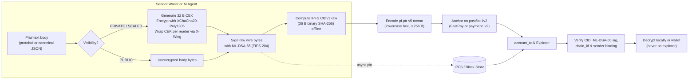

When wallets, validators, and AI agents coordinate work on a blockchain, payments rarely travel alone. A task payout carries a receipt; a governance vote carries a disclosure packet; two wallets exchange an encrypted thread. Putting kilobytes of encrypted payloads directly into consensus blocks does not scale—especially with post-quantum cryptography, where a single signature and public key already exceed 5 KB.

Post Fiat L1v2 splits every message into two parts:

1. **A compact on-chain pointer (`54–100 B`)** inside a normal transaction memo, anchoring existence, ordering, and a cryptographic fingerprint.
2. **A signed, optionally encrypted off-chain envelope** stored as a content-addressed IPFS block (CIDv1 `raw`), fetched and decrypted locally by wallets—never on a block explorer.

`postfiat.message.v1` replaces legacy hand-encoded `pf.ptr` v4 memos (classical X25519, no full-envelope signature, plaintext hashes) with one cross-language post-quantum wire format across Rust, JavaScript, and Python.

<div class="glance">
  <div><b>54–100 B On-Chain</b><span>Canonical pf.ptr v5 protobuf memos under the 256 B L1 cap</span></div>
  <div><b>Key-Committing X-Wing</b><span>ML-KEM-768 + X25519 · 32 B cek_commitment · blinded SEALED tags</span></div>
  <div><b>4.96 ms Open · 763/s Storm</b><span>Measured Node.js @noble/post-quantum &amp; x402 replay defense</span></div>
  <div><b>FastPay + x402 Native</b><span>48 B SHA3-384 order_hash indexing &amp; HTTP 402 agent settlement</span></div>
</div>

---

## 1. Architecture & Wire Format

Every visibility mode—public announcement, 1-to-1 private chat, multi-recipient group dispatch, sealed drop, or multi-chunk attachment—follows the same pipeline:



### Three Load-Bearing Decisions

1. **One canonical `.proto` schema (`proto/postfiat/message/v1/message.proto`):** `Pointer`, `Envelope`, `MessageHeader`, `XWingEncryptionHeader`, `RecipientWrap`, `Manifest`, `MessageKeyBinding`, `TextMessage`, and `X402PaymentPayload` live in one package alongside sibling governance and NFT schemas. Python, JavaScript, and Rust/WASM share one cross-language vector suite. Third-party apps can register custom payloads permissionlessly via `schema_id = 1` paired with a full `schema_name`.
2. **Sign raw wire bytes—never re-serialize protobufs:** Different protobuf encoders can reorder fields or omit defaults, quietly breaking "decode → re-encode → verify" signature checks. `Envelope` stores `header_bytes`, `encryption_header_bytes`, and `body_bytes` as opaque byte fields. Verifiers check the 36-byte CIDv1 `raw` digest and the FIPS 204 ML-DSA-65 signature over those exact transmitted bytes *before* decoding any nested field.
3. **Stay strictly under the 256-byte on-chain memo cap:** `postfiatl1v2` caps transactions at 4 memos, 256 decoded bytes per memo, 512 total memo bytes, and lowercase hex only. A `pf.ptr` v5 memo sets `memo_type` to `"pf.ptr"` (`70662e707472`), `memo_format` to `"v5"` (`7635`), and `memo_data` to canonical protobuf `Pointer` bytes carrying the 36-byte binary CIDv1 `raw` prefix (`0x01 0x55 0x12 0x20 || sha256`) or compact inline bytes. Pointers occupy `54 B` without a thread ID, `76 B` with a thread ID, and `100 B` for a multipart manifest. Pure messages with no external payment anchor via a self-payment (`from == to`).

---

## 2. Hybrid Post-Quantum Cryptography

Private and sealed messages encrypt the body once under a fresh random 32-byte Content Encryption Key (CEK) using XChaCha20-Poly1305, then wrap that CEK per recipient using **X-Wing** (`draft-connolly-cfrg-xwing-kem`), combining FIPS 203 ML-KEM-768 and X25519 through SHA3-256:

| Primitive | Wire Size | Construction |
| --- | ---: | --- |
| ML-DSA-65 auth (per envelope) | `5,261 B` | `1,952 B` public key + `3,309 B` signature (FIPS 204) |
| X-Wing public key | `1,216 B` | `1,184 B` ML-KEM-768 encapsulation key `\|\|` `32 B` X25519 public key |
| X-Wing ciphertext (per reader) | `1,120 B` | `1,088 B` ML-KEM-768 ciphertext `\|\|` `32 B` X25519 ephemeral key |
| X-Wing combiner | `32 B` | `SHA3-256(ss_MLKEM \|\| ss_X25519 \|\| ct_X25519 \|\| pk_X25519 \|\| 0x5c2e2f2f5e5c)` |
| Recipient `key_id` (`PRIVATE`) | `32 B` | `SHA-256` fingerprint of the recipient's `1,216 B` X-Wing public key |
| Blinded recipient tag (`SEALED`) | `32 B` | `SHA-256("postfiat-l1-v2/sealed-recipient-tag/v1\x00" \|\| xwing_ss \|\| aad_context)` |
| Key commitment (`cek_commitment`) | `32 B` | `SHA-256("postfiat-l1-v2/cek-commit/v1\x00" \|\| cek \|\| aad_context)` signed in `XWingEncryptionHeader` |
| Per-slot AAD (`aad_context`) | `32 B` | `SHA-256("postfiat-l1-v2/message-aad/v1\x00" \|\| chain_id \|\| 0x00 \|\| SHA-256(header_bytes) \|\| uint32_be(chunk_index))` |
| Wrap KEK | `32 B` | `HKDF-SHA256(ikm=xwing_ss, salt=aad_context, info="postfiat-l1-v2/xwing-wrap/v1\x00" \|\| key_id)` |
| Wrapped CEK | `48 B` | `32 B` CEK encrypted under KEK + `16 B` Poly1305 tag (`24 B` wrap nonce) |

Key cryptographic properties built into the wire format:

- **Domain-separated ML-DSA-65 signing:** One account keypair signs L1 transactions (`postfiat-l1-v2/tx/v1`), FastPay v3 orders (`postfiat-l1-v2/owned-transfer/v3`), message envelopes (`postfiat-l1-v2/message-envelope/v1`), and key bindings (`postfiat-l1-v2/message-key-bind/v1`). Signatures cannot cross domains. Because L1 account identity is already pure ML-DSA-65, signatures stay pure ML-DSA-65 while encryption uses hybrid X-Wing so confidentiality does not depend on ML-KEM alone.
- **Key-committing AEAD (`cek_commitment`):** Standard XChaCha20-Poly1305 is not key-committing, which would otherwise allow a malicious multi-recipient sender to wrap different CEKs to different readers of the same ciphertext. Including a signed 32-byte `cek_commitment` in `XWingEncryptionHeader` and checking it in constant time before decryption closes key-substitution attacks for 34 bytes on the wire.
- **Anchor binding inside `open_envelope()` / `openEnvelope()`:** Verifiers enforce three bindings automatically: `derive_account_address(sender_pubkey) == header.sender_account`, `header.chain_id == expected_chain_id` (stopping cross-chain replay), and `header.sender_account == expected_tx_sender` (stopping third-party CID re-anchoring).
- **Multi-chunk encrypted `Manifest` (up to 16 MiB):** Single envelopes cap at 1 MiB. Larger payloads split into ordered encrypted chunks sharing the envelope's CEK with fresh 24-byte nonces. The signed `Manifest` commits to ordered chunk CIDs and byte lengths (stopping truncation), while per-chunk `aad_context` binds every ciphertext to its exact slot index, `chain_id`, and `header_bytes` (stopping reordering or cross-message splicing). No plaintext hash is published.
- **Rotatable forward-secret keys (`epoch >= 1`):** New zero-balance accounts derive a Day-0 bootstrap X-Wing key (`epoch 0`) from the wallet seed so onboarding works before any on-chain transaction. Wallets rotate to CSPRNG non-seed keys (`epoch >= 1`) signed under `MessageKeyBinding`, and verifiers enforce monotonic `min_known_epoch` checks to block key-epoch downgrades. Once rotated, a leaked wallet seed cannot decrypt rotated traffic, and deleting retired epoch private keys provides epoch-level forward secrecy.

---

## 3. Privacy Model & Tradeoffs

| Mode | Visible On-Chain | Visible Off-Chain (IPFS Envelope) | Hidden From Non-Recipients |
| --- | --- | --- | --- |
| `PUBLIC` | Sender, payee, amount, fee, time, memo, CID | Plaintext body, header, sender pubkey | Nothing (authenticity & ordering only) |
| `PRIVATE` | Sender, payee, amount, fee, time, CID | `MessageHeader` (`sender_account`, `thread_id`, `reply_to_cid`, `schema_name`, timestamp), sender pubkey, `recipient_account` hints, reader count, approx. size | Plaintext body & chunk plaintexts |
| `SEALED` (self-payment) | Sender (`from == to`), fee, time, `54 B` memo, CID | `MessageHeader` (with `thread_id` & `reply_to_cid` omitted), sender pubkey, reader count, per-message blinded 32 B recipient tags, `cek_commitment` | Plaintext body, on-chain payee, thread linkage, and public key-directory correlation |

In `SEALED` mode, each `RecipientWrap` replaces the static `SHA-256(xwing_pk)` key ID with a per-message blinded tag derived from the ephemeral X-Wing shared secret, resolved via recipient trial-decapsulation (`5.71 ms` p50 for a 2-reader envelope). Even an observer holding every published `MessageKeyBinding` and every `SEALED` IPFS block cannot link wraps back to recipient public keys. Sender identity, timestamp, schema name, reader count, and approximate size remain visible—`SEALED` provides recipient-private, sender-authenticated drops rather than mixnet anonymity.

Two operational facts follow directly from this design:
- **Non-repudiation:** ML-DSA-65 envelope signatures are non-repudiable, which is required for reward receipts, governance packets, NFT provenance, and auditable agent payments. Where Signal-style deniable 1-to-1 chat is needed, use an off-chain PQXDH/Double-Ratchet session rather than L1-anchored envelopes.
- **Off-chain pinning:** On-chain pointers prove existence, order, and integrity, not permanent storage. Task Node pins Task Node traffic, governance packets, and Post Fiat NFT metadata via an async durable retry outbox; third-party apps pin their own blocks or use a pinning service.

---

## 4. FastPay Payouts, Wallets & x402 Agent Payments

The `pf.ptr` v5 wire format powers the full L1v2 payment stack:

- **FastPay fee discipline & `order_hash` indexing:** L1 FastPay enforces a Sui-inspired minimum fee (`25 + ceil(tx_bytes / 512) + max(0, outputs - inputs) * 1,000 + inputs` atoms) to prevent free object-splitting spam, raises the owned-object cap, and indexes FastPay transfers and unwraps into `account_tx` and `tx` keyed by immutable 48-byte SHA3-384 `order_hash` (never malleable validator certificate digests).
- **Crash-safe Task Node payouts:** Task Node reward payouts run over FastPay with encrypted `PRIVATE` `pf.reward.v1` memos so task details stay confidential while explorers display a verified `"Task reward"` badge only when the raw-byte ML-DSA-65 signature matches the pinned official payout key. A transactional Postgres store leases `(object_id, version)` rows with `FOR UPDATE SKIP LOCKED`, commits the signed order and first-pin IPFS outbox job atomically before broadcast, recovers exact persisted `order_hash` values across crashes without double-paying, and pins to IPFS asynchronously so storage I/O never stalls settlement.
- **Browser & Mac wallets:** The Rust/WASM wallet (`crates/wallet_wasm`) handles unified v2 BIP-39 KDF, raw-byte envelope signing, X-Wing key derivation, and FastPay v3 signing. The native macOS app (`tasknode-apple`) provides encrypted message history (`V2MessagesView`) and crash-resumable one-click FastPay → `PFSH03` *Make private* flows with light-client quorum finality verification.
- **x402 v2 agent payments (+ MCP wrapper):** APIs respond `402 Payment Required` with a canonical `PAYMENT-REQUIRED` protobuf header; `X402HttpClient` and `X402McpClient` enforce per-client budgets and price terms, sign native `OwnedTransferOrderV3` (FastPay) or `SignedPaymentV2` (consensus) transactions anchoring the HTTP `request_hash` in a `51 B` `pf.ptr` v5 `INLINE` memo, and retry with `PAYMENT-SIGNATURE`. The facilitator verifies signatures and memos locally before touching validators, authenticates `>= 2f+1` distinct active-committee ML-DSA-65 votes (`owned_sign_v3` / `owned_apply_v3` + signed `FastPayApplyAckV1`) or native `payment_v2` finality with exact 48-byte `order_hash` / `tx_id` agreement end to end, and deduplicates spent payments durably on immutable payment digests.

---

## 5. Benchmarks & SDK Verification

Measured in `Node.js` (`linux/x64`) with `@noble/post-quantum` and the x402 HTTP facilitator server, alongside end-to-end live verification on `postfiat-wan-devnet-2` (public, private, group, threaded, 320 KiB 3-chunk manifest, blinded `SEALED` with rotated `epoch 1` keys, and live x402 `402 → 200 → 400/409` replay defense; full verifiable dataset in [`devnet2-live-verification-20261127.json`](/evidence/message-protocol/devnet2-live-verification-20261127.json)):

| Operation (`@noble/post-quantum`, `linux/x64`) | Samples | p50 | p95 | Throughput |
| --- | ---: | ---: | ---: | ---: |
| `ML-DSA-65` sign / verify | `40` | `7.69 ms` / `2.04 ms` | `21.85 ms` / `2.88 ms` | `100.0` / `467.5 ops/s` |
| `X-Wing` encap / decap | `40` | `2.41 ms` / `2.69 ms` | `4.09 ms` / `4.69 ms` | `387.0` / `353.7 ops/s` |
| `PRIVATE` 1-reader `sealEnvelope` / `openEnvelope` | `20` | `13.69 ms` / `4.96 ms` | `23.15 ms` / `6.50 ms` | `77.2` / `194.9 ops/s` |
| `PRIVATE` 10-reader `sealEnvelope` / `openEnvelope` | `20` | `31.88 ms` / `5.58 ms` | `62.07 ms` / `6.28 ms` | `28.5` / `177.6 ops/s` |
| Blinded `SEALED` 2-reader `sealEnvelope` / trial-decap `openEnvelope` | `20` | `10.93 ms` / `5.71 ms` | `50.52 ms` / `11.28 ms` | `70.4` / `153.7 ops/s` |
| `320 KiB` 3-chunk `Manifest` split / reassemble | `15` | `3.35 ms` / `3.48 ms` | `6.38 ms` / `4.56 ms` | `265.0` / `277.9 ops/s` |
| x402 HTTP `402 → FastPay ML-DSA sign → 2-of-3 quorum → 200` | `30` | `42.45 ms` | `65.01 ms` | `23.4 calls/s` *(single-thread)* |
| **Concurrent replay storm (`200` simultaneous replays)** | `200` | `261.95 ms` total | — | **`763.5 rejected/s` (`200/200` blocked)** |

### Verifying an Anchored Envelope With the Python SDK

```python
from postfiat_rpc.message_protocol import open_envelope, decode_pointer_v5_memo

# 1. Decode the pf.ptr v5 memo from a finalized account_tx row
ptr = decode_pointer_v5_memo(tx_row["memos"][0], enforce_canonical_order=True)
envelope_bytes = fetch_ipfs_block(ptr.cid_bin)

# 2. Verify CID, ML-DSA-65 raw-byte signature, sender_pubkey -> sender_account,
#    chain_id, and anchoring tx.from in one call, then decrypt via X-Wing
opened = open_envelope(
    envelope_bytes,
    verify_signature_fn=mldsa65_verify,
    expected_cid_bin=ptr.cid_bin,
    expected_chain_id="postfiat-wan-devnet-2",
    expected_tx_sender=tx_row["from"],
    recipient_key_id=my_xwing_key_id,
    xwing_decap_fn=my_xwing_decap,
    enforce_canonical_order=True,
)
```

Full protobuf schemas, domain-separation constants, and x402 header formats live in the [Post-Quantum Message Protocol Technical Guide](/docs/message-protocol/) and [`docs/specs/message-protocol-v1.md`](https://github.com/postfiatorg/postfiatl1v2/blob/main/docs/specs/message-protocol-v1.md).
