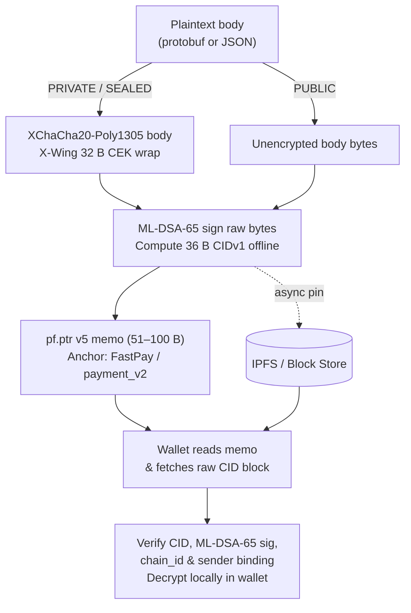
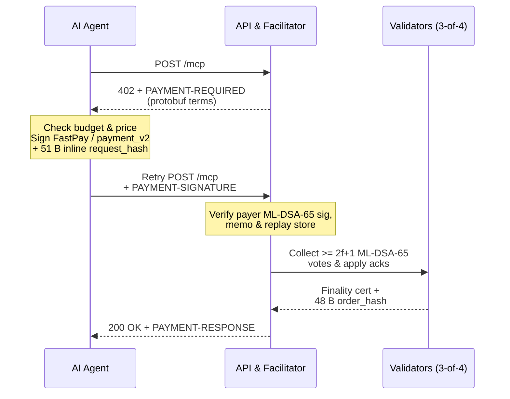

When wallets, validators, and AI agents coordinate work on a blockchain, payments rarely travel alone. A task payout carries a receipt; a governance vote carries a disclosure packet; two wallets exchange an encrypted thread. Putting kilobytes of encrypted payloads directly into consensus blocks does not scale—especially with post-quantum cryptography, where a single ML-DSA-65 public key and signature already take 5,261 bytes.

The Post Fiat Ledger splits every message into two parts:

1. **A compact on-chain pointer (51–100 bytes)** inside a normal transaction memo, anchoring existence, ordering, and a cryptographic fingerprint.
2. **A signed, optionally encrypted off-chain envelope (6,883 bytes for a 1-reader private message)** stored as a content-addressed IPFS block (CIDv1 `raw`), fetched and decrypted locally by wallets—never on a block explorer.

`postfiat.message.v1` replaces the legacy hand-encoded `pf.ptr` v4 memo format (classical X25519, no full-envelope signature, plaintext hashes) with one canonical post-quantum wire format shared across Rust, JavaScript, and Python.

<div class="glance">
  <div><b>51–100 B On-Chain</b><span>Canonical pf.ptr v5 memos under the 256 B L1 cap</span></div>
  <div><b>X-Wing + Key-Committing AEAD</b><span>ML-KEM-768 + X25519 · 32 B cek_commitment · blinded SEALED tags</span></div>
  <div><b>6,883 B Envelope · 4.84 ms Open</b><span>1-reader PRIVATE message · warmed Node.js @noble/post-quantum</span></div>
  <div><b>FastPay + x402 Native</b><span>48 B SHA3-384 order_hash · HTTP 402 agent settlement</span></div>
</div>

### Key Terms

- **`pf.ptr` memo:** A structured Post Fiat transaction memo (`memo_type = "pf.ptr"`, `memo_format = "v5"`) carrying a compact protobuf `Pointer` to an off-chain IPFS envelope or an inline request hash.
- **`payment_v2`:** Post Fiat's standard consensus-finalized account transfer transaction.
- **FastPay:** Post Fiat's consensusless payment lane for owned objects, where a payer collects `>= 2f+1` validator ML-DSA-65 approval votes directly to assemble a finality certificate without waiting for block consensus.
- **Task Node:** The application server that coordinates contributor work on Post Fiat and settles `PFT` reward payouts over FastPay with attached encrypted receipts.

---

## 1. Architecture & Wire Format

Every visibility mode—public announcement, 1-to-1 private chat, multi-recipient group dispatch, sealed drop, or multi-chunk attachment—follows the same pipeline:



### Three Load-Bearing Decisions

1. **One canonical `.proto` schema (`proto/postfiat/message/v1/message.proto`):** `Pointer`, `Envelope`, `MessageHeader`, `XWingEncryptionHeader`, `RecipientWrap`, `Manifest`, `MessageKeyBinding`, `TextMessage`, and `X402PaymentPayload` live in one package alongside sibling governance and NFT schemas. Python, JavaScript, and Rust/WASM share one cross-language vector suite, and third-party apps can register custom payload schemas permissionlessly by setting `schema = 1` (`CUSTOM`) alongside a full `schema_name`.
2. **Sign raw wire bytes—never re-serialize protobufs:** Different protobuf encoders can reorder fields or omit defaults, quietly breaking "decode → re-encode → verify" signature checks. `Envelope` therefore carries its nested messages as opaque byte fields:

```protobuf
message Envelope {
  uint32 version = 1;                // must be 1
  bytes header_bytes = 2;            // exact serialized MessageHeader bytes
  bytes encryption_header_bytes = 3; // exact serialized XWingEncryptionHeader bytes (empty if PUBLIC)
  bytes body_bytes = 4;              // plaintext (PUBLIC) or XChaCha20-Poly1305 ciphertext + 16 B tag
  SignatureAlgorithm signature_algorithm = 5; // ML-DSA-65
  bytes sender_pubkey = 6;           // 1,952 bytes
  bytes signature = 7;               // 3,309 bytes
}
```

Verifiers check the 36-byte binary CIDv1 `raw` identifier and the FIPS 204 ML-DSA-65 signature over the length-prefixed raw-byte preimage *before* decoding any nested field:

```text
preimage = "postfiat-l1-v2/message-envelope/v1\x00"
        || uint32_be(version)
        || uint32_be(len(header_bytes))            || header_bytes
        || uint32_be(len(encryption_header_bytes)) || encryption_header_bytes
        || uint32_be(len(body_bytes))              || body_bytes
```

3. **Stay strictly under the 256-byte on-chain memo cap:** The Post Fiat Ledger caps transactions at 4 memos, 256 decoded bytes per memo, 512 total memo bytes, and lowercase hex only. A `pf.ptr` v5 memo uses 6 bytes for `memo_type` (`"pf.ptr"`), 2 bytes for `memo_format` (`"v5"`), and `memo_data` for canonical protobuf `Pointer` bytes carrying either a 36-byte binary CIDv1 `raw` identifier (`0x01 0x55 0x12 0x20 || sha256`) or a 32-byte inline SHA-256 `request_hash`. Total memo sizes (type + format + `memo_data`) are:
   - **51 bytes** (`43 B` `memo_data`) for an inline x402 32-byte SHA-256 `request_hash`
   - **54 bytes** (`46 B` `memo_data`) for an unthreaded IPFS pointer
   - **67 bytes** (`59 B` `memo_data`) with an 11-byte thread ID (`"thread-4021"`), or **76 bytes** (`68 B` `memo_data`) with a 20-byte thread ID
   - **100 bytes** (`92 B` `memo_data`) for a threaded multipart manifest pointer

To anchor a standalone message without paying another party, the sender submits a self-payment transaction (`from == to`) carrying the `pf.ptr` v5 memo.

### Why Not HPKE, MLS, or PQXDH Directly?

`postfiat.message.v1` targets asynchronous, non-repudiable, blockchain-anchored objects (payout receipts, governance disclosures, auditable agent commerce) rather than stateful group sessions or interactive chat. **MLS** (RFC 9420) maintains stateful authenticated group key schedules with tree-based updates, and **PQXDH/Double-Ratchet** targets interactive deniable 1-to-1 messaging; neither is designed for standalone archival objects verified offline against an L1 account key.

**HPKE** (RFC 9180) is closer—and can itself be instantiated with X-Wing (`draft-ietf-hpke-pq`) alongside an outer signature—but single-recipient HPKE does not define multi-recipient CEK wrapping with a signed `cek_commitment` (preventing a malicious group sender from equivocating across readers), per-message blinded `SEALED` tags, per-chunk manifest AAD binding up to 16 MiB, or compact protobuf pointers inside a 256-byte L1 memo cap. `postfiat.message.v1` composes standard primitives (ML-DSA-65, X-Wing, HKDF-SHA256, XChaCha20-Poly1305) directly to cover those exact requirements.

---

## 2. Hybrid Post-Quantum Cryptography

Private and sealed messages encrypt the body once under a fresh random 32-byte Content Encryption Key (CEK) using XChaCha20-Poly1305, then wrap that CEK per recipient using **X-Wing** (CFRG draft `draft-connolly-cfrg-xwing-kem`), which combines FIPS 203 ML-KEM-768 and X25519 through SHA3-256.

Every envelope-level cryptographic binding uses `aad_context_0`—the per-slot AAD evaluated at `chunk_index = 0`—while multi-chunk payloads increment `chunk_index` per chunk. Inside `RecipientWrap.recipient_key_id`, each wrap carries a 32-byte `wire_tag`: the recipient's static key fingerprint in `PRIVATE` mode, or a per-message blinded tag in `SEALED` mode. The wrap KEK binds `wire_tag` in both modes:

| Primitive | Wire Size | Construction |
| --- | ---: | --- |
| ML-DSA-65 auth (per envelope) | `5,261 B` | `1,952 B` public key + `3,309 B` signature (FIPS 204) |
| X-Wing public key | `1,216 B` | `1,184 B` ML-KEM-768 encapsulation key `\|\|` `32 B` X25519 public key |
| X-Wing ciphertext (per reader) | `1,120 B` | `1,088 B` ML-KEM-768 ciphertext `\|\|` `32 B` X25519 ephemeral key |
| X-Wing combiner | `32 B` | `SHA3-256(ss_MLKEM \|\| ss_X25519 \|\| ct_X25519 \|\| pk_X25519 \|\| 0x5c2e2f2f5e5c)` (literal 6-byte label `\.//^\`) |
| Per-slot AAD (`aad_context(i)`) | `32 B` | `SHA-256("postfiat-l1-v2/message-aad/v1\x00" \|\| chain_id \|\| 0x00 \|\| SHA-256(header_bytes) \|\| uint32_be(i))` |
| `wire_tag` (`PRIVATE`) | `32 B` | `SHA-256(xwing_pk)` |
| `wire_tag` (`SEALED`) | `32 B` | `SHA-256("postfiat-l1-v2/sealed-recipient-tag/v1\x00" \|\| xwing_ss \|\| aad_context_0)` |
| Key commitment (`cek_commitment`) | `32 B` (`34 B` on wire) | `SHA-256("postfiat-l1-v2/cek-commit/v1\x00" \|\| cek \|\| aad_context_0)` signed in `XWingEncryptionHeader` |
| Wrap KEK | `32 B` | `HKDF-SHA256(ikm=xwing_ss, salt=aad_context_0, info="postfiat-l1-v2/xwing-wrap/v1\x00" \|\| wire_tag)` |
| Wrapped CEK | `48 B` | `32 B` CEK encrypted under KEK + `16 B` Poly1305 tag (`24 B` wrap nonce) |

Four core cryptographic invariants are enforced across the wire format and verifiers:

- **Domain-separated ML-DSA-65 signing:** One account keypair signs L1 transactions (`postfiat-l1-v2/tx/v1`), FastPay v3 orders (`postfiat-l1-v2/owned-transfer/v3`), message envelopes (`postfiat-l1-v2/message-envelope/v1`), and key bindings (`postfiat-l1-v2/message-key-bind/v1`). Signatures cannot cross domains. Because L1 account identity is already pure ML-DSA-65, signatures stay pure ML-DSA-65 while encryption uses hybrid X-Wing so confidentiality does not depend on ML-KEM alone.
- **Key-committing AEAD (`cek_commitment`):** Standard XChaCha20-Poly1305 is not key-committing, which would otherwise allow a malicious multi-recipient sender to wrap different CEKs to different readers of the same ciphertext. Including a signed 32-byte `cek_commitment` (34 bytes on the protobuf wire with its tag and length prefix) in `XWingEncryptionHeader` and checking it in constant time before decryption closes key-substitution attacks.
- **Anchor binding inside `open_envelope()` / `openEnvelope()`:** Verifiers enforce three bindings automatically: `derive_account_address(sender_pubkey) == header.sender_account`, `header.chain_id == expected_chain_id` (stopping cross-chain replay), and `header.sender_account == expected_tx_sender` (stopping third-party CID re-anchoring).
- **Multi-chunk encrypted `Manifest` (up to 16 MiB):** Single envelopes cap at 1 MiB. Larger payloads split into ordered encrypted chunks sharing the envelope's CEK with fresh 24-byte nonces. The signed `Manifest` commits to ordered chunk CIDs and byte lengths (stopping truncation), while per-chunk `aad_context(i)` binds every ciphertext to its exact slot index, `chain_id`, and `header_bytes` (stopping reordering or cross-message splicing). No plaintext hash is published.

### Key Lifecycle & Epoch Rotation

Encryption keys follow a three-stage lifecycle designed to balance zero-balance onboarding against post-compromise isolation:

| Stage | Key Source | Discovery & Downgrade Protection | What Compromise Exposes |
| --- | --- | --- | --- |
| **`epoch 0` (Day-0 bootstrap)** | Derived deterministically from the wallet seed | Recipient shares a signed `MessageKeyBinding` via an off-chain directory or direct handshake; senders verify its ML-DSA-65 signature against the `pf...` address before encrypting | Past and future `epoch 0` traffic remains decryptable if the wallet seed leaks |
| **`epoch >= 1` (Active rotated)** | Fresh CSPRNG non-seed X-Wing keypair | Signed under `MessageKeyBinding`; verifiers enforce monotonic `min_known_epoch` checks to reject rollbacks to older epochs | Only messages encrypted during that live epoch; a later wallet-seed leak cannot decrypt rotated history |
| **Retired or lost epoch** | Private key deleted (or lost with device) | Owner signs a fresh `MessageKeyBinding` for `epoch + 1` with their L1 ML-DSA-65 account key to resume receiving new traffic | Deleting retired keys provides **per-epoch key erasure** (not per-message forward secrecy); messages encrypted to a deleted or lost key stay unreadable by design |

**First-contact trust assumption:** `min_known_epoch` prevents epoch rollback only *after* a sender has observed a newer binding. On first contact through an untrusted off-chain directory, a malicious directory could serve a valid but stale `epoch 0` binding unless the recipient publishes their active epoch on-chain or exchanges it directly; wallets should pin observed epochs per counterparty and prefer on-chain bindings whenever present.

### Worked Size Budget (64-Byte Plaintext Payload)

For a typical 64-byte JSON receipt (80 bytes of XChaCha20-Poly1305 ciphertext including the 16-byte tag), exact serialized wire sizes are:

| Message | On-Chain Memo (`pf.ptr` v5) | Off-Chain IPFS Envelope Breakdown | Total Off-Chain |
| --- | ---: | --- | ---: |
| 1-reader `PRIVATE` (11 B thread ID) | `67 B` (`59 B` `memo_data`) | `5,261 B` ML-DSA-65 + `1,406 B` enc header + `119 B` header + `80 B` body + `17 B` framing | **`6,883 B`** |
| 2-reader `SEALED` (unthreaded) | `54 B` (`46 B` `memo_data`) | `5,261 B` ML-DSA-65 + `2,598 B` enc header + `106 B` header + `80 B` body + `17 B` framing | **`8,062 B`** |

The `XWingEncryptionHeader` consists of a **126-byte common header** (`cipher_suite` 2 B, `aead_nonce` 26 B, `aad_context` 34 B, `kdf_info` 30 B, `cek_commitment` 34 B, including protobuf tags/lengths) plus **1,280 bytes per `PRIVATE` `RecipientWrap`** (`wire_tag` 34 B, 42-byte `pf...` `recipient_account` hint 44 B, `xwing_ciphertext` 1,123 B, `wrap_nonce` 26 B, `wrapped_cek` 50 B, and 3 bytes of outer framing: `126 + 1,280 = 1,406 B`). In `SEALED` mode, omitting the 44-byte `recipient_account` field trims each wrap to **1,236 bytes** (`126 + 2 × 1,236 = 2,598 B`), while the on-chain memo size stays constant regardless of reader count.

---

## 3. Threat Model, Privacy Modes & `SEALED` Discovery

The protocol is designed against three adversaries: (1) a **passive global observer** reading every L1 block and public IPFS envelope—including a harvest-now-decrypt-later quantum adversary, (2) an **active network attacker** attempting ciphertext tampering, chunk reordering, cross-chain replay, or third-party CID re-anchoring, and (3) a **malicious group sender** attempting to equivocate by wrapping different CEKs to different readers of one envelope.

| Mode | Visible On-Chain | Visible Off-Chain (IPFS Envelope) | Hidden From Non-Recipients |
| --- | --- | --- | --- |
| `PUBLIC` | Sender, payee, amount, fee, time, memo, CID | Plaintext body, header, sender pubkey | Nothing (authenticity & ordering only) |
| `PRIVATE` | Sender, payee, amount, fee, time, memo, CID | `MessageHeader` (`sender_account`, `thread_id`, `reply_to_cid`, `schema_name`, timestamp), sender pubkey, static `wire_tag` (`SHA-256(xwing_pk)`, directory-linkable), `recipient_account` hints, reader count, approx. size | Plaintext body & chunk plaintexts |
| `SEALED` (self-payment) | Sender (`from == to`), fee, time, `54 B` memo (`SEALED` flag `0x20`), CID | `MessageHeader` (`thread_id` & `reply_to_cid` omitted), sender pubkey, reader count, per-message blinded 32 B `wire_tag` values, `cek_commitment` | Plaintext body, on-chain payee, thread linkage, and public key-directory correlation |

In `SEALED` mode, each `RecipientWrap` replaces the static `SHA-256(xwing_pk)` key ID with the per-message blinded `wire_tag` derived from the ephemeral X-Wing shared secret. Against the three adversaries above, the core security properties rest on explicit standard assumptions: confidentiality and `SEALED` recipient unlinkability rely on the IND-CCA / ANO-CCA (key-privacy) properties of ML-KEM-768 (including implicit rejection) and X25519 under `draft-connolly-cfrg-xwing-kem` plus modeling SHA-256 as a random oracle for blinded tags; active tampering and replay resistance rely on EUF-CMA security of ML-DSA-65 and AEAD integrity over `aad_context(i)`; and equivocation resistance against a malicious group sender relies on collision resistance of SHA-256 for `cek_commitment`. Even an observer holding every published `MessageKeyBinding` and every `SEALED` IPFS block cannot link wraps back to recipient public keys. Sender identity, timestamp, schema name, reader count, and approximate size remain visible—`SEALED` provides recipient-private, sender-authenticated drops rather than mixnet anonymity.

### How Recipients Discover `SEALED` Messages (and Full Scanning Cost)

Because `SEALED` envelopes anchor on a self-payment (`from == to`) with no plaintext recipient hint, wallets cannot query `account_tx` by recipient address. Instead, the `SEALED` bit (`0x20`) is visible in the unencrypted `Pointer.flags` field of the on-chain `pf.ptr` v5 memo, letting wallets filter down to `SEALED`-flagged transactions in two ways:

- **Sender-filtered watching (common case):** Because `sender_account` stays visible on-chain, wallets watch `SEALED`-flagged `pf.ptr` v5 transactions from known counterparties, Task Node, or followed accounts and trial-decapsulate only those envelopes.
- **Global `SEALED`-flag scanning:** On low-to-moderate volume chains, a wallet fetches every `SEALED`-flagged envelope and trial-decapsulates wraps until a recomputed `wire_tag` matches.

Both **network I/O** and **CPU** matter at scale. Scanning 1,000 2-reader `SEALED` envelopes requires fetching roughly **8 MB** (`1,000 × ~8 KB`) across 1,000 IPFS block lookups—whose round-trip network and DHT/gateway latency typically dominates—followed by **2.6–5.2 seconds** of pure-JS trial-decapsulation CPU on one thread (at 2.60 ms per X-Wing decapsulation). That is practical for sender-filtered or moderate-volume inboxes; high-volume public-inbox receivers should narrow by sender allowlist or an out-of-band notification channel rather than fetching every `SEALED` transaction on a saturated chain.

### Operational Tradeoffs

- **IPFS fetch metadata:** Retrieving a CID from a shared public IPFS gateway reveals the reader's IP address and fetch timing to the gateway operator. Wallets requiring network-level privacy should fetch envelopes through a local IPFS node or privacy-preserving relay.
- **Non-repudiation:** ML-DSA-65 envelope signatures are non-repudiable—essential for reward receipts, governance packets, NFT provenance, and auditable agent payments. Where Signal-style deniable 1-to-1 chat is desired, use an off-chain PQXDH/Double-Ratchet session rather than L1-anchored envelopes.
- **Off-chain pinning:** On-chain pointers prove existence, order, and integrity, not permanent storage. Task Node pins its own traffic, governance packets, and Post Fiat NFT metadata via a durable async retry outbox; third-party apps pin their own blocks or use a pinning service.

---

## 4. FastPay Anchoring & Crash-Safe Payouts

Most messaging traffic on the Post Fiat Ledger anchors alongside **FastPay** transfers rather than waiting for full consensus blocks. On Post Fiat, `1 PFT = 1,000,000 atoms`, and FastPay enforces a Sui-inspired minimum fee:

```text
min_fee_atoms = 25 + ceil(tx_bytes / 512) + max(0, outputs - inputs) * 1,000 + inputs
```

The trailing `+ inputs` charges 1 atom per consumed input to bound UTXO-style validation work, while `+ max(0, outputs - inputs) * 1,000` prices object-splitting spam at 0.001 PFT per newly created output. For a typical 5.8 KB ML-DSA-65 FastPay v3 transfer (`ceil(tx_bytes / 512) = 12`), a 1-input/1-output sweep costs 38 atoms (0.000038 PFT) and a 1-input/2-output transfer with change costs 1,038 atoms (0.001038 PFT). Paired with a 4,096 per-account owned-object soft cap (under a 10,000,000 global ceiling), state growth stays economically bounded while micropayments remain cheap. Every FastPay transfer is indexed in `account_tx` and `tx` under its immutable 48-byte SHA3-384 `order_hash`—never under a malleable validator certificate digest that varies depending on which validators voted first.

**Task Node** uses this lane for contributor reward payouts: before broadcasting, it commits the signed FastPay order and its IPFS pin job atomically in Postgres under a per-object lease, so a crash mid-flight replays the exact persisted `order_hash` without double-paying while IPFS pinning drains asynchronously off the settlement path. Each payout attaches a `PRIVATE` `pf.reward.v1` memo keeping task details confidential to the contributor and Task Node, while explorers display a verified `"Task reward"` badge only when the raw-byte ML-DSA-65 signature matches the pinned official payout key. Both the browser Rust/WASM wallet (`crates/wallet_wasm`) and the native macOS wallet (`tasknode-apple`) sign FastPay v3 orders and decrypt `postfiat.message.v1` history locally.

---

## 5. x402 Agent Payments

**x402** turns HTTP `402 Payment Required` into a native pay-per-request settlement layer for APIs and AI agents (including MCP tool servers), letting clients pay per call directly from their L1 `PFT` balance without API keys, subscriptions, or provider-held balances.



Three design details bound risk for autonomous agents:

1. **Exact native chain-byte signing:** Clients sign real `OwnedTransferOrderV3` (FastPay) or `SignedPaymentV2` (consensus) transactions paying `payTo` directly and anchoring the 32-byte SHA-256 HTTP `request_hash` in a 51-byte inline `pf.ptr` v5 memo, so client, facilitator, validator, and block archive agree on the exact same 48-byte `order_hash` or `tx_id`. Because funds are locked directly to `payTo` under the payer's ML-DSA-65 signature, a misbehaving facilitator cannot redirect funds or forge a receipt. However, if a facilitator broadcasts the payment and withholds the HTTP `200` response, the payer has **no protocol-level refund**—which is why unbroadcast orders carry an explicit block-height expiry (`expires_at_height`) and why agents enforce tight per-call budgets and switch away from unreliable providers.
2. **Fail-closed quorum verification:** The facilitator verifies payer signatures and memo bindings locally before contacting validators, then independently verifies `>= 2f+1` distinct active-committee ML-DSA-65 votes and signed validator apply acknowledgments (e.g., 3-of-4 for `f = 1`) before releasing the HTTP `200` response.
3. **Durable replay defense:** Every settled payment digest is recorded durably so replayed `PAYMENT-SIGNATURE` headers are rejected before touching validators.

---

## 6. Benchmarks & SDK Verification

### Cryptographic Microbenchmarks (Localhost, Pure JS)

Measured single-threaded in **`Node.js v20.20.2`** using pure-JS **`@noble/post-quantum@0.7.1`** on an **`AMD EPYC` `linux/x64`** host, warmed up before timing (15 warmup iterations per crypto benchmark). The localhost x402 row runs client, facilitator, and four mock validator RPC endpoints in one Node.js process to isolate pure-JS cryptographic overhead and HTTP framing:

| Operation (`Node.js v20.20.2`, `@noble/post-quantum@0.7.1`) | Samples | p50 | p95 | Throughput |
| --- | ---: | ---: | ---: | ---: |
| `ML-DSA-65` sign<sup>1</sup> / verify | `100` | `5.66 ms` / `1.90 ms` | `14.57 ms` / `2.53 ms` | `143.8` / `503.1 ops/s` |
| `X-Wing` encap / decap | `100` | `2.31 ms` / `2.60 ms` | `2.57 ms` / `3.31 ms` | `424.4` / `370.9 ops/s` |
| `PRIVATE` 1-reader `sealEnvelope` / `openEnvelope` | `100` | `11.45 ms` / `4.84 ms` | `23.76 ms` / `5.68 ms` | `79.3` / `200.9 ops/s` |
| Blinded `SEALED` 2-reader `sealEnvelope` / `openEnvelope`<sup>2</sup> | `100` | `12.16 ms` / `4.85 ms` | `22.26 ms` / `5.46 ms` | `73.5` / `201.8 ops/s` |
| `PRIVATE` 10-reader `sealEnvelope` / `openEnvelope` | `100` | `31.67 ms` / `5.23 ms` | `47.57 ms` / `6.22 ms` | `29.4` / `186.3 ops/s` |
| `320 KiB` 3-chunk `Manifest` (`128 KiB` chunks) split / reassemble<sup>3</sup> | `50` | `3.12 ms` / `2.63 ms` | `3.41 ms` / `3.97 ms` | `330.9` / `351.9 ops/s` |
| x402 `402 → FastPay ML-DSA → 3-of-4 quorum → 200` (localhost mock)<sup>4</sup> | `50` | `192.07 ms` | `250.79 ms` | `5.1 calls/s` *(single-thread)* |

<sub><sup>1</sup> ML-DSA-65 signing uses rejection sampling, producing the wider p50-to-p95 spread (5.66 ms vs. 14.57 ms) and sample-to-sample variance visible across `sealEnvelope` runs.<br/><sup>2</sup> `SEALED` trial-decapsulation stops at the first matching blinded tag (4.85 ms on a first-slot hit); each additional non-matching wrap adds one 2.60 ms X-Wing decapsulation, scaling linearly with reader count.<br/><sup>3</sup> Exercised with 128 KiB chunks (3 chunks) to benchmark multi-chunk manifest assembly directly, although single envelopes allow up to 1 MiB.<br/><sup>4</sup> Single-process localhost simulation runs client, facilitator, and all four committee validators serially in one JS thread (~30+ pure-JS ML-DSA-65 sign/verify calls per round trip).</sub>

### Live WAN Devnet Benchmarks (6 Rust Validators, `5-of-6` Quorum)

Measured end-to-end over direct mutual-TLS (TLS 1.3) binary Protobuf FastPay RPC v2 connections against the live 6-validator `postfiat-wan-devnet-2` Rust fleet (`5-of-6` ML-DSA-65 FastPay quorum; TCP RTT from the client host ranges from `1.2 ms` to the co-located validator to `190.7–230.9 ms` to transcontinental quorum validators). On the wire, a signed `owned_sign_v3` request takes **`7,611 B`** and a votes-only `owned_apply_v3_fast` certificate takes **`16,716 B`** (backed by a per-validator order cache with transparent full-certificate fallback). Each validator persists votes and certificates to an append-only CRC32C-framed speculative WAL (`~1.2–1.6 ms` `fdatasync`) and checks an atomic chain-tip generation sidecar so warm RPCs avoid opening the main transactional store entirely (`0` full-history storage scans across all 6 validators).

In `certificate` finality mode, x402 returns HTTP `200` once `5-of-6` distinct active-committee ML-DSA-65 votes are verified, durably written to the facilitator certificate WAL, and synchronously applied to the co-located validator, while quorum apply acknowledgments converge asynchronously (`0` unconfirmed certificates and `0` retries across all runs):

| Live Operation (`postfiat-wan-devnet-2`, Rust Validators, Protobuf v2 / TLS 1.3) | Samples | p50 | p95 | Min / Max |
| --- | ---: | ---: | ---: | ---: |
| Co-located validator (`1.2 ms` RTT) `owned_sign_v3` / `owned_apply_v3_fast` | `50` | **`9.6 ms`** / **`15.9 ms`** | `352 ms`<sup>1</sup> / **`27.9 ms`** | `7.0`–`454 ms` / `12.1`–`33.2 ms` |
| FastPay v3 `owned_sign_v3` (`5-of-6` WAN ML-DSA-65 quorum votes) | `50` | **`258 ms`** | `3.73 s`<sup>1</sup> | `251 ms` / `5.97 s` |
| **FastPay v3 1-RTT certificate finality (`5-of-6` WAN quorum)** | `50` | **`274 ms`** | `3.78 s`<sup>1</sup> | `264 ms` / `5.99 s` |
| **FastPay v3 2-RTT applied quorum (`5-of-6` votes + `5-of-6` apply acks)** | `50` | **`565 ms`** | `4.29 s`<sup>1</sup> | `539 ms` / `7.19 s` |
| **x402 `402 → FastPay ML-DSA → 5-of-6 Rust quorum → 200` (WAN, steady-state)** | `20` | **`319 ms`** | **`344 ms`** | **`300 ms` / `348 ms`** |
| x402 `402 → FastPay ML-DSA → 5-of-6 Rust quorum → 200` (WAN, across 14 block anchors)<sup>1</sup> | `50` | **`351 ms`** | `1.51 s`<sup>1</sup> | `303 ms` / `4.52 s` |

<sub><sup>1</sup> The `N = 50` runs anchored a consensus block every 8 transfers, placing 12.5% of calls directly across a post-block cache reload boundary while `committee_epoch = 1` had 5 active voting keys (zero straggler slack until `committee_epoch = 2` restores 6-of-6 active voting keys for `5-of-6` quorum). Steady-state intra-block x402 transfers (`N = 20`) settled at `319 ms` p50 and `344 ms` p95 (`348 ms` max).</sub>

Comparing the co-located validator row against the transcontinental quorum rows shows how close live settlement now sits to the speed-of-light WAN floor: on the `1.2 ms` RTT validator, `owned_sign_v3` (`9.6 ms`) plus `owned_apply_v3_fast` (`15.9 ms`) takes **`25.6 ms` combined**. Across three continents (`231 ms` max ping RTT), direct 1-RTT FastPay certificate finality completes in **`274 ms` p50** (`264 ms` min), full 2-RTT applied quorum completes in **`565 ms` p50** (`539 ms` min), and steady-state x402 HTTP `402 → 200` agent settlement completes in **`319 ms` p50** (`344 ms` p95)—leaving less than `45 ms` of cryptographic, storage, and framing overhead above a single transcontinental round trip.

Cross-language test vectors are verified across Rust, JavaScript, and Python in CI (an independent third-party cryptographic audit has not yet been published). Full live verification datasets from `postfiat-wan-devnet-2` are archived in [`devnet2-live-verification-20261127.json`](/evidence/message-protocol/devnet2-live-verification-20261127.json) (end-to-end `PUBLIC`, `PRIVATE`, multi-recipient, threaded, 320 KiB 3-chunk manifest, blinded `SEALED`, and rotated `epoch 1` flows), [`devnet2-wan-fastpay-x402-20261128.json`](/evidence/message-protocol/devnet2-wan-fastpay-x402-20261128.json) (live WAN Protobuf v2 / TLS 1.3 FastPay v3 and x402 benchmarks with per-validator timings), and the earlier HTTP/JSON-RPC baseline [`devnet2-wan-fastpay-x402-20261127.json`](/evidence/message-protocol/devnet2-wan-fastpay-x402-20261127.json).

### Verifying & Decrypting an Anchored Envelope (Python SDK)

The Python SDK injects storage and cryptographic backends as callbacks (`fetch_ipfs_block`, `mldsa65_verify`, and `my_xwing_decap`, a closure holding the recipient's X-Wing secret key) so applications can plug in a local IPFS node or hardware/Rust crypto bindings without changing verification logic:

```python
from postfiat_rpc.message_protocol import decode_pointer_v5_memo, open_envelope

# 1. Decode the pf.ptr v5 memo from a finalized account_tx row
ptr = decode_pointer_v5_memo(tx_row["memos"][0], enforce_canonical_order=True)
envelope_bytes = fetch_ipfs_block(ptr.cid_bin)  # callback -> raw CIDv1 block bytes

# 2. Verify CID, raw-byte ML-DSA-65 signature, sender_pubkey -> sender_account,
#    chain_id, anchoring tx.from, and cek_commitment in one call.
#    - PRIVATE: pass recipient_key_id=my_xwing_key_id for O(1) wrap lookup
#    - SEALED:  pass recipient_key_id=None to run blinded trial-decapsulation
opened = open_envelope(
    envelope_bytes,
    verify_signature_fn=mldsa65_verify,         # (pubkey, msg, sig) -> bool
    expected_cid_bin=ptr.cid_bin,
    expected_chain_id="postfiat-wan-devnet-2",
    expected_tx_sender=tx_row["from"],
    recipient_key_id=None,                      # or my_xwing_key_id for PRIVATE
    xwing_decap_fn=my_xwing_decap,              # closure over recipient sk: (ct) -> 32 B ss
    enforce_canonical_order=True,
    require_cek_commitment=True,
)
```

Full protobuf schemas, domain-separation constants, and x402 header formats live in the [Post-Quantum Message Protocol Technical Guide](/docs/message-protocol/) and [`docs/specs/message-protocol-v1.md`](https://github.com/postfiatorg/postfiatl1v2/blob/main/docs/specs/message-protocol-v1.md).
