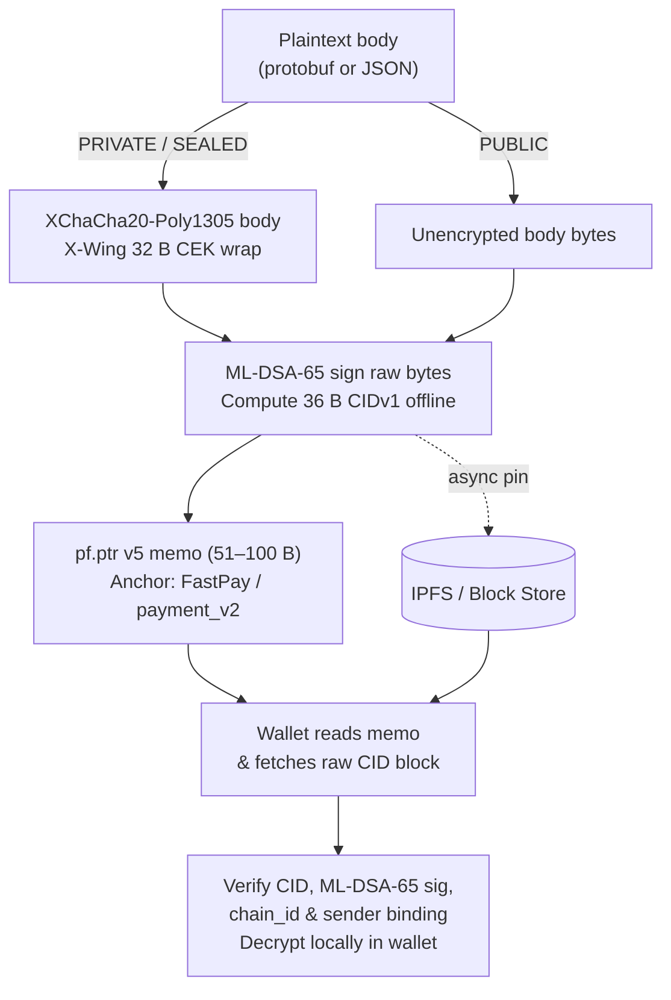

When wallets, validators, and AI agents coordinate on a blockchain, payments rarely travel alone. A task payout carries a receipt; a governance vote carries a disclosure packet; two accounts exchange an encrypted thread. Putting kilobytes of encrypted payloads directly into consensus blocks does not scale—especially under post-quantum cryptography, where a single ML-DSA-65 public key and signature already consume 5,261 bytes.

The Post Fiat Ledger splits every message into two parts:

1. **A compact on-chain pointer (51–100 bytes)** inside a normal transaction memo, anchoring existence, ordering, and a cryptographic fingerprint.
2. **A signed, optionally encrypted off-chain envelope (6,883 bytes for a 1-reader private message)** stored as a content-addressed IPFS block (CIDv1 `raw`), fetched and decrypted locally by wallets—never on a block explorer.

`postfiat.message.v1` replaces the legacy hand-encoded `pf.ptr` v4 memo format (classical X25519, no full-envelope signature, plaintext hashes) with one canonical post-quantum wire format shared across Rust, JavaScript, and Python. For the companion deep dive on sub-second payment anchoring and HTTP 402 agent settlement, see [Sub-Second Post-Quantum Payments: FastPay v3 & x402 on the Post Fiat Ledger](/blog/sub-second-post-quantum-fastpay-x402/).

<div class="glance">
  <div><b>51–100 B On-Chain</b><span>Compact pointers under the 256 B memo cap</span></div>
  <div><b>Hybrid X-Wing AEAD</b><span>ML-KEM-768 + X25519 with signed key commitment</span></div>
  <div><b>6,883 B · 4.84 ms Open</b><span>1-reader private envelope in pure-JS Node.js</span></div>
  <div><b>Zero Re-Serialization</b><span>ML-DSA-65 signs exact raw wire bytes</span></div>
</div>

### Key Terms

- **`pf.ptr` memo:** A structured Post Fiat transaction memo (`memo_type = "pf.ptr"`, `memo_format = "v5"`) carrying a canonical protobuf `Pointer` to an off-chain IPFS envelope or an inline request hash.
- **`payment_v2`:** Post Fiat's standard consensus-finalized account transfer transaction.
- **FastPay:** Post Fiat's consensusless payment lane for prefunded owned objects, where a payer collects a validator quorum (`q = n - f`, e.g., 3-of-4 or 5-of-6 for `f = 1`) of ML-DSA-65 approval votes without waiting for block consensus.
- **Task Node:** The application server that coordinates contributor work on Post Fiat and settles `PFT` reward payouts with attached encrypted receipts.

---

## 1. Architecture & Wire Format

Every visibility mode—public announcement, 1-to-1 private chat, multi-recipient group dispatch, sealed drop, or multi-chunk attachment—follows the same pipeline:



### Three Load-Bearing Decisions

1. **One canonical `.proto` schema (`proto/postfiat/message/v1/message.proto`):** `Pointer`, `Envelope`, `MessageHeader`, `XWingEncryptionHeader`, `RecipientWrap`, `Manifest`, `MessageKeyBinding`, `TextMessage`, and `X402PaymentPayload` live in one package alongside sibling governance and NFT schemas. Python, JavaScript, and Rust/WASM share one cross-language test-vector suite. Third-party apps can register custom payload schemas permissionlessly by setting `schema = 1` (`CUSTOM`) alongside a full `schema_name`.

2. **Sign raw wire bytes—never re-serialize protobufs:** Different protobuf encoders can reorder fields or omit defaults, breaking "decode → re-encode → verify" signature checks. `Envelope` therefore carries its nested messages as opaque byte fields:

```protobuf
message Envelope {
  uint32 version = 1;                // must be 1
  bytes header_bytes = 2;            // exact serialized MessageHeader bytes
  bytes encryption_header_bytes = 3; // exact serialized XWingEncryptionHeader bytes (empty if PUBLIC)
  bytes body_bytes = 4;              // plaintext (PUBLIC) or XChaCha20-Poly1305 ciphertext + 16 B tag
  SignatureAlgorithm signature_algorithm = 5; // ML-DSA-65
  bytes sender_pubkey = 6;           // 1,952 bytes
  bytes signature = 7;               // 3,309 bytes
}
```

Verifiers check the 36-byte binary CIDv1 `raw` identifier and the FIPS 204 ML-DSA-65 signature over the length-prefixed raw-byte preimage *before* decoding any nested field:

```text
preimage = "postfiat-l1-v2/message-envelope/v1\x00"
        || uint32_be(version)
        || uint32_be(len(header_bytes))            || header_bytes
        || uint32_be(len(encryption_header_bytes)) || encryption_header_bytes
        || uint32_be(len(body_bytes))              || body_bytes
```

3. **Stay strictly under the 256-byte on-chain memo cap:** The Post Fiat Ledger caps transactions at 4 memos, 256 decoded bytes per memo, 512 total memo bytes, and lowercase hex only. A `pf.ptr` v5 memo uses 6 bytes for `memo_type` (`"pf.ptr"`), 2 bytes for `memo_format` (`"v5"`), and `memo_data` for canonical protobuf `Pointer` bytes:

```protobuf
message Pointer {
  bytes cid_bin = 1;         // 36 B binary CIDv1 raw (CONTENT_BLOB / MANIFEST)
  PointerTarget target = 2;  // 1=CONTENT_BLOB, 2=MANIFEST, 3=INLINE
  ContentKind kind = 3;      // message classification (e.g., 4=CHAT, 6=REWARD, 14=X402)
  uint32 schema = 4;         // schema registry ID (1=CUSTOM)
  string task_id = 5;        // optional Task Node task ID
  string thread_id = 6;      // optional thread or governance session ID
  string context_id = 7;     // optional context ID
  uint32 flags = 8;          // exactly one of PRIVATE (0x01), PUBLIC (0x02), SEALED (0x20)
  bytes inline_payload = 9;  // 32 B SHA-256 request_hash when target == INLINE
  string schema_name = 10;   // populated only when schema == 1 (CUSTOM)
}
```

For an unthreaded pointer (`schema < 128`), `memo_data` is exactly **46 bytes** (`cid_bin` 38 B + `target` 2 B + `kind` 2 B + `schema` 2 B + `flags` 2 B), giving **54 bytes** total with `memo_type` and `memo_format`. Typical total memo sizes are:
   - **51 bytes** (`43 B` `memo_data`: `inline_payload` 34 B + `target` 2 B + `kind` 2 B + `schema=402` 3 B + `flags` 2 B) for an inline x402 `request_hash`
   - **54 bytes** (`46 B` `memo_data`) for an unthreaded IPFS pointer
   - **67 bytes** (`59 B` `memo_data`, adding `+13 B` for an 11-byte `thread_id`), or **76 bytes** (`68 B` `memo_data`) with a 20-byte `thread_id`
   - **100 bytes** (`92 B` `memo_data`) for a threaded multipart manifest pointer with task/context IDs

To anchor a standalone message without paying another party, the sender submits a self-payment transaction (`from == to`) carrying the `pf.ptr` v5 memo.

### Why Not HPKE, MLS, or PQXDH Directly?

`postfiat.message.v1` targets asynchronous, non-repudiable, blockchain-anchored objects—payout receipts, governance disclosures, and auditable agent commerce—rather than stateful interactive chat. **MLS** (RFC 9420) maintains stateful group key trees, and **PQXDH/Double-Ratchet** targets interactive deniable 1-to-1 sessions; neither fits standalone archival objects verified offline against an L1 account key.

**HPKE** (RFC 9180) is closer. Per-recipient CEK wrapping with HPKE+X-Wing (`draft-ietf-hpke-pq`) is a standard pattern (used in COSE-HPKE's multi-recipient mode), and our `cek_commitment`, blinded `SEALED` tags, and per-chunk manifest AAD could all layer above HPKE wraps. We composed X-Wing, HKDF-SHA256, and XChaCha20-Poly1305 directly to keep browser and mobile wallet implementations minimal without full HPKE/COSE framing. That simplicity tradeoff places our wrap KDF directly inside third-party audit scope rather than inheriting an HPKE profile.

---

## 2. Hybrid Post-Quantum Cryptography

Private and sealed messages encrypt the body once under a fresh random 32-byte Content Encryption Key (CEK) using XChaCha20-Poly1305, then wrap that CEK per recipient using **X-Wing** (CFRG draft `draft-connolly-cfrg-xwing-kem`), which combines FIPS 203 ML-KEM-768 and X25519 through SHA3-256.

Every envelope-level binding uses `aad_context_0`, the per-slot AAD evaluated at `chunk_index = 0`. Multi-chunk payloads increment `chunk_index` per chunk. Inside `RecipientWrap.recipient_key_id`, each wrap carries a 32-byte `wire_tag`: the recipient's static key fingerprint in `PRIVATE` mode, or a per-message blinded tag in `SEALED` mode. The wrap KEK binds `wire_tag` in both modes:

| Primitive | Wire Size | Construction |
| --- | ---: | --- |
| ML-DSA-65 auth (per envelope) | `5,261 B` | `1,952 B` public key + `3,309 B` signature (FIPS 204) |
| X-Wing public key | `1,216 B` | `1,184 B` ML-KEM-768 encapsulation key `\|\|` `32 B` X25519 public key |
| X-Wing ciphertext (per reader) | `1,120 B` | `1,088 B` ML-KEM-768 ciphertext `\|\|` `32 B` X25519 ephemeral key |
| X-Wing combiner | `32 B` | `SHA3-256(ss_MLKEM \|\| ss_X25519 \|\| ct_X25519 \|\| pk_X25519 \|\| 0x5c2e2f2f5e5c)` (literal 6-byte label `\.//^\`) |
| Per-slot AAD (`aad_context(i)`) | `32 B` | `SHA-256("postfiat-l1-v2/message-aad/v1\x00" \|\| chain_id \|\| 0x00 \|\| SHA-256(header_bytes) \|\| uint32_be(i))` |
| `wire_tag` (`PRIVATE`) | `32 B` | `SHA-256(xwing_pk)` |
| `wire_tag` (`SEALED`) | `32 B` | `SHA-256("postfiat-l1-v2/sealed-recipient-tag/v1\x00" \|\| xwing_ss \|\| aad_context_0)` |
| Key commitment (`cek_commitment`) | `32 B` (`34 B` on wire) | `SHA-256("postfiat-l1-v2/cek-commit/v1\x00" \|\| cek \|\| aad_context_0)` signed in `XWingEncryptionHeader` |
| Wrap KEK | `32 B` | `HKDF-SHA256(ikm=xwing_ss, salt=aad_context_0, info="postfiat-l1-v2/xwing-wrap/v1\x00" \|\| wire_tag)` |
| Wrapped CEK | `48 B` | `32 B` CEK encrypted under KEK + `16 B` Poly1305 tag (`24 B` wrap nonce) |

Five core cryptographic invariants are enforced across all verifiers:

- **Domain-separated ML-DSA-65 signing:** One account keypair signs L1 transactions (`postfiat-l1-v2/tx/v1`), FastPay v3 orders (`postfiat-l1-v2/owned-transfer/v3`), message envelopes (`postfiat-l1-v2/message-envelope/v1`), and key bindings (`postfiat-l1-v2/message-key-bind/v1`). Signatures cannot cross domains. Authentication stays pure ML-DSA-65 because forging a signature requires breaking the scheme before a message is anchored on chain—matching the ledger's native account key—whereas encryption uses hybrid X-Wing because harvest-now-decrypt-later attacks threaten recorded ciphertexts retroactively.
- **Key-committing AEAD (`cek_commitment`):** Standard XChaCha20-Poly1305 is not key-committing, which would allow a malicious group sender to wrap different CEKs to different readers of the same ciphertext. Checking the signed 32-byte `cek_commitment` in constant time before decryption closes equivocation across readers who can decrypt. It does **not** prevent silent exclusion: a malicious sender can still hand one reader a garbage wrap, and without verifiable encryption that reader cannot prove exclusion to third parties.
- **Self-describing headers with local recomputation:** `XWingEncryptionHeader` carries `aad_context` and `kdf_info` on the wire so offline tools and auditors can inspect parameters directly and future KDF versions can be distinguished without changing header framing; verifiers still recompute `aad_context` locally from `chain_id`, `header_bytes`, and `chunk_index` and reject any mismatch.
- **Anchor binding inside `open_envelope()` / `openEnvelope()`:** Verifiers check three bindings automatically: `derive_account_address(sender_pubkey) == header.sender_account`, `header.chain_id == expected_chain_id` (stopping cross-chain replay, with `0x00` bytes rejected in `chain_id`), and `header.sender_account == expected_tx_sender` (stopping third-party CID re-anchoring).
- **Multi-chunk encrypted `Manifest` (up to 16 MiB):** Single envelopes cap at 1 MiB. Larger payloads split into ordered encrypted chunks sharing the envelope's CEK with fresh 24-byte nonces. The signed `Manifest` commits to ordered chunk CIDs and byte lengths (stopping truncation), while per-chunk `aad_context(i)` binds each ciphertext to its slot index, `chain_id`, and `header_bytes` (stopping reordering or cross-message splicing). No plaintext hash is published.

### Key Lifecycle & Epoch Rotation

Encryption keys follow a three-stage lifecycle balancing zero-balance onboarding against post-compromise isolation:

| Stage | Key Source | Discovery & Downgrade Protection | What Compromise Exposes |
| --- | --- | --- | --- |
| **`epoch 0` (Day-0 bootstrap)** | Derived deterministically from the wallet seed | Recipient shares a signed `MessageKeyBinding` via an off-chain directory or direct handshake; senders verify its ML-DSA-65 signature against the `pf...` address before encrypting | Past and future `epoch 0` traffic remains decryptable if the wallet seed leaks |
| **`epoch >= 1` (Active rotated)** | Fresh CSPRNG non-seed X-Wing keypair | Published on-chain via `identity_set` (the ledger's account-metadata transaction, setting `message_key`) or shared as a signed `MessageKeyBinding`; verifiers enforce monotonic `min_known_epoch` checks against rollbacks | Only messages encrypted during that live epoch; a later wallet-seed leak cannot decrypt rotated history |
| **Retired or lost epoch** | Private key deleted (or lost with device) | Owner signs a fresh `MessageKeyBinding` for `epoch + 1` with their ML-DSA-65 account key to resume receiving new traffic | Deleting retired keys provides **per-epoch key erasure** (not per-message forward secrecy); messages encrypted to a deleted key stay unreadable by design |

**First-contact & early-rotation policy:** `min_known_epoch` blocks rollback only *after* a sender observes a newer binding. On first contact through an untrusted off-chain directory, a malicious directory can serve a valid but stale `epoch 0` binding unless the recipient has published their active `message_key` on-chain via `identity_set` or exchanged it directly. Wallets should pin observed epochs per counterparty, prefer on-chain `identity_set` bindings whenever present, and prompt or auto-rotate from seed-derived `epoch 0` to a CSPRNG `epoch 1` key once an account is funded.

### Worked Size Budget (64-Byte Plaintext Payload)

For a 64-byte JSON receipt (80 bytes of XChaCha20-Poly1305 ciphertext including the 16-byte tag), exact serialized wire sizes are:

| Message | On-Chain Memo (`pf.ptr` v5) | Off-Chain IPFS Envelope Breakdown | Total Off-Chain |
| --- | ---: | --- | ---: |
| 1-reader `PRIVATE` (11 B thread ID) | `67 B` (`59 B` `memo_data`) | `5,261 B` ML-DSA-65 + `1,406 B` enc header + `119 B` header + `80 B` body + `17 B` framing | **`6,883 B`** |
| 2-reader `SEALED` (unthreaded) | `54 B` (`46 B` `memo_data`) | `5,261 B` ML-DSA-65 + `2,598 B` enc header + `106 B` header + `80 B` body + `17 B` framing | **`8,062 B`** |

The `XWingEncryptionHeader` consists of a **126-byte common header** (`cipher_suite` 2 B, `aead_nonce` 26 B, `aad_context` 34 B, `kdf_info` 30 B, `cek_commitment` 34 B, including protobuf tags/lengths) plus **1,280 bytes per `PRIVATE` `RecipientWrap`** (`wire_tag` 34 B, 42-byte `pf...` `recipient_account` hint 44 B, `xwing_ciphertext` 1,123 B, `wrap_nonce` 26 B, `wrapped_cek` 50 B, and 3 bytes of outer framing: `126 + 1,280 = 1,406 B`). In `SEALED` mode, omitting the 44-byte `recipient_account` field trims each wrap to **1,236 bytes** (`126 + 2 × 1,236 = 2,598 B`), while the on-chain memo size stays constant regardless of reader count.

Embedding the `1,952 B` ML-DSA-65 `sender_pubkey` inside every envelope accounts for ~28% of a 1-reader payload. Omitting it in favor of an on-chain account-key lookup would shrink envelopes to ~4.9 KB, at the cost of requiring live L1 state (or a trusted RPC) just to verify a downloaded IPFS block. Keeping the key inline makes every envelope self-verifying offline and matches the protocol's archival design goal.

---

## 3. Threat Model, Privacy Modes & `SEALED` Discovery

The protocol targets three adversaries:

1. A **passive global observer** reading every L1 block and public IPFS envelope, including a harvest-now-decrypt-later quantum adversary.
2. An **active network attacker** attempting ciphertext tampering, chunk reordering, cross-chain replay, or third-party CID re-anchoring.
3. A **malicious group sender** attempting to equivocate by wrapping different CEKs to different readers of one envelope.

| Mode | Visible On-Chain | Visible Off-Chain (IPFS Envelope) | Hidden From Non-Recipients |
| --- | --- | --- | --- |
| `PUBLIC` | Sender, payee, amount, fee, time, memo, CID | Plaintext body, header, sender pubkey | Nothing (authenticity & ordering only) |
| `PRIVATE` | Sender, payee, amount, fee, time, memo, CID | `MessageHeader` (`sender_account`, `thread_id`, `reply_to_cid`, `schema_name`, timestamp), sender pubkey, static `wire_tag` (`SHA-256(xwing_pk)`, directory-linkable), `recipient_account` hints, reader count, approx. size | Plaintext body & chunk plaintexts |
| `SEALED` (self-payment) | Sender (`from == to`), fee, time, `54 B` memo (`SEALED` flag `0x20`), CID | `MessageHeader` (`thread_id` & `reply_to_cid` omitted), sender pubkey, reader count, per-message blinded 32 B `wire_tag` values, `cek_commitment` | Plaintext body, on-chain payee, thread linkage, and public key-directory correlation |

In `SEALED` mode, each `RecipientWrap` replaces the static `SHA-256(xwing_pk)` key ID with a per-message blinded `wire_tag` derived from the ephemeral X-Wing shared secret. Each core security property rests on an explicit standard assumption:

| Security Property | Underlying Assumption & Reference |
| --- | --- |
| Body & CEK confidentiality | IND-CCA security of the X-Wing hybrid KEM (`draft-connolly-cfrg-xwing-kem`: FIPS 203 ML-KEM-768 + RFC 7748 X25519 under Gap-DH in the ROM) and IND-CPA/INT-CTXT of XChaCha20-Poly1305 (`draft-irtf-cfrg-xchacha`, extending RFC 8439) |
| `SEALED` recipient unlinkability | Key-privacy (ANO-CCA) of the X-Wing hybrid KEM (ML-KEM-768 implicit rejection + ephemeral X25519) plus modeling SHA-256 as a random oracle for blinded `wire_tag` derivation |
| Tamper, replay & re-anchor resistance | EUF-CMA security of ML-DSA-65 (FIPS 204) over raw wire bytes plus AEAD integrity over `aad_context(i)` and anchor checks (`chain_id`, `tx.from`) |
| Multi-recipient equivocation resistance | Collision resistance of SHA-256 for the signed 32-byte `cek_commitment` (does not prevent silent exclusion) |

Under those assumptions, an observer holding every published `MessageKeyBinding` and every `SEALED` IPFS block cannot link wraps back to recipient public keys. Sender identity, timestamp, schema name, reader count, and approximate size remain visible—`SEALED` provides recipient-private, sender-authenticated drops rather than mixnet anonymity.

### Discovering `SEALED` Messages & Bounding Scanning DoS

Because `SEALED` envelopes anchor on a self-payment (`from == to`) with no plaintext recipient hint, wallets cannot query `account_tx` by recipient address. Instead, the `SEALED` bit (`0x20`) in `Pointer.flags` lets wallets filter down to `SEALED`-flagged transactions in two ways:

- **Sender-filtered watching (common case):** Because `sender_account` stays visible on-chain, wallets watch `SEALED`-flagged transactions from known counterparties, Task Node, or followed accounts and trial-decapsulate only those envelopes.
- **Global `SEALED`-flag scanning:** On low-volume chains, a wallet fetches every `SEALED`-flagged envelope and trial-decapsulates wraps until a recomputed `wire_tag` matches.

Global scanning carries a real asymmetric DoS surface:

- **CPU & bandwidth cost:** Nearly every envelope in a global scan belongs to someone else, so the scanner must inspect every wrap before concluding there is no match. In pure JS, verifying the mandatory raw-byte ML-DSA-65 signature first (`1.90 ms`) and then trial-decapsulating two wraps (`2 × 2.60 ms`) takes `7.10 ms` per envelope—roughly **~7.1 seconds typical** single-thread CPU (and ~8 MB of IPFS fetches) across 1,000 2-reader `SEALED` envelopes, or **~5.2 seconds** for the X-Wing decapsulations alone if a scanner defers signature verification until after a tag match.
- **Cheap spam economics:** On Post Fiat (`1 PFT = 1,000,000 atoms`), a `SEALED` FastPay self-payment (1-in/1-out with an inline `pf.ptr` v5 memo) costs 36 atoms (`~0.036 PFT` for 1,000 spam drops). An attacker can therefore force global scanners to burn bandwidth, CPU, or DHT timeouts on unpinned CIDs cheaply.
- **Sender/scanner wrap limits & mitigations:** The protocol enforces a hard cap of `64` recipients per envelope (`MAX_ENVELOPE_RECIPIENTS = 64`), primarily for O(1)-lookup `PRIVATE` group messages. For `SEALED` messages, untrusted global scanners drop envelopes with more than `16` wraps before touching X-Wing (`max_sealed_wraps = 16`). Senders who want global-scanner discoverability must therefore keep `SEALED` fan-out to `<= 16` readers; slots 17–64 are only reached by allowlisted receivers that explicitly raise `max_sealed_wraps`. Scanners must also apply strict per-CID fetch timeouts and bounded concurrency. High-volume receivers should narrow by sender allowlist or out-of-band notifications (trading away open-inbox discoverability), and a protocol-level fee surcharge on `SEALED`-flagged memos remains a clean future lever if global-scan spam becomes an operational issue.

### Operational Tradeoffs

- **IPFS fetch metadata:** Fetching a CID from a shared public gateway reveals the reader's IP address and fetch timing to the gateway operator. Wallets requiring network-level privacy should fetch through a local IPFS node or privacy-preserving relay.
- **Non-repudiation & transferable proof:** Because the ML-DSA-65 signature covers the ciphertext and `cek_commitment`, any recipient can reveal the `CEK` to give a third party cryptographic proof of the exact plaintext. That is desirable for reward receipts, governance disclosures, NFT provenance, and auditable agent commerce—and a clear caveat for casual private chat. For deniable 1-to-1 chat, use an off-chain PQXDH/Double-Ratchet session rather than L1-anchored envelopes.
- **Off-chain pinning:** On-chain pointers prove existence, order, and integrity, not permanent storage. Task Node pins its own traffic, governance packets, and Post Fiat NFT metadata via a durable async retry outbox; third-party apps pin their own blocks or use a pinning service.

---

## 4. Anchoring Messages on Chain

`postfiat.message.v1` attaches identically to standard consensus `payment_v2` transfers and to Post Fiat's consensusless **FastPay** payment lane:

- **Task Node payouts & explorer verification:** When Task Node pays a contributor reward over FastPay, it persists the signed order and IPFS pin job together before broadcast so a crash replays the same order hash without double-paying, while IPFS pinning drains asynchronously off the payment path. Because FastPay can finalize before an asynchronous IPFS pin propagates, wallets resolve missing CIDs with bounded exponential retry—checking the sender's pinning gateway before falling back to public IPFS/DHT. Each payout carries a `PRIVATE` `pf.reward.v1` memo readable only by the contributor and Task Node. Block explorers never hold private keys; they render a verified `"Task reward"` badge only when the envelope's raw-byte ML-DSA-65 signature matches the pinned official payout key.
- **Pay-per-call agent APIs (x402):** HTTP `402 Payment Required` endpoints and Model Context Protocol (MCP) tool servers embed a 32-byte SHA-256 `request_hash` inside a 51-byte inline `pf.ptr` v5 memo on a FastPay transfer (`OwnedTransferOrderV3`), binding the payment directly to the API request.

For how FastPay locks owned objects, settles sub-second across wide-area validator quorums, and powers x402 agent payments, see the companion post **[Sub-Second Post-Quantum Payments: FastPay v3 & x402 on the Post Fiat Ledger](/blog/sub-second-post-quantum-fastpay-x402/)** and the **[FastPay Guide for Agents & Developers](/docs/fastpay/)**.

---

## 5. Cryptographic Microbenchmarks & SDK Verification

Measured single-threaded in `Node.js v20.20.2` using pure-JS `@noble/post-quantum@0.7.1` on an `AMD EPYC` `linux/x64` host (15 warmup iterations per benchmark):

| Operation (`Node.js v20.20.2`, `@noble/post-quantum@0.7.1`) | Samples | p50 | p95 | Throughput |
| --- | ---: | ---: | ---: | ---: |
| `ML-DSA-65` sign<sup>1</sup> / verify | `100` | `5.66 ms` / `1.90 ms` | `14.57 ms` / `2.53 ms` | `143.8` / `503.1 ops/s` |
| `X-Wing` encap / decap | `100` | `2.31 ms` / `2.60 ms` | `2.57 ms` / `3.31 ms` | `424.4` / `370.9 ops/s` |
| `PRIVATE` 1-reader `sealEnvelope` / `openEnvelope` | `100` | `11.45 ms` / `4.84 ms` | `23.76 ms` / `5.68 ms` | `79.3` / `200.9 ops/s` |
| Blinded `SEALED` 2-reader `sealEnvelope` / `openEnvelope`<sup>2</sup> | `100` | `12.16 ms` / `4.85 ms` | `22.26 ms` / `5.46 ms` | `73.5` / `201.8 ops/s` |
| `PRIVATE` 10-reader `sealEnvelope` / `openEnvelope` | `100` | `31.67 ms` / `5.23 ms` | `47.57 ms` / `6.22 ms` | `29.4` / `186.3 ops/s` |
| `320 KiB` 3-chunk `Manifest` (`128 KiB` chunks) split / reassemble<sup>3</sup> | `50` | `3.12 ms` / `2.63 ms` | `3.41 ms` / `3.97 ms` | `330.9` / `351.9 ops/s` |

<sub><sup>1</sup> ML-DSA-65 signing uses rejection sampling, producing the wider p50-to-p95 spread (5.66 ms vs. 14.57 ms). For 1-reader `sealEnvelope` (11.45 ms p50), ML-DSA-65 signing (5.66 ms) and X-Wing encapsulation (2.31 ms) account for ~8.0 ms; the remaining ~3.5 ms is pure-JS XChaCha20-Poly1305 AEAD, HKDF/SHA-256 derivations, CIDv1 hashing, and protobuf encoding. Sampling variance across 100 runs also explains why 2-reader `SEALED` p50 (12.16 ms) sits only 0.71 ms above 1-reader `PRIVATE`, whereas 10-reader `PRIVATE` (31.67 ms vs. 11.45 ms, +20.2 ms for 9 extra wraps ≈ 2.25 ms/wrap) isolates linear per-recipient scaling clearly.<br/><sup>2</sup> `SEALED` trial-decapsulation stops at the first matching blinded tag (4.85 ms on a first-slot hit); each additional non-matching wrap adds one 2.60 ms X-Wing decapsulation.<br/><sup>3</sup> Measures AEAD chunk encryption/decryption and SHA-256 CID hashing across three 128 KiB chunks (excluding the single outer ML-DSA-65 envelope signature). Single envelopes allow up to 1 MiB.</sub>

Cross-language test vectors are verified across Rust, JavaScript, and Python in CI (an independent third-party cryptographic audit has not yet been published). Full live end-to-end verification records from `postfiat-wan-devnet-2`—covering `PUBLIC`, `PRIVATE`, multi-recipient, threaded, 320 KiB 3-chunk manifest, blinded `SEALED`, and rotated `epoch 1` flows—are archived in [`devnet2-live-verification-20261127.json`](/evidence/message-protocol/devnet2-live-verification-20261127.json). Note that these benchmarks isolate local cryptographic and framing CPU; end-to-end user delivery latency also includes off-chain IPFS pinning and gateway/DHT block retrieval, which vary by pinning topology.

### Verifying & Decrypting an Anchored Envelope (Python SDK)

The Python SDK injects storage and cryptographic backends as callbacks (`fetch_ipfs_block`, `mldsa65_verify`, and `my_xwing_decap`) so applications can plug in a local IPFS node or hardware/Rust crypto bindings without changing verification logic. Passing `enforce_canonical_order=True` additionally rejects non-canonical out-of-order protobuf fields on decode, complementing raw-byte signature verification:

```python
from postfiat_rpc.message_protocol import decode_pointer_v5_memo, open_envelope

# 1. Decode the pf.ptr v5 memo from a finalized account_tx row
ptr = decode_pointer_v5_memo(tx_row["memos"][0], enforce_canonical_order=True)
envelope_bytes = fetch_ipfs_block(ptr.cid_bin)  # callback -> raw CIDv1 block bytes

# 2. Verify CID, raw-byte ML-DSA-65 signature, sender_pubkey -> sender_account,
#    chain_id, anchoring tx.from, and cek_commitment in one call.
#    - PRIVATE: pass recipient_key_id=my_xwing_key_id for O(1) wrap lookup
#    - SEALED:  pass recipient_key_id=None to run bounded trial-decapsulation
opened = open_envelope(
    envelope_bytes,
    verify_signature_fn=mldsa65_verify,         # (pubkey, msg, sig) -> bool
    expected_cid_bin=ptr.cid_bin,
    expected_chain_id="postfiat-wan-devnet-2",
    expected_tx_sender=tx_row["from"],
    recipient_key_id=None,                      # or my_xwing_key_id for PRIVATE
    xwing_decap_fn=my_xwing_decap,              # closure over recipient sk: (ct) -> 32 B ss
    enforce_canonical_order=True,
    require_cek_commitment=True,
    max_sealed_wraps=16,
)
```

Full protobuf schemas, domain-separation constants, and x402 header formats live in the [Post-Quantum Message Protocol Guide](/docs/message-protocol/), the [FastPay Guide for Agents & Developers](/docs/fastpay/), and [`docs/specs/message-protocol-v1.md`](https://github.com/postfiatorg/postfiatl1v2/blob/main/docs/specs/message-protocol-v1.md).
