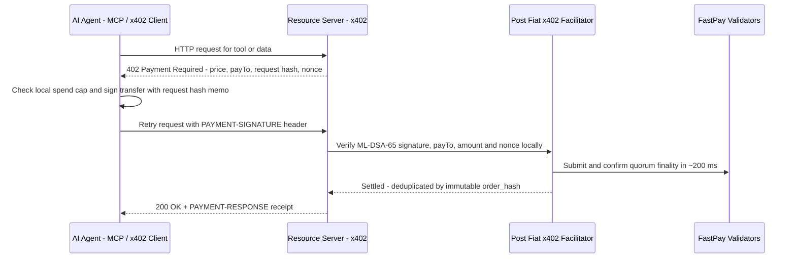

> **Deployment status (27 November 2026):** The canonical protobuf specification ([`postfiatl1v2#288`](https://github.com/postfiatorg/postfiatl1v2/pull/288)), Python & JavaScript Message SDKs, x402 v2 facilitator / MCP wrapper ([`postfiatl1v2#289`](https://github.com/postfiatorg/postfiatl1v2/pull/289)), and block-explorer decoding views are **merged on `main`**, and all nine end-to-end encrypted messaging flows below have been **executed and verified live on the 6-validator `postfiat-wan-devnet-2` blockchain (Blocks `1923–1929`)** over `payment_v2`. The next rollout wave—enforcing the Sui-inspired FastPay fee floor and `order_hash` indexing in `account_tx` (`postfiatl1v2#295`), cutting Task Node reward payouts over to FastPay (`tasknode#450`), and connecting the x402 facilitator to live FastPay validators—is implemented and in final code review before devnet-2 cutover.

<div class="glance">
  <div><b>9 / 9 Live Suites Passed</b><span>postfiat-wan-devnet-2 · Blocks 1923–1929 · 6/6 validator consensus</span></div>
  <div><b>X-Wing + ML-DSA-65</b><span>ML-KEM-768 + X25519 hybrid KEM · FIPS 204 raw-byte signatures</span></div>
  <div><b>&le; 256 B On-Chain Memo</b><span>pf.ptr v5 binary CIDv1 raw pointer · up to 16 MiB encrypted manifests</span></div>
  <div><b>FastPay + x402 Ready</b><span>Sui-style anti-bloat fee floor &amp; sub-second agent payment binding</span></div>
</div>

If a blockchain is designed for humans, wallets, and AI agents coordinating real work, messaging cannot be an ad-hoc text field bolted onto transactions.

On Post Fiat's legacy XRPL-derived chain, `pf.ptr` v4 message pointers were hand-encoded across three languages without a single canonical schema, carried uppercase hex memos (which `postfiatl1v2` rejects), encrypted bodies with classical X25519 only, omitted a sender signature over the full envelope, published plaintext SHA-256 hashes, and included Task Node as a reader on payloads by default.

With **Pillar 2** on `postfiatl1v2`, messaging, Task Node rewards, governance disclosures, NFT metadata, on-chain identity records, and machine-to-machine API payments share **one canonical post-quantum wire stack**.

---

## 1. Architecture: How a Post Fiat Message Moves

The protocol separates **on-chain anchoring** (small, deterministic, consensus-checked) from **content-addressed encrypted storage** (off-chain IPFS CIDv1 `raw` blocks up to 1 MiB per envelope or 16 MiB via multi-chunk manifests). Every message—whether a 1-to-1 private chat, a multi-recipient team dispatch, an anonymous-header sealed drop, a Task Node reward note, or a public governance packet—passes through the same pipeline:


### Four Design Choices That Eliminate Whole Classes of Bugs

1. **One canonical `.proto` source of truth (`proto/postfiat/message/v1/message.proto`):**
   Every core message type—`Pointer`, `Envelope`, `MessageHeader`, `XWingEncryptionHeader`, `RecipientWrap`, `Manifest`, `MessageKeyBinding`, `TextMessage`, and `X402PaymentPayload`—is defined once in `postfiat.message.v1` alongside sibling schemas for governance (`postfiat.governance.v1`) and NFTs (`postfiat.nft.v1`). Python (`python/postfiat_rpc/message_protocol.py`) and JavaScript (`wallet-proxy/message-protocol.js`) codecs are verified against shared cross-language byte vectors (`scripts/test-message-protocol-vectors.py`), including 48-byte SHA3-384 transaction digests. Third-party apps can ship custom schemas permissionlessly using `schema_id = 1` paired with a full schema name string.

2. **Zero re-serialization signature verification:**
   Protobuf encoders in different languages can legitimately emit fields in different orders or omit default values, which breaks naive "decode → re-encode → verify" signature schemes. `Envelope` avoids this completely by storing `header_bytes`, `encryption_header_bytes`, and `body_bytes` as **opaque raw byte fields**. Every verifier checks:
   - the 36-byte IPFS CIDv1 `raw` hash against the exact envelope bytes; and
   - the sender's **FIPS 204 ML-DSA-65** signature (`1,952 B` public key, `3,309 B` signature, domain tag `postfiat-l1-v2/message-envelope/v1`) over those exact transmitted bytes
   **before** decoding a single inner field. Tampered bytes or forged signatures fail immediately before parser or decryption logic ever runs.

3. **Compact binary `pf.ptr` v5 on-chain memos (`<= 256 B`):**
   `postfiatl1v2` enforces strict consensus memo caps (`<= 4` memos per transaction, `<= 256` decoded bytes per memo, `<= 512` total decoded memo bytes, **lowercase hex** only). A `pf.ptr` v5 memo sets:
   - `memo_type`: `"pf.ptr"` (`70662e707472`)
   - `memo_format`: `"v5"` (`7635`)
   - `memo_data`: lowercase-hex canonical protobuf `Pointer` bytes carrying the 36-byte binary CIDv1 `raw` prefix (`0x01 0x55 0x12 0x20 || sha256`)—or compact inline bytes for tiny records such as an x402 request commitment.

   Pointer flags encode visibility cleanly (`PRIVATE`, `PUBLIC`, `SEALED`, plus `MULTIPART`, `EPHEMERAL`, and `TOMBSTONE`). Sending a pure message with no significant PFT transfer uses a standard self-payment or dust payment—no bespoke message transaction type is needed on L1.

4. **Strict reader policy & zero-balance key bootstrap:**
   Task Node is included as an encrypted reader **only** on Task Node lifecycle and reward schemas that the server must process—never on user-to-user chat, group threads, or shielded transfers. Because brand-new users start at `0 PFT` and cannot submit an on-chain identity transaction before their first payout, wallets deterministically derive their X-Wing keypair from the master seed using domain-separated HKDF (`postfiat-l1-v2/message-key/v1`), sign a `MessageKeyBinding` with their ML-DSA-65 account key (`postfiat-l1-v2/message-key-bind/v1`), and register it at onboarding so even a user's very first Task Node payout encrypts end-to-end. *(Deterministic seed derivation intentionally trades incoming forward secrecy for single-seed backup restorability; rotating `key_epoch` is supported once the wallet is active.)*

---

## 2. Post-Quantum Hybrid Encryption: X-Wing + XChaCha20-Poly1305

Encrypting long-lived on-chain-anchored messages with classical X25519 alone exposes today's private traffic to harvest-now, decrypt-later attacks. On the other hand, relying solely on a post-quantum lattice KEM carries a hedge risk if a future cryptanalytic break weakens ML-KEM parameters.

Post Fiat encrypts private and sealed messages with **X-Wing** (`draft-connolly-cfrg-xwing-kem`), combining **FIPS 203 ML-KEM-768** and **X25519** through a SHA3-256 combiner:

| Component | Exact Wire Size | Role |
| --- | ---: | --- |
| **X-Wing public key** | `1,216 B` | `1,184 B` ML-KEM-768 encapsulation key `\|\|` `32 B` X25519 public key |
| **X-Wing ciphertext (per recipient)** | `1,120 B` | `1,088 B` ML-KEM-768 ciphertext `\|\|` `32 B` X25519 ephemeral key |
| **Shared secret combiner** | `32 B` | `SHA3-256(ss_MLKEM \|\| ss_X25519 \|\| ct_X25519 \|\| pk_X25519 \|\| 0x5c2e2f2f5e5c)` |
| **Wrapped Content Key (CEK)** | `48 B` | `32 B` random CEK encrypted under HKDF-derived KEK + `16 B` Poly1305 tag (`24 B` nonce) |
| **Body / chunk cipher** | `XChaCha20-Poly1305` | Authenticated with AAD `postfiat-l1-v2/message-aad/v1 \|\| chain_id \|\| header_bytes \|\| chunk_index` |

Notice how clean multi-recipient and multi-chunk encryption become under this framing:

- **Multi-recipient groups:** The message body is encrypted **once** under a fresh random 32-byte CEK. Each recipient (and optionally the sender, for sent-folder history) gets one `RecipientWrap` entry containing an X-Wing ciphertext and 48-byte wrapped CEK. Adding a recipient costs `~1.2 KB` in the off-chain envelope and **0 extra bytes on-chain**.
- **Multi-sender threads:** Any participant replies from their own funded ML-DSA-65 wallet, referencing the shared `thread_id` and prior `reply_to_cid`. Every message in the thread is independently signed by its sender and verified on read.
- **`VISIBILITY_SEALED` (anonymous recipient headers):** Standard `PRIVATE` envelopes can optionally list `recipient_account` hints for fast UX indexing. `SEALED` envelopes omit every `recipient_account` from `XWingEncryptionHeader`, leaving only opaque 16-byte `recipient_key_id` tags so off-chain observers scanning IPFS blocks cannot see who a message is addressed to.
- **Multi-chunk `Manifest` (up to 16 MiB):** Payloads larger than the single-block cap split into ordered encrypted chunks (e.g., 128 KiB each), each authenticated with its own `chunk_index` in the AEAD AAD so chunks cannot be reordered, truncated, or spliced across messages. The signed `Manifest` envelope holds the ordered chunk CID list and is anchored on-chain with the `MULTIPART` pointer flag. No plaintext SHA-256 hash is ever published in cleartext.

---

## 3. Live On-Chain Verification on `postfiat-wan-devnet-2` (Blocks 1923–1929)

To verify the full stack end-to-end against real consensus—not mocks—we built a standalone Python test environment (`pf-message-test-env`) using real `kyber-py` (`ML-KEM-768`), `cryptography` (`X25519`), `pycryptodome` (`XChaCha20-Poly1305`), and `dilithium-py` (`ML-DSA-65`), funded **four brand-new wallets with real `postfiat-wan-devnet-2` PFT**, and ran a 9-suite live verification run on **27 November 2026 (15:49–16:07 UTC)**.

### Chain Snapshot & Funded Wallets

- **Chain:** `postfiat-wan-devnet-2` (`pq-r3`, **6/6 validators converged**, `mempool_pending = [0, 0, 0, 0, 0, 0]`)
- **Genesis hash:** `ce22ca8c932da0998b484483a09647138a30e0bf44408dd49a8d6d452787ad25521aff3ed334da07e150a7233a3e90a9`
- **Final block height:** `1929`
- **Final block tip hash:** `aa380dd5a1d83db31573ef7f516595d2577bc8809748a29fc48342a5f69e4226f8d9d4384068fd426456ca1b4f86dab8`
- **Final state root:** `e2a6b59f1759e8a97e316023b6f628bca6c107470a295f1f6dd5b054e0abf4e44bf3064239485d207faaa308f572c91e`

| Test Wallet | On-Chain Address | Initial Funding | Final Balance (Seq) | X-Wing `key_id` (prefix) | ML-DSA-65 `MessageKeyBinding` |
| --- | --- | ---: | ---: | --- | --- |
| **Alice** | `pf6d2d0a000bb5c1feda7da2df955cfe0a78c788c9` | `0.200000 PFT` | `0.199711 PFT` (`seq 4`) | `ab3230536886467e…` | Verified |
| **Bob** | `pf721bb3b98bceeeebfb835d97dac6a7b4a72c797a` | `0.200000 PFT` | `0.200378 PFT` (`seq 1`) | `e5f40742cfcb516b…` | Verified |
| **Charlie** | `pfef21b496662a755d19c7c04fc37a8ed8af86a091` | `0.200000 PFT` | `0.199756 PFT` (`seq 2`) | `0971617dec92fd69…` | Verified |
| **Eve** *(outsider)* | `pf31e18f9533fc38839234a90aeb25629ebaac093a` | `0.200000 PFT` | `0.200000 PFT` (`seq 0`) | `16c7a1ebd8d24137…` | Verified |

### Live Transaction & Decryption Matrix (9 / 9 Passed)

Every row below was signed by the sender's ML-DSA-65 key, anchored via a real `payment_v2` transaction carrying a lowercase-hex `pf.ptr` v5 memo, finalized across all 6 validators, fetched back via `account_tx`, CID-checked, signature-verified, and decrypted locally:

| Suite & Flow | Block | Full On-Chain `tx_id` (SHA3-384) | IPFS CIDv1 (`raw`) | Verified Outcome |
| --- | ---: | --- | --- | --- |
| **1 · Wallet funding & key bindings** | Pre-1923 | 4 funded wallets (`0.200000 PFT` each) | — | All 4 ML-DSA-65 `MessageKeyBinding` proofs verified |
| **2 · 1-to-1 `PRIVATE`** (`Alice → Bob`, fee `22` atoms) | `1923` | `c8b7f540228331c773f0be66d92bac47a4e34c91b75a0c2b43cac53052a561cd97afcbc62b69fb7c0a3a280760ace3f2` | `bafkreihx2tfnjrdfjk6w7fq5pmnauaamtqxzjlghnqtl5cjconrfniulnu` | Bob decrypted; Alice sender-copy decrypted; **Eve rejected** (`no matching RecipientWrap`) |
| **3 · Multi-recipient `PRIVATE` group** (`Alice → [Bob, Charlie]`) | `1924` | `1484c78c9e02475ff867b3db9199b6a9671066bdb1d871a93cff64a60f92dcd0f093c709fa0b069340b9ac56fe212791` | `bafkreihdokv7wfjd6r5kyu7tf2itbij5ug4c5wt57ei2fuoqspuo77p7zq` | Single ciphertext + 3 X-Wing wraps; Bob & Charlie decrypted identically; **Eve rejected** |
| **4a · Multi-sender thread reply #1** (`Bob → [Alice, Charlie]`, thread `live-thread-f9815b56`) | `1925` | `253342e9861bf78a1ec1668870c62b7032ff27c2600f61c6987d50afa21eb484674095af11ea033f77c29804a0a4e85b` | Linked `reply_to_cid` → Block `1924` CID | Alice decrypted & verified Bob's ML-DSA-65 signature + reply chain |
| **4b · Multi-sender thread reply #2** (`Charlie → [Alice, Bob]`, thread `live-thread-f9815b56`) | `1926` | `0483906c1b57b5bc224d91985fcfe07bbe5ddf55ae5e80e6e8dc9a4bc20eaeb67b93a4b79beca33938fe399ebf2452ea` | Linked `reply_to_cid` → Block `1925` CID | Alice & Bob decrypted; **3 distinct ML-DSA-65 senders** verified in one thread |
| **5 · `SEALED` anonymous header** (`Charlie → Bob`) | `1927` | `4a999c08f0be5bd9a8b280cea75f7a21d784746d2b856ade7eb3d393c3be98c194ff4800ea57544340beef331696f808` | `bafkreih5m3t44nh5kck6z4tfvxgboslafij73seqadfebd2ela6abg6gui` | Zero `recipient_account` strings in header; Bob decrypted by `recipient_key_id`; **Eve rejected** |
| **6 · `PUBLIC` signed dispatch** (`Alice → Bob`) | `1928` | `c57ead3054861bff84e8947884f5672a14f92bd7b2f039fe440cc276be7977eaf010197eb4892e061178a0246ea963c3` | `bafkreie3x6km7obhasbkx3yl5xy2uzogjbskpwjkwbrdd3tgefnbs4kwz4` | Read & ML-DSA-65 signature verified by anyone, including Eve |
| **7 · 320 KiB 3-chunk encrypted `Manifest`** (`Alice → [Bob, Charlie]`, `MULTIPART` flag) | `1929` | `697117e66111cb057813e1451e970c2cd946b99eed50a05765ad37e5ca6bed72172746a602f9f354d2229df056055444` | Manifest: `bafkreifuhlb5nq4hjokl7t3edyfzh6yn2drvqdksr5gz5hruwqhh2cqrha` | `327,680 B` split into 3 chunk-index-AAD blocks; Bob & Charlie reassembled exact SHA-256 `b7c24200…17b` |
| **8 · Negative tamper controls** | Local on Block `1923` envelope | Flipped 1 bit in signature & raw block | `bafkreihx2tfn…` | Rejected **before** header decode: `Envelope raw-byte signature verification failed` & `IPFS CIDv1 raw multibase mismatch` |
| **9 · Final 6/6 consensus convergence** | `1929` | Tip `aa380dd5…6dab8` | — | 6/6 validators identical height, block tip, state root, and zero pending mempool |

*(For the Block `1929` 320 KiB multipart manifest, the three encrypted 128 KiB / 64 KiB chunk CIDs anchored inside the signed manifest were `bafkreiegkschilopdhomw5nxxqxh4ixr6byj35wlvepebgx7rhxdecpoa4`, `bafkreig3v6si5nng7rj42h6gs5752zrjvn64xaso6dytl44o5lgz475aki`, and `bafkreihnzshsdmr4j34x5pgfxlisgybrsylakfy3oais2i3k2u3qt6bwx4`.)*

### Ergonomic Python Flow

From a developer's perspective, sending a post-quantum multi-recipient message and decrypting it straight off finalized `account_tx` history takes a handful of lines:

```python
from pf_message_test_env import MessageTestEnvironment, Visibility

env = MessageTestEnvironment()
env.bootstrap(("alice", "bob", "charlie", "eve"))

# Encrypt once with XChaCha20-Poly1305, wrap CEK to Bob + Charlie via X-Wing,
# sign raw bytes with Alice's ML-DSA-65 key, and anchor pf.ptr v5 on postfiat-wan-devnet-2
receipt = env.send_message(
    sender_name="alice",
    recipient_names=["bob", "charlie"],
    text="Group encrypted dispatch to Bob AND Charlie",
    visibility=Visibility.PRIVATE,
    thread_id="live-thread-f9815b56",
)

# Charlie pulls finalized memos via account_tx, verifies CID + ML-DSA-65, and decrypts locally
inbox = env.read_onchain_messages_for_address(
    query_address=env.wallet("bob").address,
    decrypt_as_wallet="charlie",
    from_height=receipt.height,
    to_height=receipt.height,
)
assert inbox[0].text == "Group encrypted dispatch to Bob AND Charlie"
```

---

## 4. Next Rollout Wave: FastPay Speed With Sui-Style Fee Discipline

The live run above settled over `payment_v2` consensus blocks (`~1–2 s`). For interactive Task Node payouts and AI agent micropayments, `postfiatl1v2` also supports **FastPay** (`OwnedTransferOrderV3`) with `~200 ms` Byzantine quorum finality.

To open FastPay to everyday messaging and rewards safely—without inviting free state-bloat spam—**L1 Train A** (`postfiatl1v2#295`, currently in final review) introduces two protocol upgrades:

1. **Sui-inspired computation + new-object fee floor:**
   Zero-fee FastPay lets an attacker split coins into millions of tiny owned objects for free. Train A enforces a transparent fee floor on every `OwnedTransferOrderV3`:

   ```text
   min_fee_atoms = 25 + ceil(tx_bytes / 512) + max(0, outputs - inputs) * 1_000 + inputs
   ```

   - **Normal messages and transfers stay tiny:** `25 atoms` (`0.000025 PFT`) base plus 1 atom per 512 bytes and 1 atom per input.
   - **Consolidating small payouts stays cheap:** Merging up to 2,048 owned payout objects triggers `max(0, outputs - inputs) == 0`, paying only the small linear fee.
   - **Object-splitting spam gets expensive immediately:** Every net-new owned object costs `1,000 atoms` (`0.001 PFT`), replacing the old brittle 100,000 chain-wide object cap with economic anti-bloat discipline.

2. **Immutable `order_hash` indexing in `account_tx` and `tx`:**
   FastPay validator certificates can have different `certificate_digest` hashes depending on which validator signatures arrive first. Train A indexes applied FastPay transfers and unwraps directly into `account_tx` and `tx` keyed by **`order_hash`**—the immutable hash of the signed order itself—so wallets, explorers, and payment facilitators never see duplicate or malleable IDs.

On the application side, **Task Node's FastPay payout driver** (`tasknode#450`) leases owned payout objects via database row locks, durably writes `(payout_id, object_id, order_hash, signed_order_bytes)` *before* talking to validators so crash recovery always retries the exact same `order_hash` (preventing equivocation locks and guaranteeing zero double-pays), and pins encrypted `pf.reward.v1` envelopes asynchronously via a durable retry outbox.

On the **block explorer**, public messages decode safely in place (escaped text, zero script execution), while encrypted Task Node payouts show a clean **`"Task reward"`** badge **only** when the verified ML-DSA-65 envelope signer matches the pinned official Task Node payout public key. Outsiders cannot spoof reward cards, and decryption always happens locally in the user's wallet or Mac app—never on the explorer.

---

## 5. Machine-Native Agent Payments Over x402 (+ MCP Helper)

Humans click checkout buttons; autonomous AI agents do not. Post Fiat ships an **x402 v2** payment binding, hardened facilitator, and thin **Model Context Protocol (MCP)** wrapper (`tools/x402-facilitator/`, merged in `postfiatl1v2#289`) designed for two settlement rails:

- **Native `PFT` over FastPay** (`~200 ms` quorum finality for high-frequency API/tool calls)
- **`pfUSDC` on the consensus lane** (for dollar-denominated settlement)



Security properties already tested in `tools/x402-facilitator/test_x402_e2e.js` and `test_x402_refusals.js`:
- **Local pre-verification before touching validators:** Malformed ML-DSA-65 signatures, wrong `payTo` addresses, underpayments, expired deadlines, and bad nonces are rejected at the facilitator edge under per-IP/per-key rate limits.
- **Replay immunity across replicas:** Spent payments are deduplicated strictly by immutable **`order_hash`** (or `tx_hash` for consensus `pfUSDC`), closing validator-certificate malleability replays.
- **MCP local guardrails:** The MCP payment wrapper enforces per-call and session spending caps locally on the agent's host before signing any `402` challenge.

*(Current boundary: the facilitator and MCP loop are verified end-to-end against deterministic unit and refusal harnesses on `main`; switching the facilitator's chain adapter onto live devnet-2 FastPay validators lands immediately after Train A `#295` deploys.)*

---

## 6. What Ships Next & Where to Read the Spec

| Layer | Current State (27 Nov 2026) | Source / PR |
| --- | --- | --- |
| **Canonical `.proto` schemas & 48-byte SHA3-384 vectors** | **Merged on `main`** (`223769bdc9`) | [`postfiatl1v2#288`](https://github.com/postfiatorg/postfiatl1v2/pull/288) · `proto/postfiat/message/v1/message.proto` |
| **Python & JS Message SDKs, x402 facilitator, MCP helper, relay ops** | **Merged on `main`** (`3c10aa0513`) | [`postfiatl1v2#289`](https://github.com/postfiatorg/postfiatl1v2/pull/289) · `python/postfiat_rpc/message_protocol.py` · `wallet-proxy/message-protocol.js` |
| **Live 6-validator devnet-2 E2E (`payment_v2`, `pf.ptr` v5)** | **Verified live** (Blocks `1923–1929`, 9/9 suites) | Funded Python test harness (`pf-message-test-env`) |
| **Explorer Message views & technical docs** | **Live on postfiat.org** | [`postfiatorg.github.io#56`](https://github.com/postfiatorg/postfiatorg.github.io/pull/56) · [`#57`](https://github.com/postfiatorg/postfiatorg.github.io/pull/57) |
| **L1 Train A: Sui-style FastPay fees & `order_hash` `account_tx` indexing** | **Open PR (CI green, final review fixes)** | [`postfiatl1v2#295`](https://github.com/postfiatorg/postfiatl1v2/pull/295) |
| **Task Node FastPay reward cutover & browser/Mac wallet UX** | **Open PRs (CI green, pending Train A deploy)** | [`tasknode#450`](https://github.com/postfiatorg/tasknode/pull/450) · [`postfiatl1v2#303`](https://github.com/postfiatorg/postfiatl1v2/pull/303) · [`tasknode-apple#41`](https://github.com/postfiatorg/tasknode-apple/pull/41) |

For full protobuf wire layouts, domain-separation strings, memo size budgets, FastPay fee examples, and x402 header schemas, see the [Post-Quantum Message Protocol, FastPay & x402 Technical Guide](/docs/message-protocol/) and the canonical spec [`docs/specs/message-protocol-v1.md`](https://github.com/postfiatorg/postfiatl1v2/blob/main/docs/specs/message-protocol-v1.md) on GitHub.
