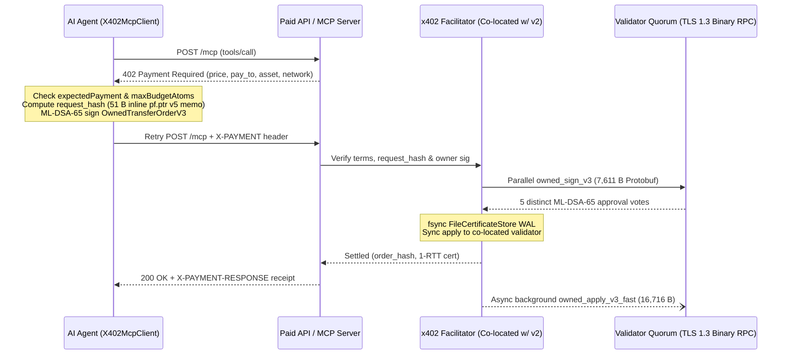

Autonomous AI agents stall when every metered tool call or market-data query waits twenty seconds for a consensus block. Global ordering is essential for shared state—order books, escrows, governance, issued assets—but a payment from a single owner does not need global total ordering before a recipient can confirm that the funds cannot be double-spent.

Post-quantum signatures make naive payment lanes much heavier than classical ones. A single FIPS 204 ML-DSA-65 public key and signature consume 5,261 bytes (1,952 B + 3,309 B), roughly 55× larger than Ed25519 (96 B combined). Over a transcontinental WAN, every extra round trip, hex-encoded JSON payload, blocked database open, or dropped TLS session turns sub-second intent into multi-second stalls.

FastPay v3 and native x402 address this on the Post Fiat Ledger by combining a consensusless owned-object lane (building on FastPay by Baudet et al. and Sui's owned-object fee design) with direct TLS 1.3 binary Protobuf transport, zero hot-path embedded-database opens across block boundaries, and single-round-trip (1-RTT) certificate settlement. For our companion post on `postfiat.message.v1` off-chain encrypted messaging and `pf.ptr` v5 pointers, see [Post-Quantum Messaging on the Post Fiat Ledger](/blog/post-quantum-messaging-fastpay-x402/).

<div class="glance">
  <div><b>273 ms p50 · 307 ms p95</b><span>Direct 1-RTT cert assembly (N = 50, 5-of-5 signers, 230 ms bare RTT)</span></div>
  <div><b>322 ms p50 · 350 ms p95</b><span>x402 402→200 (N = 50, co-located client/facilitator; remote adds 2× RTT)</span></div>
  <div><b>564 ms p50 · 596 ms p95</b><span>Direct 2-RTT applied quorum (662 ms max across 7 blocks)</span></div>
  <div><b>9.33 calls/s (K = 8)</b><span>Client-bound JS pool burst (4 waves × 8 parallel · 851 ms wave p50)</span></div>
</div>

### Key Terms

- **Owned object:** A prefunded single-owner `PFT` balance (`1 PFT = 1,000,000 atoms`) identified by `(object_id, version, value, owner_pubkey)` and wrapped from a consensus account via a signed deposit.
- **FastPay certificate:** A payer-signed transfer order bundled with `q = n - f` distinct active-committee validator ML-DSA-65 approval votes (`5` of `6` in the protocol specification for `f = 1`).
- **`order_hash`:** The immutable 48-byte SHA3-384 digest of canonical unsigned order bytes—used as the sole idempotency and indexing key across `tx`, `account_tx`, and x402 spent stores.
- **x402:** HTTP `402 Payment Required` challenge-and-settlement for paid APIs and Model Context Protocol (MCP) tools, bound to the HTTP request via an inline 51-byte `pf.ptr` v5 memo.

---

## 1. Owned Objects, Quorum Intersection & Anti-Bloat Fees

Standard Post Fiat transfers (`payment_v2`) mutate shared consensus state and wait for block certification. FastPay moves native `PFT` out of the global consensus queue by binding funds to single-owner versioned objects. Because only one key can authorize spending `(object_id, version)`, honest validators do not need global ordering across unrelated payers—they only need to prevent the same owner from spending the same object version twice.

### Quorum Sizing: Why the Protocol Uses `q = n - f = 5`

For a 6-validator committee tolerating `f = 1` Byzantine fault, `2f + 1 = 3` does not guarantee quorum intersection: two sets of 3 validators out of 6 can be completely disjoint (`3 + 3 = 6`). Minimum BFT intersection (`2q - n >= f + 1`) requires at least `q = 4`.

Post Fiat follows FastPay's `q = n - f` rule (`q = 5` for `n = 6, f = 1`), matching the ledger's 5-of-6 block-certification quorum. Any two 5-of-6 certificates overlap in `2(5) - 6 = 4` validators—leaving at least three honest witnesses under `f = 1`—while tolerating one offline validator for liveness. Every honest validator enforces **persist-before-vote**: before returning its ML-DSA-65 signature on `owned_sign_v3`, it durably appends `(object_id, version) → lock_id` to a dedicated lock WAL flushed via `fdatasync`. If a payer attempts to sign a conflicting second order for the same object version, the overlapping honest validators reject it.

### Immutable `order_hash` vs. Mutable `certificate_digest`

Two clients collecting 5 votes out of 6 validators for the exact same transfer can assemble different 5-vote subsets and therefore different `certificate_digest` values. While the ledger's monotonic object versions already prevent double-spending on-chain, an off-chain x402 facilitator or API merchant keying its own payment-credit table on `certificate_digest` could credit two separate HTTP requests for the same transfer using two different vote subsets.

FastPay therefore keys every replay check, `account_tx` index entry, `tx` lookup, and x402 spent store strictly on the immutable 48-byte SHA3-384 `order_hash` derived solely from the canonical unsigned order bytes.

### Permissionless Confirm-or-Cancel Recovery

A consensusless lane still needs liveness when a payer crashes mid-broadcast or equivocates across split validator subsets. Every transfer order carries an explicit height window (`valid_from_height`, `expires_at_height`, `recovery_closes_at_height`) pinned to an active committee epoch:

1. **Before `expires_at_height`:** Anyone holding a complete `q = n - f` certificate can apply it directly or anchor it in a consensus block.
2. **During recovery (`expires_at_height` to `recovery_closes_at_height`):** Ordered recovery does not cancel a locked object the moment `expires_at_height` passes. Instead, the recovery window lets any party holding a complete certificate—the facilitator, the recipient, or a watcher—submit it on-chain to confirm the transfer once.
3. **After `recovery_closes_at_height`:** If no valid certificate was presented, consensus emits a quorum-signed cancellation fence and advances the object version so funds are never permanently stranded, and stale speculative votes cannot resurrect the cancelled spend.

### Sui-Inspired Anti-Bloat Fees & Object Lifecycle

Because every live owned object occupies validator state, FastPay enforces a deterministic minimum fee (queryable via `fastpay_fee_quote`). To keep the fee invariant across transports—whether a client submits over JSON-RPC v1 or binary Protobuf RPC v2—the byte weight is computed from the canonical unsigned signing bytes (`signing_bytes_len`, where each output encodes a 1,952-byte ML-DSA-65 recipient public key as 3,904 hex characters):

```text
min_fee_atoms = 25
              + ceil(signing_bytes_len / 512)
              + max(0, outputs - inputs) * 1,000
              + inputs
```

| Transfer Shape | `signing_bytes_len` (`ceil / 512`) | Formula Breakdown | Minimum Fee | Cost in PFT |
| --- | ---: | --- | ---: | ---: |
| 1-in / 1-out sweep (exact spend, no change) | 4,582 B (9) | `25 + 9 + 0 + 1` | 35 atoms | 0.000035 PFT |
| 1-in / 2-out payment with change | 8,513 B (17) | `25 + 17 + 1,000 + 1` | 1,043 atoms | 0.001043 PFT |
| 10-in / 1-out dust merge (up to 2,048 inputs) | 5,590 B (11) | `25 + 11 + 0 + 10` | 46 atoms | 0.000046 PFT |

Each account carries a 4,096 owned-object soft cap under a 10,000,000 global ceiling. That pricing creates two clear operational guidelines:

- **Per-call economics:** Any payment that creates a net-new object—either a change output at call time (1,043 atoms) or a pre-split exact-denomination object created earlier (1,000 atoms to split + 35 atoms to sweep = ~1,035 atoms amortized)—pays roughly 0.001 PFT in state-creation cost. FastPay is therefore suited for single API/MCP calls priced at 10,000+ atoms (0.01+ PFT), or for periodic prepaid session top-ups that amortize one FastPay transfer across hundreds of smaller micro-calls.
- **Busy-payee consolidation:** An API server receiving thousands of incoming FastPay objects stays well below the 4,096-object soft cap by running a periodic sweeper—either merging up to 2,048 objects into one with zero new-object surcharge (46 atoms for 10 inputs) or unwrapping up to 2,048 objects back into its standard account balance in a single transaction.

---

## 2. Removing Storage, Transport & Connection-Lifecycle Bottlenecks

Early FastPay runs on our 3-continent devnet took 7.34 seconds per transfer, and a first cleanup still sat at 1.49 seconds. Even after steady-state intra-block medians reached sub-second territory, crossing consensus block boundaries exposed two distinct tail modes: first a multi-second embedded-database stall (`redb` single-writer contention), and then—after storage was fixed—a ~750 ms post-block reconnect spike caused by short socket idle timeouts.

Addressing all three layers—storage, binary transport, and persistent connection timeouts—removed both bottlenecks in our live devnet measurements.

### Storage: Removing Hot-Path `redb` Opens Across Block Transitions

Post Fiat nodes store finalized consensus state in an embedded `redb` database that permits only one open writer handle per data directory. Originally, FastPay persisted speculative effects in a rewritten JSON journal and opened `redb` under an exclusive writer lease whenever an in-memory cache check missed or a consensus block committed. Two behaviors turned every block transition into a multi-second stall:

- **Trailing-page compaction on close:** `redb` can shrink unused trailing pages when closing a handle without changing ledger state, causing file-size-based freshness checks to false-miss after every block commit.
- **Post-block reloads and WAL checks:** On the first transfer after a block commit, both `owned_sign_v3` (reloading ledger state from `redb`) and `owned_apply_v3` (checking `redb` to see whether prior-block speculative records had been anchored) waited behind concurrent consensus block-commit and status-query processes for `redb`'s writer lease—costing ~350 ms on local NVMe and 1–5 s under lease contention.

Five coordinated changes keep sign-time locks and apply-time effects crash-safe without opening `redb` on the hot path:

1. **Append-only persist-before-vote lock WAL:** During `owned_sign_v3`, before signing a vote, the validator acquires a dedicated file lock, checks for conflicting locks, appends one reservation record to `owned_locks.wal`, and calls `fdatasync`. That ~1 ms NVMe flush preserves equivocation safety completely outside `redb`.
2. **Append-only CRC32C speculative effect WAL:** Each applied effect appends one CBOR frame (`[magic][len][crc32c][payload]`) with a rolling SHA-256 chain hash and torn-tail truncation on recovery, turning `owned_apply_v3` writes into O(1) appends.
3. **Lock-free chain-tip sidecar (< 650 B):** Written atomically after each finalized block and validated on canonical path, inode, and cryptographic tip commitments (height, block hash, state root, and history commitment)—never file length.
4. **Post-block snapshot sidecar + tip-triggered background pre-warmer:** During block commit, the node writes an atomic post-block ledger snapshot. In the RPC server, a background thread watches for a newly committed tip once per block, parses the snapshot off-lock so live RPCs never stall, and briefly acquires the node's local commit mutex (< 0.5 ms) to synchronize WAL replay and warm the in-process cache without overwriting newer in-block state. *(At current devnet scale, serializing the full JSON snapshot—~33 MB—parses off-lock in ~100–150 ms; scaling toward the 10,000,000-object ceiling will require incremental delta snapshots or a read-only binary store instead of full per-block JSON dumps.)*
5. **Commit-time WAL pruning:** Inside block commit—while `redb` is already open—the validator prunes now-anchored speculative WAL records immediately so the WAL drops to 0 B after each block commit. The first post-block `owned_apply_v3` therefore sees zero stale-height records and stays on the O(1) append path without touching `redb`.

### Transport & Connection Lifecycle: Direct TLS 1.3 Protobuf Framing

Hex-encoding ML-DSA-65 keys and signatures inside JSON-over-HTTP roughly doubled wire sizes—pushing `owned_sign_v3` to ~15 KB (past a 10-MSS TCP initial congestion window of ~14.6 KB) and full 5-vote `owned_apply_v3` certificates to ~47 KB, while adding HTTP framing and proxy hops.

`postfiat-node` now serves binary FastPay RPC v2 directly over persistent TLS 1.3 + mutual TLS (mTLS) TCP sockets (`TCP_NODELAY = true`, frame `[u8 version = 2][u32be body_len][protobuf]`, 64 KiB cap):

- **`owned_sign_v3` (method 1) — 7,611 B on the wire:** Keys and signatures travel as raw bytes, and a boolean flag (`owner_is_change_recipient`) omits the duplicate 1,952-byte change-output public key. The frame sums to 1,952 B (payer key) + 3,309 B (payer signature) + 1,952 B (payee key) + 398 B (order metadata and framing) = 7,611 B, fitting inside one initial TCP congestion window.
- **`owned_apply_v3_fast` (method 2) — 16,716 B on the wire:** During `owned_sign_v3`, each validator caches the verified signed order in a 256-entry LRU. On apply, the client sends only `lock_id` plus the quorum votes (~5 × 3,309 B plus framing). If a validator restarted or never saw the sign call, it replies `OrderNotCached` (status 3) and the client falls back automatically to `owned_apply_v3_full` (method 3).
- **Decoupled 300-second persistent idle timeout:** Initially, the TLS 1.3 listener reused each validator's short per-request `--timeout-ms` (30 s on four validators, 120 s on `validator-0`) as its socket read timeout. Whenever our benchmark paused between blocks for 37–61 seconds, the four 30-second validators dropped their idle sockets and forced a 3-RTT TCP + TLS 1.3 mTLS reconnect (`~750 ms`), while `validator-0` stayed open. Decoupling the persistent idle read timeout to a uniform 300 seconds across all validators—while keeping write timeouts bounded to `--timeout-ms`—eliminated those idle disconnects in our follow-up run.
- **Large consolidations & mTLS boundaries:** Multi-input merges (up to 2,048 inputs) exceeding the 64 KiB binary frame cap route over standard JSON-RPC v1. Arbitrary AI agents never need validator mTLS credentials: only operators running x402 facilitators or payment gateways maintain mTLS links to validators, while agents speak plain HTTPS to paid APIs or standard JSON-RPC v1 to public nodes.

### Finality: 1-RTT Certificates vs. 2-RTT Applied Quorum

Waiting for both `owned_sign_v3` quorum (RTT 1) and remote `owned_apply_v3_fast` quorum (RTT 2) across three continents costs two transcontinental round trips. Yet once RTT 1 finishes, `q = n - f` validators have already persisted exclusive lock-WAL entries binding the input object to this `order_hash`, blocking any conflicting spend.

In 1-RTT (`certificate`) mode, an x402 facilitator:

1. Collects and verifies `q = n - f` distinct active-committee ML-DSA-65 votes (`owned_sign_v3`).
2. Appends the complete certificate to an `fsync`-backed WAL (`FileCertificateStore`) so committed certificates survive a facilitator restart and replay on startup.
3. Applies the certificate synchronously to its co-located validator (~17 ms median), confirming execution against local state.
4. Returns HTTP 200 immediately while a background worker delivers `owned_apply_v3_fast` to the remaining remote validators (inspectable at `GET /x402/certificates/:orderHash`).

**Conditional finality and correlated-outage risk:** A 1-RTT certificate is *equivocation-locked* rather than unconditionally finalized until it is anchored on-chain. On devnet-2, the validity window (`expires_at_height`, 20 blocks) is followed by a confirm-or-cancel recovery window (`recovery_closes_at_height`, another 20 blocks—roughly 10–15 minutes total at ~20 s/block) during which any party holding the certificate can submit it on-chain to confirm the payment. Because the facilitator WAL and co-located validator share a host or region, their failures are correlated: **any temporary outage or network partition of that co-located pair lasting past `recovery_closes_at_height` before a remote validator receives the certificate would allow the payment to be cancelled even though HTTP 200 already returned.** Operators who cannot accept that correlated-outage window can either replicate the certificate synchronously to one geographically remote watcher before returning HTTP 200 (adding one regional RTT, typically 20–80 ms) or select 2-RTT (`applied_quorum`) settlement for high-value transfers.

| Settlement Mode | Operations Completed Before Caller Unblocks | When to Use |
| --- | --- | --- |
| Direct 1-RTT (certificate assembly) | `owned_sign_v3` quorum + client verification of 5 validator signatures (no local apply) | Raw wallet/gateway transfers measuring pure equivocation-lock assembly. |
| x402 1-RTT (`certificate` + local apply) | HTTP `402` + `owned_sign_v3` quorum + facilitator WAL `fsync` + co-located validator apply + HTTP `200` | Default for paid APIs and MCP tools with a durable WAL and background apply worker. |
| Direct 2-RTT (`applied_quorum`) | `owned_sign_v3` quorum + remote `owned_apply_v3_fast` signed ack quorum | High-value transfers, immediate change spending across remote validators without a pool, or remote `account_tx` visibility before returning. |

---

## 3. Native x402 Agent Settlement Over HTTP & MCP

FastPay integrates with HTTP APIs and Model Context Protocol (MCP) tool servers through Post Fiat's native x402 stack (`X402HttpClient`, `X402McpClient`, `createFacilitatorCore`, `createX402Gate`).



### Request-Bound Settlement via Inline `pf.ptr` v5 Memos

Every x402 FastPay order embeds a 51-byte inline `pf.ptr` v5 memo (`target = INLINE`, `kind = X402`) carrying a 32-byte `request_hash`:

```text
request_hash = SHA-256("${METHOD} ${urlPath}\ncontent-type:${normalizedContentType}\n" || body)
```

Here `urlPath` includes the request path and query string, and `normalizedContentType` strips parameters and lowercases the media type. The facilitator verifies this memo alongside the challenge-bound `pay_to`, `network`, and `nonce` before broadcasting `owned_sign_v3`, preventing a captured payment from being replayed against a different method, route, query, or payload on that gate. (Host-header isolation is enforced at the API gateway / `pay_to` routing layer rather than inside `request_hash`.)

### Parallel Agent Calls with `OwnedObjectPool`

Because an owned object `(object_id, version)` can only be spent once, an agent holding a single object must serialize calls—waiting for change-output convergence before spending the next version—or risk signing a conflicting order. `OwnedObjectPool` removes that serialization bottleneck by maintaining `K` pre-split objects so an agent can issue `K` concurrent 1-RTT calls while change outputs confirm asynchronously:

```js
// Assuming wallet keys, recovery window, and pre-split owned objects from owned_recovery_capabilities / owned_objects:
let nonce = 1;
const pool = new OwnedObjectPool(initialOwnedObjects, { lowWaterRatio: 0.5 });

const httpClient = new X402HttpClient({
  chainId: 'postfiat-wan-devnet-2',
  payerAccount, payerPublicKey, payerSecretKey,
  maxBudgetAtoms: 500_000,
  allowedNetworks: ['postfiat:wan-devnet-2'],
  allowedAssets: ['PFT'],
  nativeFastPay: async ({ required }) => {
    const obj = pool.checkout(required.max_amount_atoms + 2_000, required.asset_id);
    return {
      domain: activeRecoveryDomain,
      recovery: activeRecoveryWindow,
      payeePubkeyHex,
      inputs: [{ id: obj.id, version: obj.version }],
      inputTotalAtoms: obj.value,
      nextNonce: () => nonce++,
    };
  },
});

const mcp = new X402McpClient({ endpointUrl: 'https://api.example.com/mcp', httpClient });
const { result, paymentReceipt } = await mcp.callTool(
  'market_quote',
  { pair: 'PFT/USD' },
  { expectedPayment: { amountAtoms: 10_000, assetId: 'PFT', payTo: payeeAccount } }
);
```

When `GET /x402/certificates/:orderHash` reports remote quorum confirmation, `pool.confirmPending(changeObjectId)` returns the change output to the ready pool, and `pool.needsReplenish()` signals when to split fresh objects before the pool runs dry.

### Agent Safety Guardrails & Non-Refundability Boundary

Autonomous wallets spending real `PFT` should enforce three client-side rules:

1. **Pin `expectedPayment` and `maxBudgetAtoms`:** `X402HttpClient` checks every `402` challenge against `expectedPayment`, `allowedNetworks`, `allowedAssets`, and `maxBudgetAtoms` before signing anything.
2. **Persist before broadcast on retries:** Never rebuild an order with a new nonce, fee, or recipient for the same `(object_id, version)` after a network timeout; persist `(object_id, version, order_hash, signed_order)` and retry that exact `order_hash` to avoid self-equivocation.
3. **Account for non-refundability:** Once an agent transmits a signed order in `X-PAYMENT`, the API server can collect validator signatures and settle the transfer even if it crashes or withholds the HTTP 200 body. There is no protocol-level HTTP refund. Bound per-call exposure with tight `expectedPayment` limits, conservative `maxBudgetAtoms`, and short `expires_at_height` windows against untrusted servers.

---

## 4. Live 3-Continent WAN Benchmarks (Sequential, Cross-Block & Concurrent)

We benchmarked the live 6-validator `postfiat-wan-devnet-2` Rust fleet across North America, Europe, and Asia in one uninterrupted three-phase run spanning 19 consecutive consensus blocks (heights 2016 → 2035; 132 measured transfers plus 4 warmups and 1 pool split = 137 FastPay transactions; 6-of-6 state-root convergence verified at the end):

1. **Direct FastPay (`N = 50` sequential):** Anchoring a consensus block after every 8 transfers.
2. **x402 MCP `402 → 200` (`N = 50` sequential):** Anchoring a consensus block after every 8 calls.
3. **Concurrent `OwnedObjectPool` x402 burst (`K = 8` parallel × 4 waves = `32` calls):** Pre-splitting 8 owned objects and firing 8 paid MCP tool calls simultaneously per wave.

### Bare Network Topology & Benchmark Scope

Measured bare TCP connect RTTs from the benchmark host to each validator's TLS 1.3 FastPay port were:

- **Co-located:** `validator-2` at 1.3–2.4 ms (median 2.4 ms); `validator-5` at 1.2–1.6 ms.
- **Trans-regional:** `validator-1` at 191.0 ms median; `validator-4` at 191.1 ms median.
- **Transcontinental:** `validator-0` at 229.9 ms median; `validator-3` at 230.0 ms median (max 232.9 ms).

Four experimental conditions govern how to read the results:

- **Effective 5-of-5 quorum (6-node fleet, 1 non-voting holder):** On this long-lived devnet, `validator-5` rotated its consensus key at height 917 while FastPay committee epoch 1 remained pinned to its pre-rotation key (reconfiguring the FastPay committee requires a governance epoch-2 transition not yet run on devnet-2). As a result, `validator-5` replicates and holds applied effects without signing epoch-1 votes, so reaching `q = 5` waits on all five active signers—including both ~230 ms transcontinental links—with zero straggler tolerance. That makes this a stricter latency test than a production 6-key `5-of-6` committee, while not exercising `f = 1` fault-tolerant liveness.
- **Co-located client and facilitator:** Both the benchmark client and the x402 facilitator sat co-located with `validator-2` (~2 ms RTT). A remote agent talking to a remote facilitator adds `2 × client-to-facilitator RTT` (one round trip for the `402` challenge, one for the paid retry). With co-located x402 p95 at 350.2 ms, a remote agent 150 ms away clears p95 around ~650 ms, while a transcontinental agent 250 ms away sits near ~850 ms.
- **Harness-driven block pauses vs. mid-commit races:** In this devnet benchmark, the harness itself stops sending FastPay traffic after every 8 transfers to submit an on-demand consensus block anchor (~20–25 s) and poll all 6 validators for 6-way convergence (~15–25 s), producing a 37.1–61.2 s (median 44.2 s) idle pause in the harness—not a protocol halt. In production, FastPay RPCs only synchronize briefly on a validator's local commit mutex while a block is actively committing, and read committed state from the pre-warmed sidecar; transfers explicitly racing an in-flight block commit were not measured in this sequential run.
- **Small sample size (`N = 50`):** At `N = 50`, p95 is roughly the third-worst sample; in the post-block subset (`n = 6` per phase), we report median and maximum rather than p95.

### Unfiltered Results Across All Three Phases (`132` Measured Transfers, `19` Blocks Crossed)

| Workload (`postfiat-wan-devnet-2`, TLS 1.3 Protobuf RPC, 5-of-5 Active Signers) | Min | p50 | p95 | Max | Mean |
| --- | ---: | ---: | ---: | ---: | ---: |
| Co-located `validator-2` (~2 ms RTT) `owned_sign_v3` (`N = 50`) | 9.7 ms | 11.7 ms | 18.3 ms | 32.1 ms | 12.5 ms |
| Co-located `validator-2` (~2 ms RTT) `owned_apply_v3_fast` (`N = 50`) | 13.0 ms | 16.6 ms | 23.0 ms | 39.9 ms | 17.5 ms |
| Direct FastPay — 1-RTT certificate assembly (`N = 50`, 7 blocks) | 258.1 ms | 273.0 ms | 306.6 ms | 369.1 ms | 277.6 ms |
| Direct FastPay — 2-RTT applied quorum (`N = 50`, 7 blocks) | 529.1 ms | 563.8 ms | 596.0 ms | 662.3 ms | 565.6 ms |
| x402 MCP `402 → 200` 1-RTT settlement (`N = 50`, 7 blocks) | 298.8 ms | 321.7 ms | 350.2 ms | 363.8 ms | 325.7 ms |
| Concurrent `OwnedObjectPool` x402 (`K = 8` parallel, `N = 32`, 4 waves) | 316.6 ms | 602.7 ms | 865.6 ms | 868.5 ms | 656.5 ms |

### Steady-State vs. Post-Block Separation

Splitting the `N = 50` runs into steady-state intra-block transfers (`n = 44`) versus the first transfer immediately after each 37–61 s block-anchor pause (`n = 6` per phase; 12 post-block transitions total) shows no post-block slowdown in this run:

| Mode Split | Steady-State (`n = 44`) p50 / p95 / max | First Transfer After 37–61 s Anchor Pause (`n = 6`) p50 / max |
| --- | ---: | ---: |
| Direct FastPay 1-RTT | 271.9 ms / 306.6 ms / 369.1 ms | 279.2 ms / 299.4 ms |
| x402 MCP `402 → 200` | 321.7 ms / 350.2 ms / 363.8 ms | 314.7 ms / 349.0 ms |

Per-validator client timings across all 7 blocks match bare TCP RTT plus ~15–22 ms of server compute and TLS/protobuf framing with zero 3-RTT reconnects observed: `validator-0` 252.1 ms p50 / 260.7 ms p95; `validator-1` 212.0 / 217.5 ms; `validator-2` 11.7 / 18.3 ms; `validator-3` 246.4 / 253.4 ms; `validator-4` 206.3 / 214.0 ms.

### Concurrent `OwnedObjectPool` Throughput (`K = 8` Parallel Agents)

In Phase 3, firing 8 pre-split x402 MCP calls simultaneously across 4 waves completed all 8 calls in **839.5–870.9 ms** wall-clock time (851.4 ms median, 857.6 ms mean)—delivering **9.33 settled calls/second** (9.19–9.53 calls/s) with 32 / 32 successes and 0 retries, compared to ~1.7–3.1 calls/s for a single sequential object (depending on whether the caller waits for 2-RTT remote apply before spending change).

Server-side validator telemetry indicates that this 9.33 calls/s ceiling was client/facilitator-bound rather than validator-bound: across all **1,370 FastPay v2 RPCs** handled by the five active signers across all three phases (137 transactions × 2 RPCs = 274 requests per validator), server logs recorded **0 `redb` opens**, **0 ledger cache misses**, **8.9–12.8 ms** median handler times, **13.9–20.7 ms** p95 handler times, and **36.2–107.7 ms** max handler times. Because validator handlers remained under ~21 ms at p95, we infer (without a separate JS CPU flamegraph) that the extra ~530 ms per wave came from the benchmark's single-threaded Node.js process running 8 pure-JS ML-DSA-65 signings, 40 pure-JS validator vote verifications, 8 facilitator WAL `fsync`s, and 8 co-located applies sequentially on one event loop while overlapping the 258 ms quorum-vote round trip. True validator-side saturation throughput remains a separate multi-client benchmark.

### Three-Stage Engineering Progression

| Unfiltered Cross-Block Tail (`N = 50`, 5-of-5 Active Signers) | Stage 0: Baseline (Pre-Snapshot Sidecar) | Stage 1: Zero-`redb` Storage (30 s Idle Timeout) | Stage 2: Zero-`redb` + 300 s Persistent Idle Timeout | Stage 0 → Stage 2 p95 |
| --- | ---: | ---: | ---: | ---: |
| Co-located `validator-2` `owned_sign_v3` p95 / max | 352.3 / 454.0 ms | 33.4 / 35.6 ms | **18.3 / 32.1 ms** | 19.3× lower |
| Direct FastPay 1-RTT WAN p95 / max | 3,777.6 / 5,990.0 ms | 741.2 / 753.4 ms | **306.6 / 369.1 ms** | 12.3× lower |
| Direct FastPay 2-RTT WAN p95 / max | 4,288.8 / 7,185.5 ms | 1,259.5 / 1,273.7 ms | **596.0 / 662.3 ms** | 7.2× lower |
| x402 `402 → 200` WAN p95 / max | 1,510.0 ms p95 | 788.2 / 818.9 ms | **350.2 / 363.8 ms** | 4.3× lower |

*(Stages 0, 1, and 2 were run as separate sequential devnet sessions on the same six hosts; Stage 0's direct phase experienced heavier background `redb` lease contention than its x402 phase.)*

- **Wire & reliability counters:** `owned_sign_v3` measured 7,611 B and `owned_apply_v3_fast` measured 16,716 B. Across the 50 direct transfers (`50 × 6 = 300` apply calls), the five active signers achieved 250 / 250 LRU hits (100%), while `validator-5` received 50 / 50 expected `owned_apply_v3_full` deliveries. Across all 82 x402 calls (50 sequential + 32 concurrent), the background apply worker recorded **0 unconfirmed certificates** and **0 failed-apply retries**; all 6 validators recorded **0 full-history scans**.
- **Latency budget above bare RTT:** Against the 230.0 ms bare max TCP RTT, direct 1-RTT certificate assembly (273.0 ms p50) adds ~43 ms of end-to-end work (14.4 ms payer ML-DSA-65 signing, ~9–13 ms remote validator verification/lock `fdatasync`/signing, TLS/protobuf framing, and client verification of 5 validator signatures). Co-located x402 `402 → 200` settlement (321.7 ms p50) adds ~92 ms above bare RTT (HTTP challenge/retry, facilitator verification, WAL `fsync`, and the 16.6 ms co-located validator apply).

The complete raw benchmark artifact is archived at [`devnet2-wan-fastpay-x402-20261128-r8.json`](/evidence/message-protocol/devnet2-wan-fastpay-x402-20261128-r8.json).

---

## 5. Getting Started

- **FastPay Guide for Agents & Developers:** [`/docs/fastpay/`](/docs/fastpay/) (plain-Markdown agent spec at [`/agents/fastpay.md`](/agents/fastpay.md)) — complete JavaScript (`X402McpClient` + `OwnedObjectPool`), Python (`postfiat_rpc`), and FastPay RPC v2 production facilitator playbooks.
- **Message Protocol & x402 Developer Guide:** [`/docs/message-protocol/`](/docs/message-protocol/) — canonical protobuf schemas, memo rules, and SDK examples.
- **Companion Architecture Post:** [Post-Quantum Messaging on the Post Fiat Ledger](/blog/post-quantum-messaging-fastpay-x402/) — off-chain encrypted envelopes, raw-byte ML-DSA-65 signing, hybrid X-Wing encryption, and blinded `SEALED` drops.
