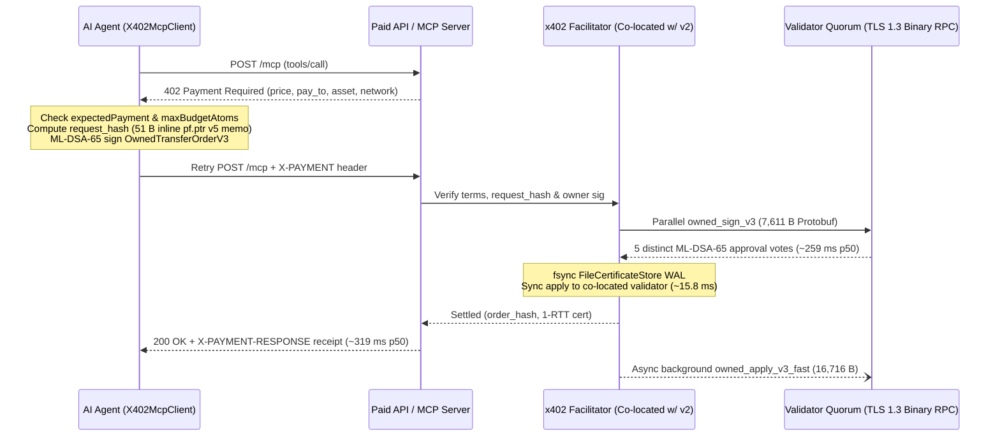

Autonomous AI agents stall when every metered tool call or market-data query waits fifteen to twenty seconds for a consensus block. Global ordering is necessary for shared state—order books, escrows, governance, issued assets—but a payment from a single owner does not need total ordering before a recipient can verify that the funds cannot be double-spent.

Post-quantum cryptography raises the stakes. A single FIPS 204 ML-DSA-65 public key and signature consume 5,261 bytes (1,952 B + 3,309 B), roughly 55× larger than Ed25519 (96 B combined). Over a transcontinental WAN, every extra round trip, hex-encoded JSON payload, or blocked database open turns sub-second intent into multi-second delays.

FastPay v3 and native x402 address this on the Post Fiat Ledger by combining a consensusless owned-object lane (building on FastPay by Baudet et al. and Sui's owned-object fee design) with direct TLS 1.3 binary Protobuf transport, zero-`redb` hot-path storage across block transitions, and durable 1-RTT certificate settlement. For the companion deep dive on `postfiat.message.v1` off-chain encrypted messaging and `pf.ptr` v5 pointers, see [Post-Quantum Messaging on the Post Fiat Ledger](/blog/post-quantum-messaging-fastpay-x402/).

<div class="glance">
  <div><b>274 ms Direct 1-RTT</b><span>WAN p50 · N = 50, 5-of-5 active signers (230 ms bare RTT)</span></div>
  <div><b>319 ms x402 402→200</b><span>Co-located client/facilitator (remote adds 2× client RTT)</span></div>
  <div><b>27.0 ms Co-Located</b><span>11.2 ms sign + 15.8 ms fast apply · 0 hot-path redb opens</span></div>
  <div><b>7,611 B Sign Frame</b><span>TLS 1.3 Protobuf · fits inside one 10-MSS TCP window</span></div>
</div>

### Key Terms

- **Owned object:** A prefunded single-owner `PFT` balance (`1 PFT = 1,000,000 atoms`) identified by `(object_id, version, value, owner_pubkey)` and wrapped from a consensus account via a signed deposit.
- **FastPay certificate:** A payer-signed transfer order bundled with `q = n - f` distinct active-committee validator ML-DSA-65 approval votes (`5` of `6` in the protocol specification for `f = 1`).
- **`order_hash`:** The immutable 48-byte SHA3-384 digest of canonical unsigned order bytes—used as the sole idempotency and indexing key across `tx`, `account_tx`, and x402 spent stores.
- **x402:** HTTP `402 Payment Required` challenge-and-settlement for paid APIs and Model Context Protocol (MCP) tools, bound to the HTTP request via an inline 51-byte `pf.ptr` v5 memo.

---

## 1. Owned Objects, Quorum Intersection & Anti-Bloat Fees

Standard Post Fiat transfers (`payment_v2`) mutate shared consensus state and wait for block certification. FastPay moves native `PFT` out of the global consensus queue by binding funds to single-owner versioned objects. Because only one key can authorize spending `(object_id, version)`, honest validators do not need global ordering across unrelated payers—they only need to prevent the same owner from spending the same object version twice.

### Quorum Sizing: Why the Protocol Uses `q = n - f = 5`

For a 6-validator committee tolerating `f = 1` Byzantine fault, `2f + 1 = 3` does not guarantee quorum intersection: two sets of 3 validators out of 6 can be completely disjoint (`3 + 3 = 6`). Minimum BFT intersection (`2q - n >= f + 1`) requires at least `q = 4`.

Post Fiat follows FastPay's `q = n - f` rule (`q = 5` for `n = 6, f = 1`), matching the ledger's 5-of-6 block-certification quorum. Any two 5-of-6 certificates overlap in `2(5) - 6 = 4` validators—leaving at least three honest witnesses under `f = 1`—while tolerating one offline validator for liveness. Every honest validator enforces **persist-before-vote**: before returning its ML-DSA-65 signature on `owned_sign_v3`, it durably appends `(object_id, version) → lock_id` to a dedicated lock WAL flushed via `fdatasync`. If a payer attempts to sign a conflicting second order for the same object version, the overlapping honest validators reject it.

### Immutable `order_hash` vs. Mutable `certificate_digest`

Two clients collecting 5 votes out of 6 validators for the exact same transfer can assemble different 5-vote subsets and therefore different `certificate_digest` values. Deduplicating on `certificate_digest` would allow the same payment to be credited twice.

FastPay keys every replay check, `account_tx` index entry, `tx` lookup, and x402 spent store strictly on the immutable 48-byte SHA3-384 `order_hash` derived solely from the canonical unsigned order bytes.

### Permissionless Confirm-or-Cancel Recovery

A consensusless lane still needs liveness when a payer crashes mid-broadcast or equivocates across split validator subsets. Every transfer order carries an explicit height window (`valid_from_height`, `expires_at_height`, `recovery_closes_at_height`) pinned to an active committee epoch:

1. **Before `expires_at_height`:** Anyone holding a complete `q = n - f` certificate can apply it directly or anchor it in a consensus block.
2. **During recovery (`expires_at_height` to `recovery_closes_at_height`):** Ordered recovery does not cancel a locked object the moment `expires_at_height` passes. Instead, the recovery window lets any party holding a complete certificate—the facilitator, the recipient, or a watcher—submit it on-chain to confirm the transfer once.
3. **After `recovery_closes_at_height`:** If no valid certificate was presented, consensus emits a quorum-signed cancellation fence and advances the object version so funds are never permanently stranded, and stale speculative votes cannot resurrect the cancelled spend.

### Sui-Inspired Anti-Bloat Fees & Object Lifecycle

Because every live owned object occupies validator state, FastPay enforces a deterministic minimum fee (queryable via `fastpay_fee_quote`), weighted by the canonical unsigned order byte length (`signing_bytes_len`, where each output encodes a 1,952-byte ML-DSA-65 recipient public key as 3,904 hex characters):

```text
min_fee_atoms = 25
              + ceil(signing_bytes_len / 512)
              + max(0, outputs - inputs) * 1,000
              + inputs
```

| Transfer Shape | `signing_bytes_len` (`ceil / 512`) | Formula Breakdown | Minimum Fee | Cost in PFT |
| --- | ---: | --- | ---: | ---: |
| 1-in / 1-out sweep (exact spend, no change) | 4,582 B (9) | `25 + 9 + 0 + 1` | 35 atoms | 0.000035 PFT |
| 1-in / 2-out payment with change | 8,513 B (17) | `25 + 17 + 1,000 + 1` | 1,043 atoms | 0.001043 PFT |
| 10-in / 1-out dust merge (up to 2,048 inputs) | 5,590 B (11) | `25 + 11 + 0 + 10` | 46 atoms | 0.000046 PFT |

Each account carries a 4,096 owned-object soft cap under a 10,000,000 global ceiling. That fee structure has two practical consequences for agents and paid APIs:

- **Per-call economics:** Any payment that creates a net-new object—either a change output at call time (`1,043 atoms`) or a pre-split exact-denomination object created earlier (`1,000 atoms` to split + `35 atoms` to sweep = `~1,035 atoms` amortized)—pays roughly `0.001 PFT` in state-creation cost. FastPay is therefore suited for single API/MCP calls priced at `10,000+ atoms` (`0.01+ PFT`), or for periodic prepaid session top-ups that amortize one FastPay transfer across hundreds of sub-`0.001 PFT` micro-calls.
- **Busy-payee consolidation:** An API server receiving thousands of incoming FastPay objects stays well below the 4,096-object soft cap by running a periodic sweeper—either merging up to 2,048 objects into one with zero new-object surcharge (`46 atoms` for 10 inputs) or unwrapping up to 2,048 objects back into its standard account balance in a single transaction.

---

## 2. Eliminating Storage, Transport & Round-Trip Bottlenecks

Early FastPay runs on our 3-continent devnet took 7.34 seconds per transfer, and a first cleanup still sat at 1.49 seconds. Even after steady-state intra-block p50 reached ~274 ms, crossing a consensus block boundary triggered 3.78 s WAN p95 tails (5.99 s max) and 352 ms p95 on the co-located validator.

Profiling isolated bottlenecks across three layers: storage, transport, and finality round trips.

### Storage: Removing Hot-Path `redb` Opens Across Block Transitions

Originally, validators stored speculative FastPay effects in a rewritten JSON journal and opened the transactional `redb` database under an exclusive single-writer lease whenever a cache check missed or a consensus block committed. Two behaviors turned every block transition into a stall:

- **Trailing-page compaction on close:** `redb` can shrink unused trailing pages when closing a handle without changing ledger state, causing byte-length freshness checks to false-miss after every block commit.
- **Post-block reloads and WAL checks:** On the first transfer after a block commit, both `owned_sign_v3` (reloading ledger state from `redb`) and `owned_apply_v3` (checking `redb` to see whether prior-block speculative records had been anchored) contended for `redb`'s exclusive writer lease against concurrent consensus block-commit and status-query processes—costing ~350 ms on local NVMe and 1–5 s under lease contention.

Five coordinated changes keep sign-time locks and apply-time effects crash-safe without opening `redb` on the hot path:

1. **Append-only persist-before-vote lock WAL:** During `owned_sign_v3`, before signing a vote, the validator acquires a dedicated file lock, checks for conflicting locks, appends one reservation record to `owned_locks.wal`, and calls `fdatasync`. That single ~1 ms NVMe flush preserves equivocation safety completely outside `redb`.
2. **Append-only CRC32C speculative effect WAL:** Each applied effect appends one CBOR frame (`[magic][len][crc32c][payload]`) with a rolling SHA-256 chain hash and torn-tail truncation on recovery, turning `owned_apply_v3` writes into O(1) appends.
3. **Lock-free chain-tip sidecar (< 650 B):** Written atomically after each finalized block and validated on canonical path, inode, and cryptographic tip commitments (height, block hash, state root, and history commitment)—never file length.
4. **Post-block snapshot sidecar + tip-triggered background pre-warmer:** During block commit, the node writes an atomic post-block ledger snapshot. In the RPC server, a background thread watches for a newly committed tip once per block, parses the snapshot off-lock so live RPCs never block, and briefly acquires the ordered-commit lock (< 0.5 ms) to synchronize WAL replay and warm the in-process cache without overwriting newer in-block state. *(At current devnet scale, serializing the full JSON snapshot—~33 MB—parses off-lock in ~100–150 ms; approaching the 10,000,000-object ceiling will require incremental delta snapshots or a read-only binary store instead of full per-block JSON dumps.)*
5. **Commit-time WAL pruning:** Inside the block-commit path—while `redb` is already open under the ordered-commit lock—the validator prunes now-anchored speculative WAL records immediately (`v2.wal` drops to 0 B after each block commit). The first post-block `owned_apply_v3` sees zero stale-height records and stays on the O(1) append path without touching `redb`.

### Transport: Direct TLS 1.3 mTLS Protobuf Framing

Hex-encoding ML-DSA-65 keys and signatures inside JSON-over-HTTP roughly doubled wire sizes—pushing `owned_sign_v3` to ~15 KB (past a 10-MSS TCP initial congestion window of ~14.6 KB) and full 5-vote `owned_apply_v3` certificates to ~47 KB, while adding HTTP framing and proxy hops.

`postfiat-node` now serves binary FastPay RPC v2 directly over persistent TLS 1.3 + mutual TLS (mTLS) TCP sockets (`TCP_NODELAY = true`, frame `[u8 version = 2][u32be body_len][protobuf]`, 64 KiB cap):

- **`owned_sign_v3` (method 1) — 7,611 B on the wire:** Keys and signatures travel as raw bytes, and a boolean flag (`owner_is_change_recipient`) omits the duplicate 1,952-byte change-output public key. The frame breaks down as 1,952 B (payer key) + 3,309 B (payer signature) + 1,952 B (payee key) + 398 B (order metadata and framing) = 7,611 B, fitting inside one initial TCP congestion window.
- **`owned_apply_v3_fast` (method 2) — 16,716 B on the wire:** During `owned_sign_v3`, each validator caches the verified signed order in a 256-entry LRU. On apply, the client sends only `lock_id` plus the quorum votes (~5 × 3,309 B plus small framing). If a validator restarted or never saw the sign call (for instance, a non-voting holder), it replies `OrderNotCached` (status 3) and the client falls back automatically to `owned_apply_v3_full` (method 3).
- **Large consolidations & mTLS boundaries:** Multi-input merges (up to 2,048 inputs) exceeding the 64 KiB binary frame cap route over JSON-RPC v1 (`owned_sign_v3` / `owned_apply_v3`), keeping the binary lane sized for low-latency payments. Arbitrary AI agents never need validator mTLS credentials: only operators running x402 facilitators or payment gateways maintain mTLS links to validators, while agents speak plain HTTPS to paid APIs or standard JSON-RPC v1 to public nodes.

### Finality: 1-RTT Certificates vs. 2-RTT Applied Quorum

Waiting for both `owned_sign_v3` quorum (RTT 1) and remote `owned_apply_v3_fast` quorum (RTT 2) across three continents costs two transcontinental round trips (565.3 ms p50). Yet once RTT 1 finishes, `q = n - f` validators have already persisted exclusive lock-WAL entries binding the input object to this `order_hash`, blocking any conflicting spend.

In 1-RTT (`certificate`) mode, an x402 facilitator:

1. Collects and verifies `q = n - f` distinct active-committee ML-DSA-65 votes (`owned_sign_v3`).
2. Appends the complete certificate to an `fsync`-backed WAL (`FileCertificateStore`) so committed certificates survive a facilitator restart and replay on startup.
3. Applies the certificate synchronously to its co-located validator (15.8 ms p50), confirming execution against local state.
4. Returns HTTP 200 immediately while a background worker delivers `owned_apply_v3_fast` to the remaining remote validators (inspectable at `GET /x402/certificates/:orderHash`).

**Conditional finality and correlated-outage risk:** A 1-RTT certificate is *equivocation-locked* rather than unconditionally finalized until it is anchored on-chain. On devnet-2, the validity window (`expires_at_height`, 20 blocks ≈ 5–6 minutes) is followed by a confirm-or-cancel recovery window (`recovery_closes_at_height`, another 20 blocks ≈ 10–12 minutes total from issuance) during which any party holding the certificate can submit it on-chain to confirm the payment. Because the facilitator WAL and co-located validator share a host or region, their failures are correlated: **any temporary outage or network partition of that co-located pair lasting past `recovery_closes_at_height` before a remote validator receives the certificate would allow the payment to be cancelled even though HTTP 200 already returned.** Operators who cannot accept that correlated-outage window can either replicate the certificate synchronously to one geographically remote watcher before returning HTTP 200 (adding one regional RTT, typically 20–80 ms) or select 2-RTT (`applied_quorum`) settlement (565.3 ms p50) for high-value transfers.

| Settlement Mode | Operations Completed Before Caller Unblocks | Live WAN p50 (5-of-5 Active Signers) | When to Use |
| --- | --- | ---: | --- |
| Direct 1-RTT (certificate assembly) | `owned_sign_v3` quorum + client verification of 5 validator signatures (no local apply) | 273.7 ms | Raw wallet/gateway transfers measuring pure equivocation-lock assembly. |
| x402 1-RTT (`certificate` + local apply) | HTTP `402` + `owned_sign_v3` quorum + facilitator WAL `fsync` + co-located validator apply + HTTP `200` | 319.4 ms | Default for low-value paid APIs and MCP tools with a durable WAL and background apply worker. |
| Direct 2-RTT (`applied_quorum`) | `owned_sign_v3` quorum + remote `owned_apply_v3_fast` signed ack quorum | 565.3 ms | High-value transfers, immediate change spending across remote validators without a pool, or remote `account_tx` visibility before returning. |

---

## 3. Native x402 Agent Settlement Over HTTP & MCP

FastPay integrates with HTTP APIs and Model Context Protocol (MCP) tool servers through Post Fiat's native x402 stack (`X402HttpClient`, `X402McpClient`, `createFacilitatorCore`, `createX402Gate`).



### Request-Bound Settlement via Inline `pf.ptr` v5 Memos

Every x402 FastPay order embeds a 51-byte inline `pf.ptr` v5 memo (`target = INLINE`, `kind = X402`) carrying a 32-byte `request_hash`:

```text
request_hash = SHA-256("${METHOD} ${urlPath}\ncontent-type:${normalizedContentType}\n" || body)
```

Here `urlPath` includes the request path and query string, and `normalizedContentType` strips parameters and lowercases the media type. The facilitator checks this memo alongside the challenge-bound `pay_to`, `network`, and `nonce` before broadcasting `owned_sign_v3`, preventing a captured payment from being replayed against a different method, route, query, or payload on that gate. (Host-header isolation is enforced at the API gateway / `pay_to` routing layer rather than inside `request_hash`.)

### Parallel Agent Calls with `OwnedObjectPool`

Because an owned object `(object_id, version)` can only be spent once, an agent holding a single object must serialize calls—waiting for change-output convergence before spending the next version—or risk signing a conflicting order. `OwnedObjectPool` removes that serialization bottleneck by maintaining `K` pre-split objects so an agent can issue `K` concurrent 1-RTT calls while change outputs confirm asynchronously:

```js
// Assuming wallet keys, recovery window, and pre-split owned objects from owned_recovery_capabilities / owned_objects:
let nonce = 1;
const pool = new OwnedObjectPool(initialOwnedObjects, { lowWaterRatio: 0.5 });

const httpClient = new X402HttpClient({
  chainId: 'postfiat-wan-devnet-2',
  payerAccount, payerPublicKey, payerSecretKey,
  maxBudgetAtoms: 500_000,
  allowedNetworks: ['postfiat:wan-devnet-2'],
  allowedAssets: ['PFT'],
  nativeFastPay: async ({ required }) => {
    const obj = pool.checkout(required.max_amount_atoms + 2_000, required.asset_id);
    return {
      domain: activeRecoveryDomain,
      recovery: activeRecoveryWindow,
      payeePubkeyHex,
      inputs: [{ id: obj.id, version: obj.version }],
      inputTotalAtoms: obj.value,
      nextNonce: () => nonce++,
    };
  },
});

const mcp = new X402McpClient({ endpointUrl: 'https://api.example.com/mcp', httpClient });
const { result, paymentReceipt } = await mcp.callTool(
  'market_quote',
  { pair: 'PFT/USD' },
  { expectedPayment: { amountAtoms: 10_000, assetId: 'PFT', payTo: payeeAccount } }
);
```

When `GET /x402/certificates/:orderHash` reports remote quorum confirmation, `pool.confirmPending(changeObjectId)` returns the change output to the ready pool, and `pool.needsReplenish()` signals when to split fresh objects before the pool runs dry.

### Agent Safety Guardrails & Non-Refundability Boundary

Autonomous wallets spending real `PFT` should enforce three client-side rules:

1. **Pin `expectedPayment` and `maxBudgetAtoms`:** `X402HttpClient` checks every `402` challenge against `expectedPayment`, `allowedNetworks`, `allowedAssets`, and `maxBudgetAtoms` before signing anything.
2. **Persist before broadcast on retries:** Never rebuild an order with a new nonce, fee, or recipient for the same `(object_id, version)` after a network timeout; persist `(object_id, version, order_hash, signed_order)` and retry that exact `order_hash` to avoid self-equivocation.
3. **Account for non-refundability:** Once an agent transmits a signed order in `X-PAYMENT`, the API server can collect validator signatures and settle the transfer even if it crashes or withholds the HTTP 200 body. There is no protocol-level HTTP refund. Bound per-call exposure with tight `expectedPayment` limits, conservative `maxBudgetAtoms`, and short `expires_at_height` windows against untrusted servers.

---

## 4. Live 3-Continent WAN Benchmarks & Tail-Latency Anatomy

We benchmarked the live 6-validator `postfiat-wan-devnet-2` Rust fleet across North America, Europe, and Asia using an unfiltered cross-block workload: 50 direct FastPay transfers followed by 50 x402 MCP calls (100 measured transfers plus 4 warmups = 104 total), anchoring a certified consensus block every 8 transfers across 14 consecutive blocks (heights 2000 → 2014; observed block-anchor pauses ranged from 16.2 s to 30.1 s) and verifying 6-of-6 state-root convergence at the end.

### Bare Network Topology & Benchmark Scope

Measured bare TCP connect RTTs from the benchmark host to each validator's TLS 1.3 FastPay port were:

- **Co-located:** `validator-2` at 1.3–2.4 ms (median 2.4 ms); `validator-5` at 1.2–1.6 ms.
- **Trans-regional:** `validator-1` at 191.0 ms median; `validator-4` at 191.1 ms median.
- **Transcontinental:** `validator-0` at 229.9 ms median; `validator-3` at 230.0 ms median (max 232.9 ms).

Four experimental conditions govern how to read the numbers:

- **Effective 5-of-5 quorum (6-node fleet, 1 non-voting holder):** In epoch 1 on this devnet, five validators (`validator-0` through `validator-4`) held active committee signing keys while `validator-5` replicated and held applied effects without an epoch-1 signing key. Assembling `q = 5` therefore waited on all five active signers—including both ~230 ms transcontinental links—with zero straggler tolerance. That makes this a stricter latency test than a production 6-key `5-of-6` committee, while not exercising `f = 1` fault-tolerant liveness.
- **Co-located client and facilitator:** Both the benchmark client and the x402 facilitator sat co-located with `validator-2` (~2 ms RTT). A remote agent talking to a remote facilitator adds `2 × client-to-facilitator RTT` (one round trip for the `402` challenge, one for the paid retry), which can push remote-client p95 tails past one second depending on client distance.
- **Sequential post-block testing, not mid-commit concurrency:** Transfers ran sequentially between block anchors (with 16–30 s pauses during each anchor), testing cold post-block transitions rather than transfers racing an in-flight block commit.
- **Sample size and single-client load:** With `N = 50` per workload and a block anchor every 8 transfers (~1 in 8 transfers hits a post-block boundary), p95 sits at roughly the third-worst sample. Multi-agent concurrent throughput, ML-DSA-65 CPU saturation under `OwnedObjectPool` load, and on-chain block-anchoring bandwidth for ~17–24 KB certificates are separate benchmarks not measured here.

### Unfiltered Cross-Block Results (5-of-5 Active Signers in a 6-Node Fleet, 14 Blocks Crossed)

| Metric (`postfiat-wan-devnet-2`, TLS 1.3 Protobuf RPC) | Min | p50 | p95 | Max | Mean |
| --- | ---: | ---: | ---: | ---: | ---: |
| Co-located `validator-2` (~2 ms RTT) `owned_sign_v3` | 9.0 ms | 11.2 ms | 33.4 ms | 35.6 ms | 14.0 ms |
| Co-located `validator-2` (~2 ms RTT) `owned_apply_v3_fast` | 12.7 ms | 15.8 ms | 25.8 ms | 95.1 ms | 18.5 ms |
| Direct FastPay — 1-RTT certificate assembly (`N = 50`, 7 blocks) | 258.2 ms | 273.7 ms | 741.2 ms | 753.4 ms | 331.5 ms |
| Direct FastPay — 2-RTT applied quorum (`N = 50`, 7 blocks) | 533.2 ms | 565.3 ms | 1,259.5 ms | 1,273.7 ms | 648.3 ms |
| x402 MCP `402 → 200` 1-RTT settlement (`N = 50`, 7 blocks) | 295.4 ms | 319.4 ms | 788.2 ms | 818.9 ms | 376.7 ms |

- **Server-side & delivery telemetry:** Across all 1,040 benchmark RPCs handled by the five active signers (104 transfers × 2 RPCs = 208 requests per validator), server logs recorded **0 `redb` opens**, **0 ledger cache misses**, **8.6–12.4 ms** median handler time, and **37.6–88.5 ms** max handler time across `validator-0` through `validator-3` (with one 336.0 ms outlier on `validator-4`). Across the 50 direct transfers (`50 × 6 = 300` apply calls), the five active signers achieved 250 / 250 LRU hits (100%), while the non-voting holder (`validator-5`) received 50 / 50 expected `owned_apply_v3_full` deliveries. Across the 50 x402 calls, the background apply worker recorded 0 unconfirmed certificates and 0 failed-apply backoff retries; all 6 validators recorded 0 full-history scans.
- **Latency budget above bare RTT:** Against the 230.0 ms bare max TCP RTT, direct 1-RTT certificate assembly (273.7 ms p50) adds **~44 ms** of end-to-end work (13.4 ms payer ML-DSA-65 signing, ~9–12 ms remote validator verification/lock `fdatasync`/signing, and client verification of 5 validator signatures). Full x402 `402 → 200` settlement (319.4 ms p50) adds **~89 ms** above bare RTT (HTTP challenge/retry, facilitator checks, WAL `fsync`, and the 15.8 ms co-located validator apply).

### Before and After: Eliminating the Post-Block Storage Stall

| Unfiltered Cross-Block Tail Metric (`N = 50`, 5-of-5 Active Signers) | Before Snapshot Sidecar & Commit-Time WAL Pruning | After | Improvement |
| --- | ---: | ---: | ---: |
| Co-located `validator-2` `owned_sign_v3` p95 / max | 352.3 ms / 454.0 ms | 33.4 ms / 35.6 ms | 10.5× lower p95 |
| Direct FastPay 1-RTT WAN p95 / max | 3,777.6 ms / 5,990.0 ms | 741.2 ms / 753.4 ms | 5.1× lower p95 |
| Direct FastPay 2-RTT WAN p95 / max | 4,288.8 ms / 7,185.5 ms | 1,259.5 ms / 1,273.7 ms | 3.4× lower p95 |
| x402 `402 → 200` WAN p95 | 1,510.0 ms | 788.2 ms (818.9 ms max) | 1.9× lower p95 |

*(These before/after runs compare two sequential devnet sessions on the same fleet; in the pre-fix session, the direct phase encountered heavier transient sibling-process `redb` lease contention than the x402 phase, which is why the pre-fix direct p95 exceeded the pre-fix x402 p95.)*

### Anatomy of the Remaining Cross-Block Tail (~741–788 ms)

Because server-side logs recorded 0 `redb` opens, 0 cache misses, 8.6–12.4 ms median handler times, and 37.6–88.5 ms max handler times on `validator-0` through `validator-3` (including `validator-3` at 75.9 ms max), validator compute and storage cannot explain the 710.7 ms client-observed p95 on `validator-3`. Per-validator client timings show a clean transport split between `validator-0` and `validator-1..4`:

- **`validator-0` (`--timeout-ms 120000`, 229.9 ms bare RTT):** Kept its socket open across every 16–30 s anchor pause. Its 7,611 B `owned_sign_v3` (fitting inside a 10-MSS initial TCP window) stayed at **252.8 ms p50 / 264.5 ms p95**, while its 16,716 B `owned_apply_v3_fast` (exceeding 10 MSS after an idle pause under the client host's `net.ipv4.tcp_slow_start_after_idle = 1`) took two flights (**480.0 ms p95**).
- **`validator-1..4` (`--timeout-ms 30000`):** On the first transfer after block-anchor pauses, `owned_sign_v3` took `~3 × bare RTT` plus TLS/handler compute—matching a fresh TCP + TLS 1.3 mTLS handshake (1 RTT TCP `SYN/SYN-ACK`, 1 RTT TLS 1.3 mTLS, 1 RTT `owned_sign_v3`)—and was immediately followed by a single-RTT `owned_apply_v3_fast` on the freshly opened, ACK-expanded socket:
  - `validator-1` (191.0 ms bare RTT): **610.3 ms p95** sign (`3 × 191 = 573 ms` + TLS/handler) / **220.4 ms p95** apply.
  - `validator-4` (191.1 ms bare RTT): **596.6 ms p95** sign (`3 × 191 = 573 ms` + TLS/handler) / **210.1 ms p95** apply.
  - `validator-3` (230.0 ms bare RTT): **710.7 ms p95** sign (`3 × 230 = 690 ms` + TLS/handler) / **257.8 ms p95** apply.
  - `validator-2` (2.4 ms bare RTT): **33.4 ms p95** sign / **25.8 ms p95** apply.

Adding client ML-DSA-65 signing (13.4 ms p50, 38.2 ms p95) and 5× vote verification on top of `validator-3`'s 710.7 ms tail accounts for the 741.2 ms direct 1-RTT p95 (753.4 ms max) and 788.2 ms x402 p95 (818.9 ms max). Our working hypothesis is that idle TLS session resets across anchor pauses (plus `tcp_slow_start_after_idle = 1` on the client host for the 16.7 KB apply frame) drive both halves of this split; because a standalone 18-second idle probe to `validator-3` stayed open while anchor pauses ranged from 16.2 s to 30.1 s, we treat the exact drop trigger as a hypothesis until we re-benchmark with unified 120 s timeouts, application-level keepalives, `tcp_slow_start_after_idle = 0`, and a 6-key active committee. Even before that follow-up, every 1-RTT transfer in this co-located 100-transfer devnet run settled under one second (direct 1-RTT max 753.4 ms; x402 max 818.9 ms; 2-RTT applied quorum max 1,273.7 ms).

The raw benchmark artifact is archived at [`devnet2-wan-fastpay-x402-20261128-r7.json`](/evidence/message-protocol/devnet2-wan-fastpay-x402-20261128-r7.json).

---

## 5. Getting Started

- **FastPay Guide for Agents & Developers:** [`/docs/fastpay/`](/docs/fastpay/) (plain-Markdown agent spec at [`/agents/fastpay.md`](/agents/fastpay.md)) — complete JavaScript (`X402McpClient` + `OwnedObjectPool`), Python (`postfiat_rpc`), and FastPay RPC v2 production facilitator playbooks.
- **Message Protocol & x402 Developer Guide:** [`/docs/message-protocol/`](/docs/message-protocol/) — canonical protobuf schemas, memo rules, and SDK examples.
- **Companion Architecture Post:** [Post-Quantum Messaging on the Post Fiat Ledger](/blog/post-quantum-messaging-fastpay-x402/) — off-chain encrypted envelopes, raw-byte ML-DSA-65 signing, hybrid X-Wing encryption, and blinded `SEALED` drops.
